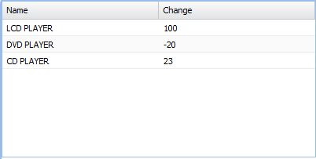
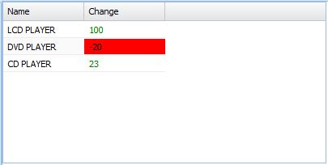

Witam Dzisiejszy post nie będzie związany z platformą .NET, lecz z javascriptowym frameworkiem Extjs w wersji 4.1. Jako, że ostatnio w pracy poświęcam dużo czasu na pisanie w wyżej wymienionej technologii postanowiłem zaprezentować, w jaki sposób zmienić styl konkretnej komórki w gridzie. Zacznijmy od przygotowania danych do wyświetlenia - zdefiniujmy zatem stora, który będzie przechowywał informacje mające zostać zaprezentowane na gridzie.

```
Ext.create('Ext.data.Store', {
    storeId:'itemsStore',
    fields:['name', 'email', 'change'],
    data:{'items':[
        { 'name': 'LCD PLAYER',    "change":100  },
        { 'name': 'DVD PLAYER', "change":-20  },
        { 'name': 'CD PLAYER',   "change":23   },
        
    ]},
    proxy: {
        type: 'memory',
        reader: {
            type: 'json',
            root: 'items'
        }
    }
});

```

Następnie podepnijmy stora pod grida w wersji podstawowej - bez zmiany stylu konkretnych komórek.

```
Ext.create('Ext.grid.Panel', {
    store: Ext.data.StoreManager.lookup('itemsStore'),
    columns: [
        { header: 'Name',  dataIndex: 'name' },
        { header: 'Change', dataIndex: 'change'}
    ],
    height: 200,
    width: 400,
    forceFit:true,
    renderTo: Ext.getBody()
});

```

W celu zmiany parametrów poszczególnych komórek grida posłużymy się tzw. rendererem. Renderer jest to funkcja, której zadaniem jest modyfikacją komórek w danej kolumnie grida. Dzięki rendererowi możemy nie tyko zmienić zawartość komórki, ale również przypisać jej osobny styl lub klasę CSS. Myślę, że renderer można porównać do conwertera znanego z technologii WPF. Funkcję renderera podłączymy pod ostatnią kolumnę. Kod po modyfikacjach będzie wyglądał w następujący sposób:

```
Ext.create('Ext.grid.Panel', {
    store: Ext.data.StoreManager.lookup('itemsStore'),
    columns: [
        { header: 'Name',  dataIndex: 'name' },
        { header: 'Change', dataIndex: 'change', renderer: function(value, metaData, record, row, col, store, gridView){
            if(value>0)
              metaData.tdCls = 'price-rise'
            else
              metaData.tdCls = 'price-fall'
                  
             return value;
        }}
    ],
    height: 200,
    width: 400,
    
    renderTo: Ext.getBody()
});

```

```
.price-fall  {
    background-color: red !important;
    
}
.price-rise {
    background-color: #B0FFC5;
    color:green;
}​

```

Zauważmy, że funkcja renderer przyjmuje kilka parametrów. Najważniejsze z nich to

- value - wartość wyświetlona w komórce grida
- metaData- obiekt dający nam dostęp do parametrów komórki (np. tdCls)
- record - record grida

W moim przypadku na podstawie wartości wyświetlanej w komórkach kolumny "Change",określam czy dana komórka powinna być czerwona czy zielona. Wygląd grida przed oraz po zastosowaniu renderera przedstawiają poniższe screeny [](http://tpodolak.com/blog/wp-content/uploads/2012/07/extjs-4-1-zmiana-stylu-konkretnej-komorki-w-gridzie/Before.jpg) [](http://tpodolak.com/blog/wp-content/uploads/2012/07/extjs-4-1-zmiana-stylu-konkretnej-komorki-w-gridzie/After.jpg)
