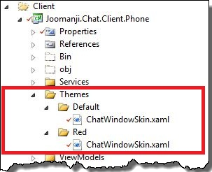

### 1\. Introduction

Today, I would like to present my concept of making skinnable application in Windows Phone 7.1. Making a skinnable application in Windows Phone might be a little bit tricky. Unfortunately, WP7 doesn't support _DynamicResource_ keyword which is a basic tool for making skins in WPF. In order to overcome this inconvenience I decided to write a _SkinManager_ for WindowsPhone.

### 2\. Base view

As I mentioned before, there is no support for using dynamic resources in WP7, therefore, in order to force a control to change style, we have to assign this style in code behind. It is rather obvious that in a single window/control there might be quite a lot of other controls whose style also should be changed. That is why, I decided to write controls iterator first.

```
public class ViewsEnumerator : IEnumerator
{
    private Stack _frameworkElementsStack = new Stack();
    private FrameworkElement _current;
    private readonly FrameworkElement _startingElement;
    
    public ViewsEnumerator(FrameworkElement stargingElement)
    {
        _startingElement = stargingElement;
    }
    
    public void Dispose()
    {
        _current = null;
        _frameworkElementsStack.Clear();
        _frameworkElementsStack = null;
    }
 
    #region Implementation of IEnumerator

    public bool MoveNext()
    {
        if (_current == null)
        {
            _current = _startingElement;
            for (int i = 0; i < VisualTreeHelper.GetChildrenCount(_current); i++)
                _frameworkElementsStack.Push((FrameworkElement)VisualTreeHelper.GetChild(_current, i));
        }
        else
        {
            if (_frameworkElementsStack.Count == 0) return false;
            _current = _frameworkElementsStack.Pop();

            for (int i = 0; i < VisualTreeHelper.GetChildrenCount(_current); i++)
                _frameworkElementsStack.Push((FrameworkElement)VisualTreeHelper.GetChild(_current, i));
            return true;
        }
        return true;
    }

    public void Reset()
    {
        _current = null;
        _frameworkElementsStack.Clear();
        _frameworkElementsStack = null;
    }

    public FrameworkElement Current
    {
        get { return _current; }
    }

    object IEnumerator.Current
    {
        get { return Current; }
    }

    #endregion
}

```

In this iterator I used DFS algorithm for searching elements in a tree. Thanks to this piece of code I can take advantage of LINQ's benefits. In the next step I created base classes for views.

```
public interface IViewBase : IEnumerable
{
}

public class ViewBase : UserControl, IViewBase
{
   #region Implementation of IEnumerable

    /// 
    /// Returns an enumerator that iterates through the collection.
    /// 
    /// 
    /// A  that can be used to iterate through the collection.
    /// 
    public IEnumerator GetEnumerator()
    {
        return new ViewsEnumerator(this);
    }

    /// 
    /// Returns an enumerator that iterates through a collection.
    /// 
    /// 
    /// An  object that can be used to iterate through the collection.
    /// 
    IEnumerator IEnumerable.GetEnumerator()
    {
        return GetEnumerator();
    }

    #endregion
}

```

### 3\. SkinManager class

Having prepared basis for skinnable control, let me introduce a custom attribute called the _SkinnablePartAttribute_

```
[AttributeUsage(AttributeTargets.Class)]
public class SkinnablePartAttribute : Attribute
{
    public string ThemePartName { get; set; }
}

```

This attribute should decorate custom controls which should have an ability to change theme/skin. As you can see, the _SkinnablePartAttribute_ has a _ThemePartName_ property which holds information about a name of _ResourceDictionary_ where styles for the given control ought to be searched. Now, it is time to take a look at a _SkinManager_ class. The _SkinManager_ class has one public function - _ApplySkin_

```
public static void ApplySkin(TView view, string skinName)
           where TView : FrameworkElement, IViewBase
{
    foreach (IViewBase control in view.Where(val => val.ImplementsInterfaceOf()))
    {
        var assemblyName = control.GetType().Assembly.FullName;
        Uri parsedUri;
        var attribute = control.GetType().GetCustomAttributes(typeof(SkinnablePartAttribute), true).SingleOrDefault();
        if (attribute != null && Uri.TryCreate(string.Format("/{0};component/Themes/{1}/{2}.xaml",assemblyName.Substring(0, assemblyName.IndexOf(",", StringComparison.Ordinal)), skinName,(attribute as SkinnablePartAttribute).ThemePartName), UriKind.Relative, out parsedUri))
            ApplySkin(control, parsedUri);
        else
            Debug.WriteLine(string.Format("Could not find {0}/{1}", skinName,(attribute as SkinnablePartAttribute).ThemePartName));
    }
}

```

This function iterates through all controls which implement a _IViewBase_ interface - in other words, the function iterates through our custom controls. If a control is decorated with the _SkinnablePartAttribue_, a new _Uri_ is created based on the information from the _ThemePartName_ property and from the skinName parameter(I assumed that all dictionaries are located in the Themes directory). In the final step, private function also known as the _AppySkin_ function is called. This function looks this way:

```
private static void ApplySkin(TView view, Uri uri, int mergedDictionaryIndex = 0)
            where TView :  IViewBase
{
    var castedView = view as FrameworkElement;
    if(castedView == null) return;

    var resourceMergedDictionary = castedView.Resources.MergedDictionaries[mergedDictionaryIndex];
    var beforeClearDictionary = resourceMergedDictionary.ToDictionary(key => key.Value, val => new { key = val.Key, value = val.Value });
    castedView.Resources.MergedDictionaries.Remove(resourceMergedDictionary);
    resourceMergedDictionary.Clear();

    var newStyleDictionary = new ResourceDictionary
    {
        Source = uri
    };

    castedView.Resources.MergedDictionaries.Insert(mergedDictionaryIndex, newStyleDictionary);
    foreach (var control in view.Where(val => val.Style != null && !val.ImplementsInterfaceOf()).Where(control =>
        beforeClearDictionary.ContainsKey(control.Style) && newStyleDictionary[beforeClearDictionary[control.Style].key] != null))
        control.Style = newStyleDictionary[beforeClearDictionary[control.Style].key] as Style;

    beforeClearDictionary.Clear();
}

```

Here, all the magic begins. In the first step, current _ResourceDictionary_ is transformed into the standard dictionary. The key of this dictionary is a value of style – a reference to the style object. In the next step, I created a new _ResourceDictionary_ based on the Uri parameter passed to this function. In the last step, another loop over controls is performed. However, this time only controls with the assigned _Style_ property are taken into consideration. Then, if the _newStyleDictionary_ contains a key of given control style we are ready to swap styles.

```
control.Style = newStyleDictionary[beforeClearDictionary[control.Style].key] as Style;

```

Entire listing of _SkinManager_ is presented below

```
public static class SkinManager
{
    private static void ApplySkin(TView view, Uri uri, int mergedDictionaryIndex = 0)
        where TView :  IViewBase
    {
        var castedView = view as FrameworkElement;
        if(castedView == null) return;

        var resourceMergedDictionary = castedView.Resources.MergedDictionaries[mergedDictionaryIndex];
        var beforeClearDictionary = resourceMergedDictionary.ToDictionary(key => key.Value, val => new { key = val.Key, value = val.Value });
        castedView.Resources.MergedDictionaries.Remove(resourceMergedDictionary);
        resourceMergedDictionary.Clear();

        var newStyleDictionary = new ResourceDictionary
        {
            Source = uri
        };

        castedView.Resources.MergedDictionaries.Insert(mergedDictionaryIndex, newStyleDictionary);
        foreach (var control in view.Where(val => val.Style != null && !val.ImplementsInterfaceOf()).Where(control =>
            beforeClearDictionary.ContainsKey(control.Style) && newStyleDictionary[beforeClearDictionary[control.Style].key] != null))
            control.Style = newStyleDictionary[beforeClearDictionary[control.Style].key] as Style;

        beforeClearDictionary.Clear();

    }
    
    public static void ApplySkin(TView view, string skinName)
       where TView : FrameworkElement, IViewBase
    {

        foreach (IViewBase control in view.Where(val => val.ImplementsInterfaceOf()))
        {
            var assemblyName = control.GetType().Assembly.FullName;
            Uri parsedUri;
            var attribute = control.GetType().GetCustomAttributes(typeof(SkinnablePartAttribute), true).SingleOrDefault();
            if (attribute != null && Uri.TryCreate(string.Format("/{0};component/Themes/{1}/{2}.xaml",assemblyName.Substring(0, assemblyName.IndexOf(",", StringComparison.Ordinal)), skinName,(attribute as SkinnablePartAttribute).ThemePartName), UriKind.Relative, out parsedUri))
                ApplySkin(control, parsedUri);
            else
                Debug.WriteLine(string.Format("Could not find {0}/{1}", skinName,(attribute as SkinnablePartAttribute).ThemePartName));
            
        }
    }
}

```

### 4\. Example of usage

In order to use the _SkinManager_ it is essential to make some preparation. First of all, you have to create _Themes_ directory in a project. In this directory there must be separate subdirectories for every skin you would like to use. What is more, in these subdirectories you should place all _ResourceDictionaries_ specified in the _SkinnablePartAttribute_. A sample directory structure is shown in the picture below: [](http://tpodolak.com/blog/wp-content/uploads/2012/07/windows-phone-skinnable-application/DirectoryStructure.png) The very last step is to make controls (which should be skinnable) inherit from _ViewBase_. Here is example of usage

```
namespace Joomanji.Chat.Client.Views
{
    [SkinnablePart(ThemePartName = "ChatWindowSkin")]
    public partial class ChatWindowView : ViewBase
    {
        public ChatWindowView()
        {
            SkinManager.ApplySkin(this, "Red"); // change skin
        }
    }   
}

```

and screenshots of the same view with different skin

[](http://tpodolak.com/blog/wp-content/uploads/2012/07/windows-phone-skinnable-application/right.jpg)

[](http://tpodolak.com/blog/wp-content/uploads/2012/07/windows-phone-skinnable-application/left.jpg)

### 5\. Controls with dynamically changing content

After some test, it turned out that the mechanism presented above has problems with controls which change their content dynamically. Let me clarify - styling grids, list boxes etc. work fine, however changing row styles and　listboxitem styles are not working properly. In order to overcome this problem you must define a style for a specific target type. Here is an example of usage with the listbox:

```

    <Setter Property="HorizontalContentAlignment" Value="Stretch"/>
    <Setter Property="VerticalAlignment" Value="Stretch"/>
    <Setter Property="ItemTemplate" Value="{StaticResource GeneralChatMessageTemplate}"/>

```
