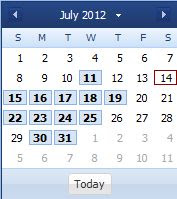

A couple of weeks ago I wrote a post about creating a mutiselectable datepicker. The idea of creating this component was to use the object inheritance. Today, I would like to show how to create a multiselectable datepicker as a plugin to _Ext.date.Picker_. The code responsible for selecting dates is almost the same, the only thing which must be changed is the component initialization and access to the datepicker component. In order to make a plugin to any _Ext.Component_ class, you must implement the _init_ method which takes as argument a reference to the component - so let's change the existing code to meet this requirement. We need to rename _initComponent_ function to _init_. In addition to, we should delete the _extend_ property from our code. After these changes the _init_ function looks like this:

```
init:function(datePicker){
        var me = this;
        me.datePicker = datePicker;
        // me.callParent(arguments);
        me.datePicker.on('select',me.handleSelectionChanged,me);
        me.datePicker.on('afterrender',me.higlighDates,me);
}

```

Please notice, that the _init_ function takes as an argument the datepicker component - and from now on this is our only way to access this component. The rest of the code also requires some modifications - it's necessary to change all references to the _datepicker_ (from the variable _me_ to _me.datePicker_). The entire code listing is presented below.

```
Ext.define('Multiselect', {
    selectedDates : {},
    clsHigligthClass :'x-datepicker-selected',
    datePicker:null,
    init:function(datePicker){
        var me = this;
        me.datePicker = datePicker;
       // me.callParent(arguments);
        me.datePicker.on('select',me.handleSelectionChanged,me);
        me.datePicker.on('afterrender',me.higlighDates,me);
    },
    
    higlighDates: function(){
        var me = this;
        if(!me.datePicker.cells)
            return;
        me.datePicker.cells.each(function(item){
            var date = new Date(item.dom.firstChild.dateValue).toDateString();
            if(me.selectedDates[date]){
                if(item.getAttribute('class').indexOf(me.clsHigligthClass)=== -1){
                    item.addCls(me.clsHigligthClass)
                }
            }else{
                item.removeCls(me.clsHigligthClass);
            }
        })
    },

    handleSelectionChanged:function(cmp,date){
        var me = this;
        if(me.selectedDates[date.toDateString()])
            delete me.selectedDates[date.toDateString()]
        else
            me.selectedDates[date.toDateString()] = date;
        me.higlighDates();
    }
})

```

Here is example of usage;

```
var picker = Ext.create('Ext.picker.Date', {
                    plugins: [Ext.create('Multiselect')]
                });

```

and the result [](http://tpodolak.com/blog/wp-content/uploads/2012/09/extjs-4-1-1-multiselectable-datepicker-as-plugin/datepicker.jpg) Source code for this post can be found [here](https://github.com/tpodolak/Blog/tree/master/ExtjsMultiselectableDatePickerAsPlugin)
