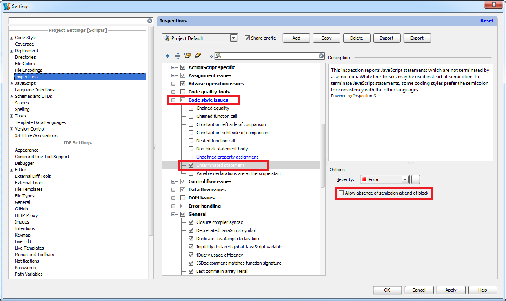
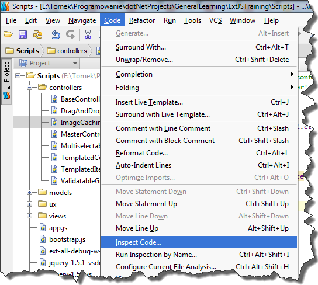
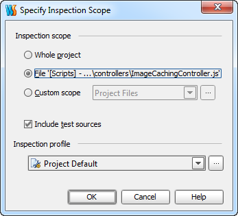
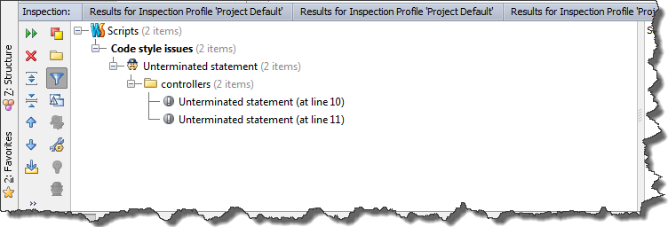
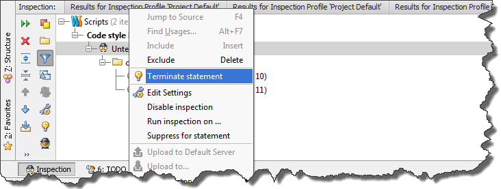
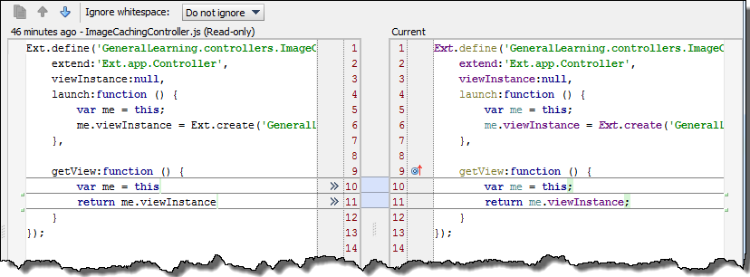

Recently in the company I work for, we've been trying to improve Javascript code quality. After hooking up JSlint into our build script, it turned out that the most common issue with our code is missing semicolon at the end of statements. Fixing all warnings manually would be very boring task, that is why I started searching for alternative solution. Fortunatelly once again, WebStorm came for the rescue. As you probably know WebStorm has it's own code inspection tool which indicates problems with code. However except that, this tool can also fix these problems automatically. Here is a little demonstration. Let us start with simple code.

```
Ext.define('GeneralLearning.controllers.ImageCachingController',{
    extend:'Ext.app.Controller',
    viewInstance:null,
    launch:function(){
        var me = this;
        me.viewInstance = Ext.create('GeneralLearning.views.ImageCachingView');
    },

    getView:function(){
        var me = this
        return me.viewInstance
    }
});

```

In the listing above, there are two lines with missing semicolon (in function _getView_). Let fix them using Webstorm code inspection tool. First of all, we have to make sure that appropriate inspection options are selected. In order to do that, let's choose "Settings" from menu "File". In the opened window, go to "Settings" and select options presented in the picture below. [](http://tpodolak.com/blog/wp-content/uploads/2013/04/fixing-missing-semicolon-issue-using-webstorm/options.png) In the next step, from menu _"Code"_ choose _"Inspect code"_ [](http://tpodolak.com/blog/wp-content/uploads/2013/04/fixing-missing-semicolon-issue-using-webstorm/InspectCode.png) In the opened window, we can change inspection profile or inspection scope, but usually we can go with default settings [](http://tpodolak.com/blog/wp-content/uploads/2013/04/fixing-missing-semicolon-issue-using-webstorm/InspectCodeWindow.png) After inspection is done, at the bottom of the screen you will see results [](http://tpodolak.com/blog/wp-content/uploads/2013/04/fixing-missing-semicolon-issue-using-webstorm/InspectionResult.png) Now, we can quickly fix them by using context menu and clicking _"Terminate statement"_ [](http://tpodolak.com/blog/wp-content/uploads/2013/04/fixing-missing-semicolon-issue-using-webstorm/InspectionResultMenu.png) Here is the result of fixing operation [](http://tpodolak.com/blog/wp-content/uploads/2013/04/fixing-missing-semicolon-issue-using-webstorm/result.png)
