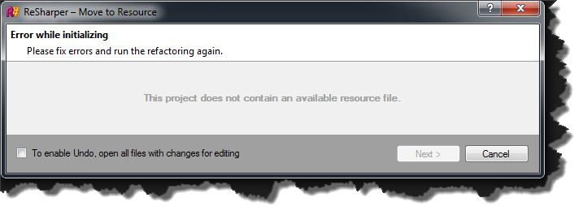
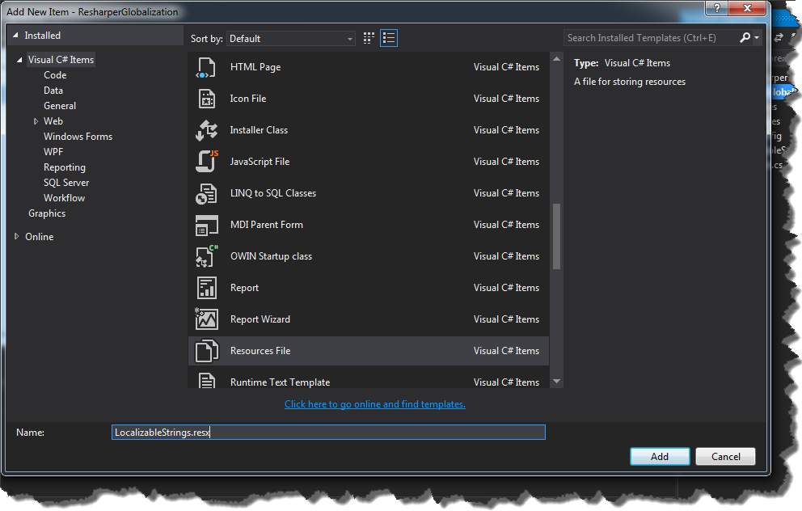
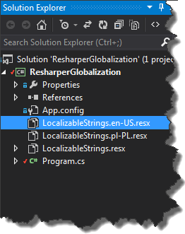
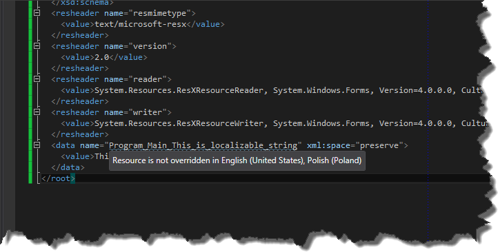
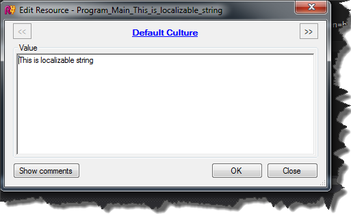

Everyone who has ever tried to create multilingual application knows, that this is very tedious task. The most repetitive work is usually moving hard-coded strings to resource files. Fortunately with Resharper this is definitelly less painfull than usuall.  
In order to point out localizable parts of application , it is necessary to decorate classes with _System.ComponentModel.LocalizableAttribute_. However, usually we want to localize an entire program, so more universal solution is to set appropriate project configuration in properties window. To bring up this window, select project file and then press _F4_ button.  From now on, Resharper shows warnings indicating that our hard-coded strings might be moved to resource file. Pressing _ALT+ENTER_ on these strings will bring up the context menu action, where new option - _"Move to resource"_ is available.  Choosing this option will bring up the _"Move to Resource_" window. However if we do not have any resource files in our project, we will get this message.  In order to create these files, right click on project and choose _Add->New Item_. Now, select _Resource.resx_ file and name it for example _LocalizableStrings.resx_.  In this resource file we will store values for our _"default language"_. Supporting more languages require us to create additional LocalizableString files with appropriate _LETF_ tags suffixes.  Now, we are able to move our hard-coded string to resource files.   By default Resharper adds hard-coded strings to default resource file, so we have to specify values for localizable string for other languages. In order to do that, first navigate to resource entry in _LocalizableStrings.resx_ file by holding _CTRL_ and clicking property _"Program\_Main\_This\_is\_localizable\_string"_   and then press _ALT+ENTER_ and choose _"Override 'PropertyName…'"_. This operation brings up _"Edit Resource"_ window where You can easily navigate between resource files and update given resource property  Resharper not only is able to move strings to resource files but also can use existing ones. This basically means that if we use hard-coded string which already has been added to resource file, Resharper will suggest to use predefined resource 
