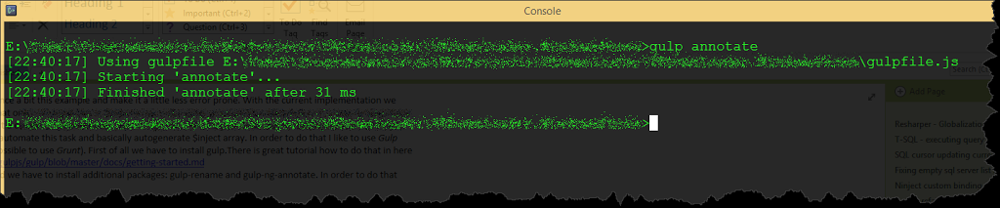

There are couple of ways of injecting dependencies into AngularJS components. The most common one is just to specify the dependency name in the function's argument list

```
(function() {
    angular
        .module('app')
        .controller('shellCtrl', function ($scope, $http) {
            $scope.title = "Title";
        });
})();

```

However this technique fails in real life scenarios, because for production we usually (or rather always) minify and uglify javascript files. Uglify proces renames our variables and due to the fact that dependencies are resolved by name, AngularJS is not able to find appropriate services, directives etc. To overcome this limitation, we can enclose our function definition into an array, and specify dependencies as a string literals. Our original code becomes then

```
(function () {
    angular.module('app')
           .controller('shellCtrl', ['$scope', '$http', function ($scope, $http) {
               $scope.title = "Title";
           }]);
})();

```

Although this works fine even after minifying and uglifiyng js files, for me this code is hard to read. That is why I like to use yet another technique. This technique leverages variable hoisting and _$inject_ property

```
(function(){
    angular.module('app')
           .controller('shellCtrl',shellController);

    shellController.$inject=['$scope','$http'];

    function shellController($scope,$http){
        $scope.title='title';
    }
})();

```

As You can see I extracted controller function into separate variable "shellController" and listed all necessary dependencies in _$inject_ array

```
shellController.$inject= ['$scope','$http']

```

It is even possible to enhance a bit this example and make it a little less error prone. With the current implementation we have to make sure that order of properties in _$inject_ array is the same as in function declaration. It is easy to keep track of that if we have just a couple of dependencies, but it might be a bit of a pain if we start to add, remove or edit them. Fortunately we can automate this task and basically autogenerate _$inject_ array. In order to do that I like to use Gulp (although it is also possible to use Grunt). First of all we have to install Gulp. There is great tutorial how to do that in here https://github.com/gulpjs/gulp/blob/master/docs/getting-started.md Having Gulp on board we have to install additional packages: _gulp-rename_ and _gulp-ng-annotate_. In order to do that type into command line

```
npm install gulp-ng-annotate --save-dev
npm install gulp-rename --save-dev

```

Now we can create gulp.js file which should look more or less like that

```
var rename = require('gulp-rename'),
    ngAnnotate = require('gulp-ng-annotate');

gulp.task('annotate', function () { //create new task 'annotate'
    return gulp.src('app/layout/controllers/shellController.js') //select files to process
        .pipe(ngAnnotate()) // add angularjs dependeny injection annotation
        .pipe(rename('app.all.js')) //rename in-memory stream to app.all.js
        .pipe(gulp.dest('.build'));//save stream to new location
})

```

We can run this task typing into command line

```
gulp annotate

```

[](http://tpodolak.com/blog/wp-content/uploads/2015/02/angularjs-extending-existing-services-using-decorator/gulp.png) And as a result our original code (notice lack of dependeny annotations - no $inject arrray)

```
(function() {
    angular.module('app')
           .controller('shellCtrl', shellController);

    function shellController($scope, $http) {
        $scope.title = 'title';
    }
})();

```

Will be transformed into

```
(function(){
    angular.module('app')
           .controller('shellCtrl',shellController);

    function shellController($scope,$http){
    }
    
shellController.$inject=["$scope","$http"];
})();

```
