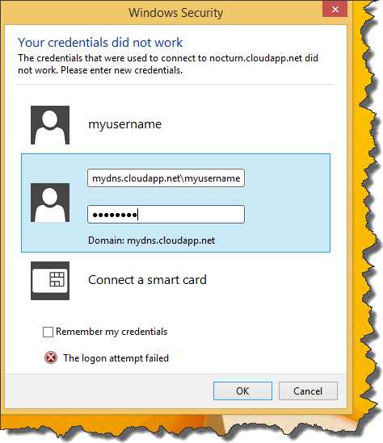

Today just a quick tip, which may save you some time. If you want to connect to virtual machine with _Windows 10 Technical Preview_, make sure that you include _DNS_ name in user name field. So instead of default combination of username and password  which worked for me for every virtual machine (except for the one with Windows 10). You should use something like that  If You don't know the _DNS_ name for virtual machine, you can easily check it in _Virtual Machines_ pane 
