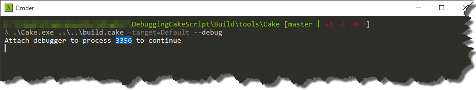
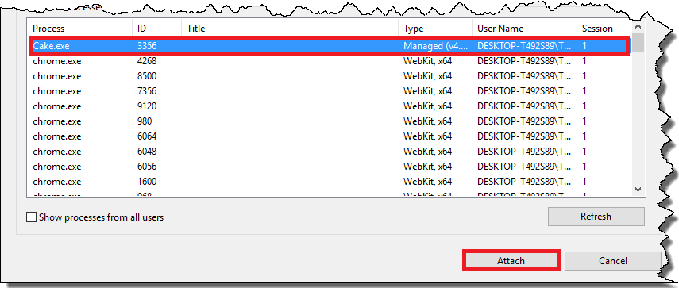
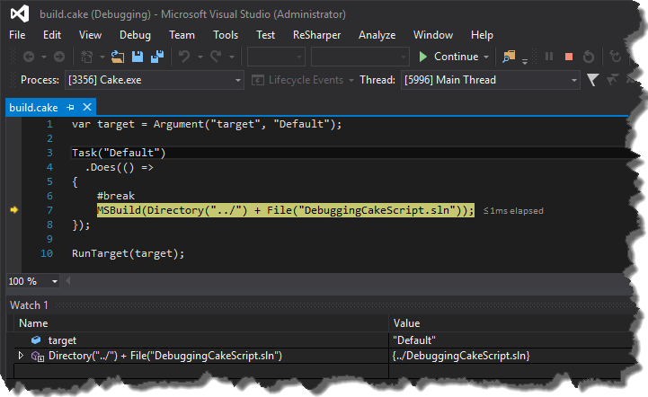

We've been using [Cake](http://cakebuild.net/) in our project for quite some time and it has been working great. However for time to time lack of debugging support was really annoying for me. Fortunately it seems that these times are gone now. During [NDC Oslo 2016](https://vimeo.com/171704581) [Gary Ewan Park](https://github.com/gep13) showed that it is possible to attach debugger to the build process. Here are the steps to achieve that. Let's assume that we have following simple cake script.

```
var target = Argument("target", "Default");
Task("Default")
    .Does(() =>
{
    MSBuild(Directory("../") + File("DebuggingCakeScript.sln"));
});

RunTarget(target);

```

In order to make the debugging possible it is necessary to add

```
#break

```

preprocessor directive to the task we want the debugger to stop.

```
var target = Argument("target", "Default");
Task("Default")
    .Does(() =>
{
    #break
    MSBuild(Directory("../") + File("DebuggingCakeScript.sln"));
});

RunTarget(target);

```

This operation doesn't affect the default build process, so if you run in console

```
.\build.ps1 -target Default

```

the build will run as usual. In order to be able to attach the debugger we have to call _Cake_ with

```
 --debug

```

flag. You can't do it directly via

```
\build.ps1

```

script so assuming that you didn't change directory structure created by bootstrapper, go to _Tools_/_Cake_ folder and run from _PowerShell_

```
.\Cake.exe ..\..\build.cake -target=Default --debug

```

where

```
..\..\build.cake

```

is path to your cake script and

```
Default

```

is task you want to start. Once you run the command, cake will wait for attaching the debugger [](http://tpodolak.com/blog/wp-content/uploads/2016/07/debugging-cake-scripts/WaitingForDebugger.png) Now launch _Visual Studio_, go to _Debug-> Attach to Process…_, find process id listed in console [](http://tpodolak.com/blog/wp-content/uploads/2016/07/debugging-cake-scripts/Attach.png) and click _Attach_. After couple of seconds _Visual Studio_ will load your cake script and you will be able to debug it like normal application. [](http://tpodolak.com/blog/wp-content/uploads/2016/07/debugging-cake-scripts/attached.png)
