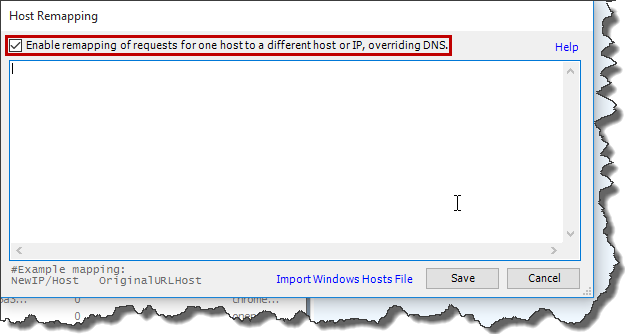

As a back-end developer I am quite often contacted by front-end devs to take a look why certain _UI_ calls to the server results in wrong data being returned by _API_. Usually I am provided with request payload so it is quite straightforward to reply it with _Postman_ or _Fiddler_ and see what is going on the backend. However for time to time, replying single request is not enough to reproduce the problem. In that case it is easier to just recreate the scenario on the _UI_ and debug the _API_ during that process. Unfortunately this approach requires backend devs to have _UI_ up and running on their local machines and that is not always possible (e.g. you might not get access to _UI_ repository). Fortunately with _Fiddler_ it is quite easy to intercept outgoing front-end calls to the _API_ and redirect them to your locally deployed version (so you can easily debug the _API_). Let's assume we would like to redirect all _simpletestspa.azurewebsites.net_ calls _to localhost:50277_. In order to do that run _Fiddler_ and go to _Tools -> Hosts…_ [](http://tpodolak.com/blog/wp-content/uploads/2016/09/fiddler-redirecting-outgoing-calls-to-local-server/Toolsv2.png) Select "_Enable remapping of requests for one host to a different host or IP, overriding DNS_" checkbox [](http://tpodolak.com/blog/wp-content/uploads/2016/09/fiddler-redirecting-outgoing-calls-to-local-server/HostsWindow.png) and enter following values in the editor

```
localhost:50277 simpletestspa.azurewebsites.net

```

From now every outgoing request to _simpletestspa.azurewebsites.net_ will be redirected to your local instance of the server on _localhost:50277_.
