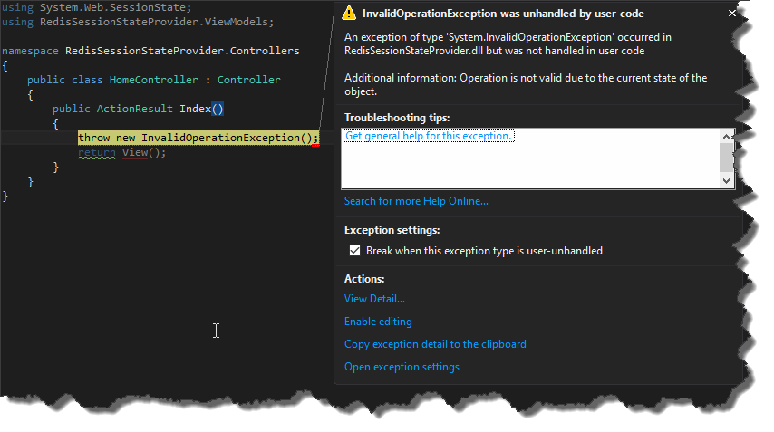
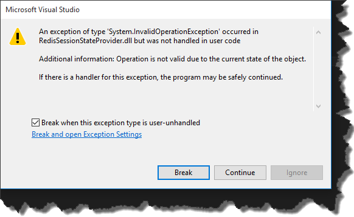

I think everyone is familiar with this nice exception window we see once exception is thrown.  However today for some reasons my _VisualStudio_ started showing some weird dialog.  This was pretty frustrating as I wasn’t able to see which line has thrown exception and basically after clicking "_Break_" or "_Continue_" application was terminated. After a while I found out that the default window is called "_Exception assistant_" and you can enable it in _Visual Studio's_ options. So in order to restore default behavior, just go to _Tools -> Options -> Debugging -> General_ and select "_Enable the exception assistant_" checkbox. 
