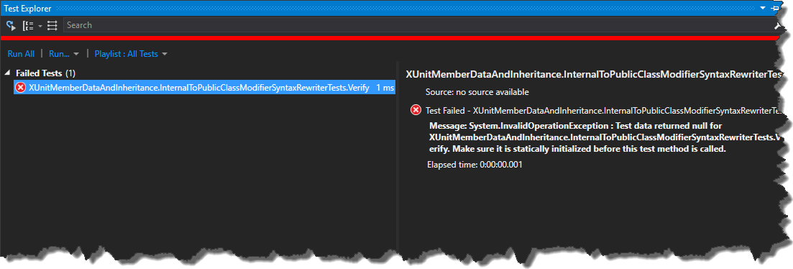
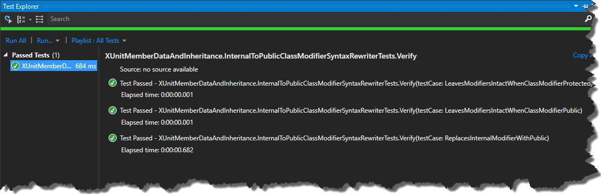

### 1\. Introduction.

When I was writing [Cake.Intellisense](https://github.com/tpodolak/Cake.Intellisense) I was playing a lot with _Roslyn_ syntax rewriters. The one thing which was pretty important for me at this time was a reliable set of tests which can quickly show if rewritten code is valid _C#_ code and if it matches my expectations. As I don’t like to repeat my code I wanted to have a base test class which can be provided with different test cases from inherited classes. The initial implementation looked as follows

```
public abstract class CSharpSyntaxRewriterTest where T : CSharpSyntaxRewriter
{
    public static IEnumerable TestCases { get; set; }
    protected T Subject { get; }

    private readonly NSubstituteAutoMocker _autoMock;
    
    protected CSharpSyntaxRewriterTest()
    {
        _autoMock = new NSubstituteAutoMocker();
        Subject = _autoMock.ClassUnderTest;
    }

    [Theory]
    [MemberData(nameof(TestCases))]
    public void Verify(SyntaxRewriterTestCase testCase)
    {
        var inputTree = SyntaxFactory.ParseSyntaxTree(testCase.Input);
        var result = Subject.Visit(inputTree.GetRoot());

        inputTree.GetDiagnostics().Should().BeEmpty();
        result.GetDiagnostics().Should().BeEmpty();
        result.ToFullString().Should().Be(testCase.ExpectedResult);
    }
}

```

As you can see I have a generic base test class which holds test cases in a static field _TestCases_. The field is static as it is required by _XUnit_, this solution is perfectly valid because a static field is shared across [all instances of the same type](https://stackoverflow.com/a/3037259). Having a base test class ready I wanted to write a set of unit tests for following syntax rewriter

```
public class InternalToPublicClassModifierSyntaxRewriter : CSharpSyntaxRewriter
{ 
    public override SyntaxNode VisitClassDeclaration(ClassDeclarationSyntax node)
    {
        var internalModifierIndex = node.Modifiers.IndexOf(SyntaxKind.InternalKeyword);
            
        if (internalModifierIndex > -1)
        {
            var tokenInList = node.Modifiers[internalModifierIndex];
            var updatedModifiers = node.Modifiers.Replace(tokenInList,
                   SyntaxFactory.Token(SyntaxKind.PublicKeyword).WithLeadingTrivia(tokenInList.LeadingTrivia)
                        .WithTrailingTrivia(tokenInList.TrailingTrivia));

            node = node.WithModifiers(updatedModifiers);
         }

         return base.VisitClassDeclaration(node);
    }
}

```

The rewriter shown above is a very simple piece of code which replaces internal class modifier with a public one. Writing the tests for that class was supposed to be very easy, I just had to provide test cases with input code and expected result.

```
public class InternalToPublicClassModifierSyntaxRewriterTests
        : CSharpSyntaxRewriterTest
{
    static InternalToPublicClassModifierSyntaxRewriterTests()
    {
        TestCases = new[]
        {
            new[] { ReplacesInternalModifierWithPublic() },
            new[] { LeavesModifiersIntactWhenClassModifierPublic() },
            new[] { LeavesModifiersIntactWhenClassModifierProtected() }
        };
    }

    private static SyntaxRewriterTestCase ReplacesInternalModifierWithPublic()
    {
        return new SyntaxRewriterTestCase(nameof(ReplacesInternalModifierWithPublic), 
                "internal class Foo { }", "public class Foo { }");
    }

    private static SyntaxRewriterTestCase LeavesModifiersIntactWhenClassModifierPublic()
    {
        return new SyntaxRewriterTestCase(nameof(LeavesModifiersIntactWhenClassModifierPublic),
                "public class Foo { }", "public class Foo { }");
    }

    private static SyntaxRewriterTestCase LeavesModifiersIntactWhenClassModifierProtected()
    {
        return new SyntaxRewriterTestCase(nameof(LeavesModifiersIntactWhenClassModifierProtected),
                "protected class Foo { }", "protected class Foo { }");
    }
}

```

Unfortunately running the tests resulted in _InvalidOperationException_ being thrown from _XUnit_ [](//tpodolak.com/blog/wp-content/uploads/2017/06/xunit-memberdataattribute-and-generic-type-inheritance/FailedTest.png) If you look closely at the message you will notice that the _TestCases_ field used for providing data was not initialized, which means that the static constructor of class _InternalToPublicClassModifierSyntaxRewriterTests_ was not run. That was pretty surprising for me that is why I wanted to investigated the issue a bit more.

### 2\. Investigation.

I started from going back to the basics. As we probably all know, the static constructor is triggered when one of the following events occur:

- An instance of the class type is created.
- Any of the static members of the class type are referenced

The first condition is not met because instance of the test class is created after test cases are enumerated. That is why member data fields have to be a static fields/properties etc. When it comes to second condition the situation in here is a bit more complicated but if you take a look at the [MemberDataAttributeBase](https://github.com/xunit/xunit/blob/bccfcccf26b2c63c90573fe1a17e6572882ef39c/src/xunit.core/MemberDataAttributeBase.cs) class

```
public override IEnumerable GetData(MethodInfo testMethod)
{
    Guard.ArgumentNotNull("testMethod", testMethod);

    var type = MemberType ?? testMethod.DeclaringType;
    var accessor = GetPropertyAccessor(type) ?? GetFieldAccessor(type) ?? GetMethodAccessor(type);
    // implementation omitted for brevity  
}

```

you will notice that member data looks for properties in _DeclaringType_ of method. In my case declaring type is

```
XUnitMemberDataAndInheritance.CSharpSyntaxRewriterTest`1[[XUnitMemberDataAndInheritance.InternalToPublicClassModifierSyntaxRewriter]]

```

not

```
InternalToPublicClassModifierSyntaxRewriterTests

```

So when _XUnit_ accesses _TestCase_ property the static constructor from _InternalToPublicClassModifierSyntaxRewriterTests_ class will not be called either as the types does not match.

### 3\. Solution.

In order to bend the behavior of _XUnit_ to my needs, I had to ensure that the static constructor from inherited class is called. Fortunately, workaround is pretty straightforward - I had to introduce a custom _MemberDataAttribute_ which calls static constructor from _ReflectedType_ manually

```
[DataDiscoverer("Xunit.Sdk.MemberDataDiscoverer", "xunit.core")]
[AttributeUsage(AttributeTargets.Method, AllowMultiple = true)]
public class CustomMemberDataAttribute : MemberDataAttributeBase
{
    public CustomMemberDataAttribute(string memberName, params object[] parameters)
            : base(memberName, parameters)
    {
    }

    public override IEnumerable GetData(MethodInfo testMethod)
    {
        var type = MemberType ?? testMethod.ReflectedType;
        System.Runtime.CompilerServices.RuntimeHelpers.RunClassConstructor(type.TypeHandle);
        return base.GetData(testMethod);
    }

    protected override object[] ConvertDataItem(MethodInfo testMethod, object item)
    {
        if (item == null)
        {
            return null;
        }

        var array = item as object[];
        if (array == null)
        {
            throw new ArgumentException(
                    $"Property {MemberName} on {MemberType ?? testMethod.ReflectedType} yielded an item that is not an object[]");
        }
            return array;
    }
}

```

Now all I have to do is use newly created attribute in _CSharpSyntaxRewriterTest_ test class

```
[Theory]
[CustomMemberData(nameof(TestCases))]
public void Verify(SyntaxRewriterTestCase testCase)
{
    // implementation omitted for brevity        
}

```

From now on all of the test cases will be run correctly [](//tpodolak.com/blog/wp-content/uploads/2017/06/xunit-memberdataattribute-and-generic-type-inheritance/GreenTest.png) Source code for this post can be found [here](https://github.com/tpodolak/Blog/tree/master/XUnitMemberDataAndInheritance)
