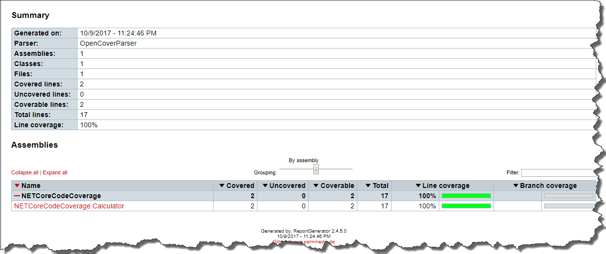

### 1\. Introduction.

I've been struggling for some time to make _OpenCover_ work with _.NET Core_ projects, so I've decided to document a working example. This is basically an aggregation of hints and answers I found on the _Web_ (especially in [here](https://github.com/OpenCover/opencover/issues/601))

### 2\. Working example.

If you run an _OpenCover_ with the same arguments you were running it for a classic framework, you will end up with something like this [](//tpodolak.com/blog/wp-content/uploads/2017/10/net-core-calculating-code-coverage-on-windows/MissingPdbs.png) As you can see the coverage was not calculated and _OpenCover_ is complaining about a missing _PDBs_. In order to fix that we have to do two things. First of all, we have to build the project with a full _PDBs_

```
dotnet build "PathToYourSolution.sln" /p:DebugType=Full

```

And then run _OpenCover_ with and _\-oldStyle_ switch

```
OpenCover.Console.exe -target:"C:/Program Files/dotnet/dotnet.exe" -targetargs:"test \"PathToTestProject.csproj\" --configuration Debug --no-build" -filter:"+[*]* -[*.Tests*]*" -oldStyle -register:user -output:"OpenCover.xml"

```

From now on, _OpenCover_ recognizes _PDB_ files and the code coverage is calculated correctly [](//tpodolak.com/blog/wp-content/uploads/2017/10/net-core-calculating-code-coverage-on-windows/OkPdbs.png)

### 3\. Cake script.

As we use a _Cake_ as our build automation tool I've also prepared a sample script for generating a code coverage. The core part of the script looks as follows

```
// rest of the code omitted for brevity

Task("Build")
    .IsDependentOn("Restore-NuGet-Packages")
    .Does(() =>
{
    DotNetCoreBuild(paths.Files.Solution.ToString(), new DotNetCoreBuildSettings
    {
        Configuration = parameters.Configuration,
        ArgumentCustomization = arg => arg.AppendSwitch("/p:DebugType","=","Full")
    });
});

Task("Run-Tests")
    .IsDependentOn("Build")
    .Does(() =>
{
    var success = true;
    var openCoverSettings = new OpenCoverSettings
    {
        OldStyle = true,
        MergeOutput = true
    }
    .WithFilter("+[*]* -[*.Tests*]*");

    foreach(var project in paths.Files.TestProjects)
    {
        try 
        {
            var projectFile = MakeAbsolute(project).ToString();
            var dotNetTestSettings = new DotNetCoreTestSettings
            {
                Configuration = parameters.Configuration,
                NoBuild = true
            };

            OpenCover(context => context.DotNetCoreTest(projectFile, dotNetTestSettings), paths.Files.TestCoverageOutput, openCoverSettings);
        }
        catch(Exception ex)
        {
            success = false;
            Error("There was an error while running the tests", ex);
        }
    }

    ReportGenerator(paths.Files.TestCoverageOutput, paths.Directories.TestResults);

    if(success == false)
    {
        throw new CakeException("There was an error while running the tests");
    }

});

```

Notice that script is able to merge code coverage results from multiple test projects thanks to _MergeOutput_ flag passed to _OpenCover_.

[](//tpodolak.com/blog/wp-content/uploads/2017/10/net-core-calculating-code-coverage-on-windows/Report.png) Full sources of that script (along with a _dotnet vstest_ alternative approach) can be found [here](https://github.com/tpodolak/Blog/tree/master/NETCoreCodeCoverage/Build).
