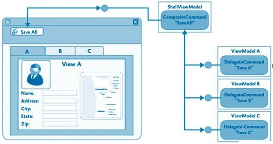

### 1\. DelegateCommands

`DelegateCommands` w `Prismie` są to obiekty, które implementują interfejs `ICommand`, służą one do interakcji widoku z `ViewModelem`.
Korzystając z `Prisma` nie musimy już pisać własnej klasy implementującej ten interfejs (tak jak to zrobiliśmy [tutaj](http://tpodolak.com/blog/2011/11/27/commands-czyli-interakcja-widoku-z-viewmodelem-cz-2/)).
Konstruktor klasy `DelegateCommand` przyjmuje dwa parametry:

- `Action` `execteMethod` - funkcja odpalania przy wywołaniu komendy,
- `Func` `canExecuteMethod` - funkcja sprawdzająca czy daną komendę można wywołać

`DelegateCommands` z `Prisma` używamy w taki sam sposób w jaki używaliśmy komend w [tym](http://tpodolak.com/blog/2011/11/27/commands-czyli-interakcja-widoku-z-viewmodelem-cz-2) poście.

### 2\. CompositeCommands

`CompositeCommands` są to obiekty, które przechowują kolekcją obiektów typu `DelegateCommand`.
Tworzenie `CompositeCommand` jest bardzo proste. Po pierwsze musimy stworzyć obiekt typu `CompositeCommand`

```csharp
public CompositeCommand SomeCompositeCommand = new CompositeCommand();
```

następnie rejestrujemy w tym obiekcie obiekt implementujący interfejs `ICommand`, czyli w naszym przypadku jakiś obiekt typu `DelegateCommand`.
Robimy to w następujący sposób:

```csharp
DelegateCommand DistributeCommand = new DelegateCommand(DistributeCards);
SomeCompositeCommand.RegisterCommand(DistributeCommand);
```

w razie potrzeby możemy usunąć komendę z kolekcji komend przy pomocy następującej składni:

```csharp
SomeCompositeCommand.UnregisterCommand(DistributeCommand);
```

Mając już stworzony obiekt typu `CompositeCommand` oraz zarejestrowane w nim obiekty `DelegateCommand` możemy zastosować bindowanie.

```xml
<Button Command="{Binding SomeCompositeCommand}" Grid.Column="1">Rodzaj</Button>
```

Od teraz, w chwili naciśnięcia przycisku, najpierw sprawdzane jest czy dana `CompositeCommand` może zostać wykonana.
`CompositeCommand` może zostać wykonana tylko wtedy, gdy wszystkie komendy do niej podpięte mogą zostać wykonane.
Jeżeli warunek ten zostanie spełniony następuje wywoływanie po kolei wszystkich metod execute z komend podpiętych do danej `CompositCommand`.
`CompositeCommand` znajduje zastosowanie w przypadku gdy pozwalamy użytkownikowi na edycję wielu elementów jednocześnie i potrzebujemy w prosty sposób przeprowadzić walidację na poszczególnych widokach.

[](http://tpodolak.com/blog/wp-content/uploads/2011/11/prism-komendy/CompositeCommand.jpg)

`CompositeCommand` może również wykorzystana np. do zapisania tylko aktywnego widoku. Dzięki temu, że `DelegateCommand` implementuje interfejs `IActiveAware`, `CompositeCommand` wie, który widok jest aktualnie zaznaczony i zapisze tylko wybrany widok.

Interfejs `IActiveAware` wygląda w następujący sposób

```csharp
public interface IActiveAware
{    
    bool IsActive { get; set; }
    event EventHandler IsActiveChanged;
}
```

- `bool IsActive` - wskazuje czy dana komenda jest aktualnie aktywna
- `event EventHandler IsActiveChanged` - informuje o zmianie aktywności komendy

W celu wykorzystania tego interfejsu przez `CompositeCommand` należy skorzystać z drugiego dostępnego konstruktora tej klasy

```csharp
CompositeCommand SomeCompositeCommand = new CompositeCommand(true);
```

Od teraz po naciśnięciu przycisku zbindowanego do tej komendy, wywołana zostanie jedynie aktywna komenda - czyli taka, której właściwość `IsActive` została ustawiona na true.
Niestety o ustawianie aktywności danej komendy musimy zadbać sami.
