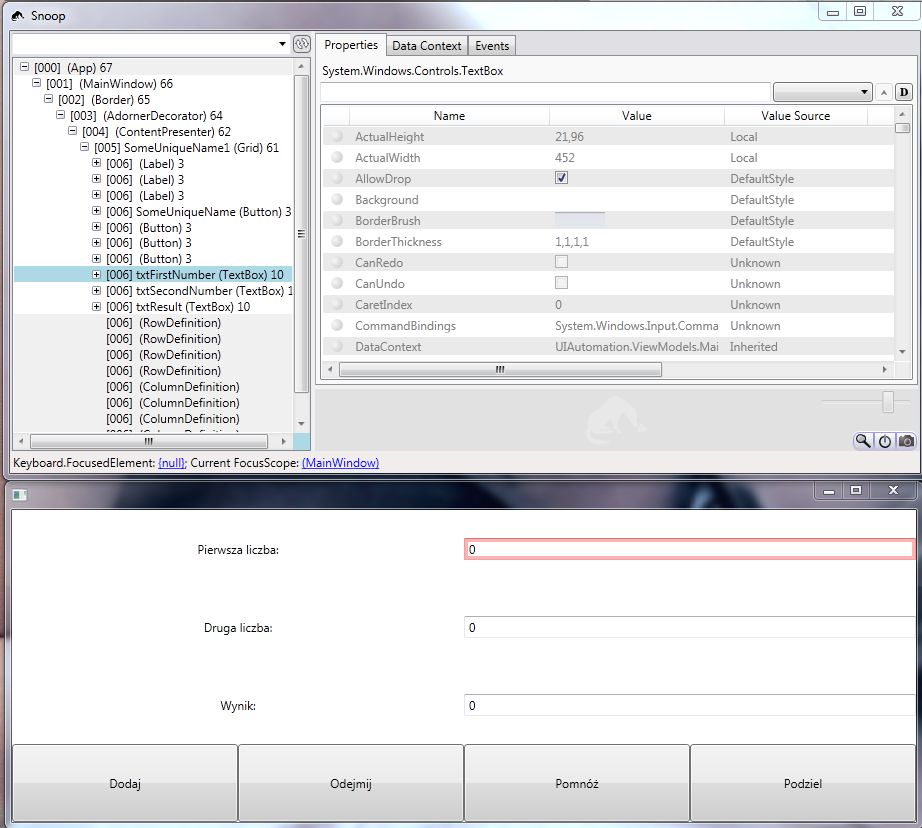
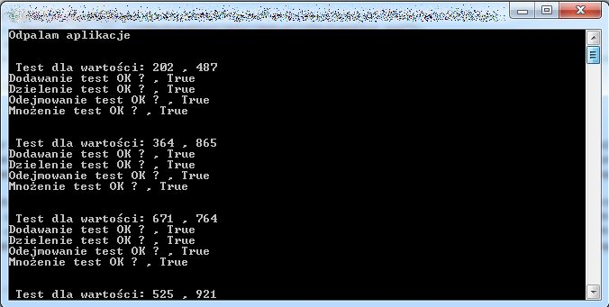

Biblioteka `Microsoft UI Automation` ujrzała światło dzienne wraz z premierą `.NET 3.0` - jednakże pozostała ona w cieniu swoich większych braci `WPF` oraz `WPF`, które również zostały wprowadzone do `Frameworka 3.0`.
`Microsoft UI automation` zapewnia nam dostęp do wszystkich elementów drzewa wizualnego aplikacji. Dzięki czemu mamy możliwość:

- Znajdowania wybranych przez nas kontrolek
- Interakcji z kontrolkami - wpisywanie tekstów do TextBox-ów, klikanie w przyciski itp
- Wczytywania wartości już wprowadzonych do kontrolek

Każda kontrolka znajdująca się na widoku jest traktowana przez `UI Automation` jako `AutomationElement`.
Rootem naszego drzewa wizualnego pulpit, dostęp do niego uzyskujemy poprzez statyczną właściwość

```csharp
AutomationElement.RootElement

```

Mając dostęp do roota możemy następnie poruszać się po drzewie tak aby znaleźć interesujące nas elementy. Załóżmy, że napisaliśmy prostą aplikację `WPF-ową`, która wykonuje podstawowe obliczenia matematyczne (pomysł na prostą aplikację do testowania zaczerpnięty z [tej](http://blog.ganeshzone.net/index.php/2011/08/automated-ui-testing-of-wpf-applications-using-microsoft-ui-automation-library/) strony - kod jednak pisałem po swojemu :D).
Wizualnie aplikacja ta przedstawia się w następujący sposób:
```xml wrap=false
<Window x:Class="UIAutomation.Views.MainWindow"
        xmlns="http://schemas.microsoft.com/winfx/2006/xaml/presentation"
        xmlns:x="http://schemas.microsoft.com/winfx/2006/xaml"
        Height="350" Width="525" Title="{Binding Title}">
    <Grid x:Name="SomeUniqueName1">
        <Grid.RowDefinitions>
            <RowDefinition></RowDefinition>
            <RowDefinition></RowDefinition>
            <RowDefinition></RowDefinition>
            <RowDefinition></RowDefinition>
        </Grid.RowDefinitions>
        <Grid.ColumnDefinitions>
            <ColumnDefinition></ColumnDefinition>
            <ColumnDefinition></ColumnDefinition>
            <ColumnDefinition></ColumnDefinition>
            <ColumnDefinition></ColumnDefinition>
        </Grid.ColumnDefinitions>
        <Label Content="Pierwsza liczba:" HorizontalAlignment="Center" VerticalAlignment="Center" Grid.ColumnSpan="2"></Label>
        <Label Content="Druga liczba:" HorizontalAlignment="Center" VerticalAlignment="Center" Grid.Row="1" Grid.ColumnSpan="2"></Label>
        <Label Content="Wynik:" HorizontalAlignment="Center" VerticalAlignment="Center" Grid.Row="2"  Grid.ColumnSpan="2"></Label>
        <Button Name="btnAdd"  Grid.Column="0" Grid.Row="3" Content="Dodaj" Command="{Binding AddCommand}" />
        <Button Name="btnSubtract" Grid.Column="1" Grid.Row="3"  Content="Odejmij" Command="{Binding SubstractCommand}" />
        <Button Name="btnMultiply" Grid.Column="2" Grid.Row="3"  Content="Pomnóż" Command="{Binding MultiplyCommand}" />
        <Button Name="btnDivide" Grid.Column="3" Grid.Row="3"  Content="Podziel" Command="{Binding DivideCommand}" />
        <TextBox Name="txtFirstNumber"  Grid.Column="2"  VerticalAlignment="Center" Grid.ColumnSpan="2" Text="{Binding FirstNumber,Mode=TwoWay}"></TextBox>
        <TextBox Name="txtSecondNumber" Grid.Column="2" Grid.Row="1" HorizontalAlignment="Stretch" VerticalAlignment="Center" Text="{Binding SecondNumber,Mode=TwoWay}" Grid.ColumnSpan="2"></TextBox>
        <TextBox Name="txtResult"  Grid.Column="2" Grid.Row="2" HorizontalAlignment="Stretch" VerticalAlignment="Center" Text="{Binding Result,Mode=TwoWay}" Grid.ColumnSpan="2"></TextBox>
    </Grid>
</Window>
```
W celu poruszania się po drzewie wizualnym możemy skorzystać z dwóch metod

```csharp
public AutomationElement FindFirst(TreeScope scope, Condition condition);
public AutomationElementCollection FindAll(TreeScope scope, Condition condition);
```

pierwsza z nich zwraca nam konkretny element, który spełnia podane przez nas kryterium.
Pierwszy parametr funkcji TreeScope scope określa nam sposób przeszukiwania drzewa wizualnego. Dostępne opcje to:

- `Element` - wyszukiwanie odbywa się tylko na danym elemencie
- `Children` - wyszukiwanie odbywa się na wszystkich dzieciach danego elementu - nie zagłębiamy się rekurencyjnie,sprawdzamy tylko jeden poziom w dół od danego elementu
- `Descendants` - wyszukiwanie odbywa się na wszystkich potomkach - przeszukiwanie rekurencyjne w dół
- `Subtree` - wyszukiwanie odbywa się na wszystkich potomkach, oraz elemencie od którego zaczynamy
- `Ancestors` - wyszukiwanie odbywa się na wszystkich rodzicach - rekurencyjnie w górę drzewa

Drugim z parametrów jakie musimy podać jest to `UIAutomation.Condition`.
Parametr ten określa jaki warunek musi spełnić dany element aby został uwzględniony w wyniku wyszukiwania.
Sama klasa `Condition` jest klasą abstrakcyjną, z której dziedziczą wyspecjalizowane klasy.
Do określenia warunków najczęściej będziemy korzystać z potomka klasy `Condition`, mianowicie z

```csharp
PropertyCondition

```

określa ona jaka właściwość kontrolki/aplikacji będzie uwzględniana przy wyszukiwaniu wyniku.

Pierwszym krokiem przy testowaniu aplikacji będzie oczywiście znalezienie głównego okna programu. Mając w solucji stworzony projekt z aplikacją `WPF-ową`, dodajmy drugi projekt - tym razem będzie to projekt typu `ConsoleApplication`.
Następnie musimy dodać referencję do odpowiednich ddl-ek. Potrzebujemy następujących bibliotek:

- `UIAutomation.dll`
- `UIAutomationClient.dll`
- `UIAutomationType.dll`

Następnie w naszym projekcie konsolowym w metodzie main odpalamy aplikację, którą chcemy testować. W moim przypadku wygląda to w następujący sposób:

```csharp
Console.WriteLine("Odpalam aplikacje");
Process p = Process.Start("..\..\..\UIAutomation\bin\Debug\UIAutomation.exe");
```

Następnie musimy dostać się do głównego okna testowanej aplikacji. Możemy to zrobić używając funkcji `FindFirst`:

```csharp
AutomationElement mainForm =  AutomationElement.RootElement.FindFirst(TreeScope.Children,new PropertyCondition(AutomationElement.ProcessIdProperty, p.Id));
```

lub możemy uzyskać dostęp do okna przy pomocy funkcji

```csharp
AutomationElement mainForm = AutomationElement.FromHandle(p.MainWindowHandle);
```

W pierwszym przypadku wykorzystując funkcję `FindFirst` przeszukujemy wszystkie dzieci (`TreeScope.Children`) roota (czyli pulpitu).
Jako warunek wyszukiwania podaliśmy obiekt klasy `PropertyCondition`.
Jako właściwość do porównywania podaliśmy id processu (`AutomationElement.ProcessIdProperty`).
W drugim przypadku po prostu uzyskujemy dostęp do okna dzięki znajomości jego uchwytu (właściwość `MainWindowHandle` z klasy `Process`).
Według mnie lepiej skorzystać z funkcji pierwszej, zwłaszcza gdy odpalamy aplikację, która się długo uruchamia.
W pierwszym przypadku wystarczy zrobić odpowiednią funkcję oczekującą na odpalanie (gdyż funkcja zwróci nam `null` gdy okna jeszcze nie będzie), natomiast druga opcja rzuci nam wyjątek. Oczekiwania na załadowanie okna może wyglądać w następujący sposób

```csharp
AutomationElement mainForm;
while ((mainForm = AutomationElement.RootElement.FindFirst(TreeScope.Children,new PropertyCondition(AutomationElement.ProcessIdProperty,p.Id)))==null)
{
    Thread.Sleep(100);
}
```

Mając dostęp do głównego okna możemy przeprowadzić testy - przetestujemy czy po wpisaniu danych do tekstboksów i przeprowadzeniu odpowiednich akcji (dodawanie,usuwanie,odejmowanie,dzielenie) w polu wynik pojawi się odpowiednia wartość.
Zacznijmy od zlokalizowania textboxów. Posłużmy się tutaj przedstawioną wcześniej funkcją `FindFirst`.

```csharp
var firstTextbox = mainForm.FindFirst(TreeScope.Children, new PropertyCondition(AutomationElement.AutomationIdProperty, "txtFirstNumber"));
```

Wyszukiwanie odbywa się po właściwości `AutomationElement.AutomationIdProperty` - właściwość ta jest zawsze taka sama jak nazwa kontrolki - chyba, że ktoś ją zmieni przy pomocy `AttachedProperty` `AutomationProperties.AutomationId`.
Odpalając powyższy kod okazuje się, że nasza zmienna firstTextbox jest nullem - czyli framework nie był w stanie znaleźć naszego textboxa.
Dlaczego tak się stało? Odpowiedzi może nam dostarczyć aplikacja `Snoop`, dzięki której możemy podejrzeć drzewo wizualne naszego programu.

[](http://tpodolak.com/blog/wp-content/uploads/2011/12/ui-automation-czyli-testy-automatyczne-w-net/snoopResult.jpg)

Na powyższym screenie widzimy, że szukany textbox nie jest bezpośrednim dzieckiem `MainWindow`, jest natomiast dzieckiem grida (tego można było się spodziewać zwłaszcza, że umieściliśmy textbox w gridzie).
Zauważmy jednak, że MainWindow nie jest bezpośrednim rodzicem grida - znajduje się on dopiero na poziomie 4 w drzewie.
Z racji dużego skomplikowania drzewa wizualnego aplikacji według mnie bezpiecznie jest używać funkcji `Find` z parametrem `TreeScope.Descendants`.
Unikniemy dzięki temu przykrych niespodzianek z nieodnalezionymi kontrolkami.
Nasza funkcja zatem powinna wyglądać w następujący sposób.

```csharp
var firstTextbox = mainForm.FindFirst(TreeScope.Descendants, new PropertyCondition(AutomationElement.AutomationIdProperty, "txtFirstNumber"));

```

W analogiczny sposób znajdujemy pozostałe przyciski na naszej formie, a następnie postarajmy się wprowadzić do nich jakiś text. W celu interakcji z kontrolkami wykorzystamy tzw. `Patterns`.
`Patterns` definiują określone funkcjonalności, które wspiera nasza kontrolka. Do najczęściej używanych patterns należą:

- `SelectionPattern` - używany do manipulacjami kontrolkami wspierającymi zaznaczanie np. `ListBox-ami`
- `TextPattern` - używany do manipulacjami kontrolkami wspierającymi edycję
- `ValuePattern` \- używany do pobierania i ustawiania wartości kontrolek nie wspierających wielokrotnych wartości
- `InvokePattern` \- używane do kontrolek wspierających wywołania - np. przyciski (wywołanie przyciśnięcia)
- `ScrollPattern` \- używane do kontrolek posiadających `ScrolBar-y`
- `RangeValuePattern` \- używany do kontrolek mogących posiadać jakiś zakres wartości np. `ComboBox`

Zatem w celu ustawienia wartości w textbox-ie posłużymy się następującym kodem

```csharp
var pattern = txtFirstNumber.GetCurrentPattern(ValuePattern.Pattern) as ValuePattern;
pattern.SetValue("50");
```

W analogiczny sposób ustawiamy zawartość drugiego textbox-a

```csharp
var pattern = txtSecondNumber.GetCurrentPattern(ValuePattern.Pattern) as ValuePattern;
pattern.SetValue("50");
```

Mając wprowadzone dane do textbox-ów wypadałoby teraz przeprowadzić obliczenia.
Zatem musimy w jakiś sposób aby "nacisnąć" jeden z naszych czterech przycisków. Znajdźmy zatem nasze przyciski:

```csharp wrap=false
var btnAdd = mainForm.FindFirst(TreeScope.Descendants, new PropertyCondition(AutomationElement.AutomationIdProperty, "btnAdd"));
var btnSubtract = mainForm.FindFirst(TreeScope.Descendants, new PropertyCondition(AutomationElement.AutomationIdProperty, "btnSubtract"));
var btnMultiply = mainForm.FindFirst(TreeScope.Descendants, new PropertyCondition(AutomationElement.AutomationIdProperty, "btnMultiply"));
var btnDivide = mainForm.FindFirst(TreeScope.Descendants, new PropertyCondition(AutomationElement.AutomationIdProperty, "btnDivide"));
```

Następnie wykorzystując wspomniany wcześniej `InvokePattern` naciśnijmy przycisk `Dodaj`.

```csharp
InvokePattern ipClickButton1 = (InvokePattern)btnAdd.GetCurrentPattern(InvokePattern.Pattern);
ipClickButton1.Invoke();
```

Ostatnim krokiem będzie zweryfikowanie czy wartość w textbox-ie txtResult jest zgodna z oczekiwaniami.
W celu wyciągnięcia wartości z txtResult po raz kolejny posłużę się `ValuePattern`

```csharp
var value = (txtResult.GetCurrentPattern(ValuePattern.Pattern) as ValuePattern).Current.Value
```

Wynik otrzymany w textbox-ie porównujemy z oczekiwanym rezultatem

```csharp
Console.Write("Dodawanie test OK ? , {0}",value == "100");
```

Na koniec najlepiej wrzucić nasz test w jakąś pętle, losowo generować wartości oraz porównywać je z wartościami oczekiwanymi.
Dobrym pomysłem jest również stworzenie sobie jakiejś klasy pomocniczej, w której zostałyby umieszczone funkcje do wypełniania textbox-ow, klikania w buttony itp - gdyż jak widać dużo kodu jest powtarzalna. Ostatecznie aplikacja testowa może wyglądać w następujący sposób:

```csharp
class Program
{
    static void Main(string[] args)
    {
        Random rand = new Random();
        try
        {
            Console.WriteLine("Odpalam aplikacje");
            Process p = Process.Start("..\..\..\UIAutomation\bin\Debug\UIAutomation.exe");
            AutomationElement mainForm;
            while ((mainForm = AutomationElement.RootElement.FindFirst(TreeScope.Children,new PropertyCondition(AutomationElement.ProcessIdProperty,p.Id)))==null)
            {
                Thread.Sleep(100);
            }
            
            var txtFirstNumber = mainForm.FindFirst(TreeScope.Descendants, new PropertyCondition(AutomationElement.AutomationIdProperty, "txtFirstNumber"));
            var txtSecondNumber = mainForm.FindFirst(TreeScope.Descendants, new PropertyCondition(AutomationElement.AutomationIdProperty, "txtSecondNumber"));
            var txtResult = mainForm.FindFirst(TreeScope.Descendants, new PropertyCondition(AutomationElement.AutomationIdProperty, "txtResult"));
            
            var btnAdd = mainForm.FindFirst(TreeScope.Descendants, new PropertyCondition(AutomationElement.AutomationIdProperty, "btnAdd"));
            var btnSubtract = mainForm.FindFirst(TreeScope.Descendants, new PropertyCondition(AutomationElement.AutomationIdProperty, "btnSubtract"));
            var btnMultiply = mainForm.FindFirst(TreeScope.Descendants, new PropertyCondition(AutomationElement.AutomationIdProperty, "btnMultiply"));
            var btnDivide = mainForm.FindFirst(TreeScope.Descendants, new PropertyCondition(AutomationElement.AutomationIdProperty, "btnDivide"));
            
            for (int i = 0; i < 200; i++)
            {
                double firstNumber = rand.Next(1, 1000);
                double seconNumber = rand.Next(1, 1000);
                Console.WriteLine("nn Test dla wartości: {0} , {1}", firstNumber, seconNumber);
                txtFirstNumber.SetTextBoxValue(firstNumber.ToString());
                txtSecondNumber.SetTextBoxValue(seconNumber.ToString());
                btnAdd.Click();
                Console.WriteLine("Dodawanie test OK ? , {0}", txtResult.GetTextBoxValue().ConvertToDouble() == firstNumber + seconNumber);
                btnDivide.Click();
                Console.WriteLine("Dzielenie test OK ? , {0}", Math.Round(txtResult.GetTextBoxValue().ConvertToDouble(), 2) == Math.Round(firstNumber / seconNumber, 2));
                btnSubtract.Click();
                Console.WriteLine("Odejmowanie test OK ? , {0}", txtResult.GetTextBoxValue().ConvertToDouble() == firstNumber - seconNumber);
                btnMultiply.Click();
                Console.WriteLine("Mnożenie test OK ? , {0}", txtResult.GetTextBoxValue().ConvertToDouble() == firstNumber * seconNumber);
            }
            
            Console.WriteLine("nEnd test runn");
            Console.ReadKey();
            p.Close();
            p.Kill();
        }
        catch (Exception ex)
        {
            Console.WriteLine("Fatal error: " + ex.Message);
            Console.WriteLine("nEnd test runn");
            Console.ReadKey();
        }
    }
}
```

oraz klasa pomocnicza

```csharp
public static class UiAutomationHelper
{
    public static string GetTextBoxValue(this AutomationElement automationElement)
    {
        return (automationElement.GetCurrentPattern(ValuePattern.Pattern) as ValuePattern).Current.Value;
    }
    
    public static void SetTextBoxValue(this AutomationElement automationElement,string value)
    {
        (automationElement.GetCurrentPattern(ValuePattern.Pattern) as ValuePattern).SetValue(value);
    }
    
    public static void Click(this AutomationElement automationElement)
    {
        InvokePattern ipClickButton1 = (InvokePattern)automationElement.GetCurrentPattern(InvokePattern.Pattern);
        ipClickButton1.Invoke();
        Thread.Sleep(100); // dajmy czas na pokazanie okna, wykonanie funkcji itp
    }
    
    public static double ConvertToDouble(this string str)
    {
        double number;
        if (double.TryParse(str.Replace('.',','), out number  ))
            return number;
        throw new Exception("Niepoprawna wartość");
    }
}
```

[](http://tpodolak.com/blog/wp-content/uploads/2011/12/ui-automation-czyli-testy-automatyczne-w-net/result.jpg)
