Poszukując sposobów automatycznego testowania aplikacji natrafiłem na ciekawą funkcjonalność Visual Studio 2010 Ultimate. Mianowicie w tej wersji naszego ulubionego IDE znalazło się miejsce na nowy typ testów - Coded UI Test. Coded UI Test jest to automatyczny test UI, który tworzymy poprzez nagrywanie akcji jakie wykonujemy w naszej aplikacji. Nie musimy pisać ani jednej linijki kodu żeby przetestować jakąś funkcjonalność naszego programu. Jedyne co musimy zrobić jest to przejście przez wszystkie niezbędne kroki w naszej aplikacji, tak aby zweryfikować naszą funkcjonalność. W celu stworzenia Coded UI Test musimy po pierwsze zaopatrzyć się w wersję Ultimate Visual Studio 2010. Z tego co wiem, niestety niższe wersje nie mają funkcjonalności automatycznego testowania. Następnie musimy stworzyć nowy Test Project. W tym celu z menu File wybieramy New a następnie Project. W oknie, które się pokaże, w drzewie po lewej stronie wybieramy Test, a następnie w prawej części okna Test Project [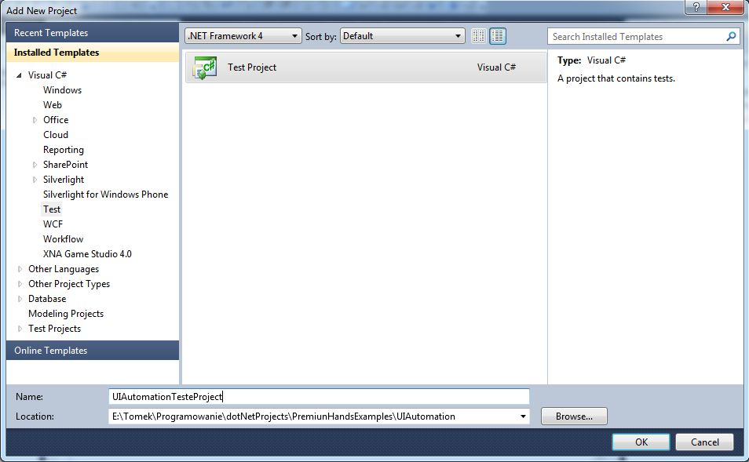](http://tpodolak.com/blog/wp-content/uploads/2011/12/coded-ui-test-tworzenie-testow-ui-przy-pomocy-visual-studio-ultimate/Project.jpg) Mając stworzony projekt testowy dodajemy do niego nowy Coded UI Test. W Solution Explore-rze klikamy PPM na projekt testowy, a następnie z menu contextowego wybieramy Coded UI Test. [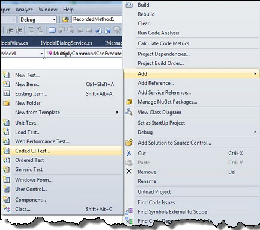](http://tpodolak.com/blog/wp-content/uploads/2011/12/coded-ui-test-tworzenie-testow-ui-przy-pomocy-visual-studio-ultimate/CodedUITest.png) W oknie, które się pojawi wybieramy Record actions,edit UI map or add assertion lub gdy mamy już gotowe testy możemy wybrać opcję nr 2. Po wybraniu pierwszej opcji okno Visual Studio zostanie zminimalizowane, a w prawym dolnym rogu pulpitu ukaże się następujące okienko. [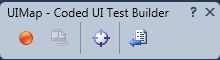](http://tpodolak.com/blog/wp-content/uploads/2011/12/coded-ui-test-tworzenie-testow-ui-przy-pomocy-visual-studio-ultimate/Record.jpg) Służy ono do nagrywania testu. Naciskając czerwony przycisk rozpoczynamy proces nagrywania testu. W moim przypadku będę testować aplikację, którą testowałem również w poprzednim poście. Wykonuje zatem czynności mające na celu sprawdzenie funkcjonalności dodawania liczb. Po kliknięciu na textbox-a pojawia się nad nim dymek,że dana akcja jest nagrywana. [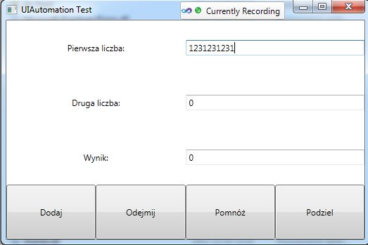](http://tpodolak.com/blog/wp-content/uploads/2011/12/coded-ui-test-tworzenie-testow-ui-przy-pomocy-visual-studio-ultimate/UI.jpg) Po "wyklikaniu" całej ścieżki mającej sprawdzić funkcjonalność klikamy przycisk "Generate code"" (ten najbardziej z prawej strony). Następnie w okienku, które się pojawi [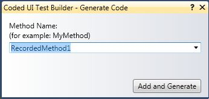](http://tpodolak.com/blog/wp-content/uploads/2011/12/coded-ui-test-tworzenie-testow-ui-przy-pomocy-visual-studio-ultimate/MethodName.jpg) podajemy nazwę naszego testu. Po kliknięciu OK, Visual Studio wygeneruje nam kod odpowiedzialny za nasz test. [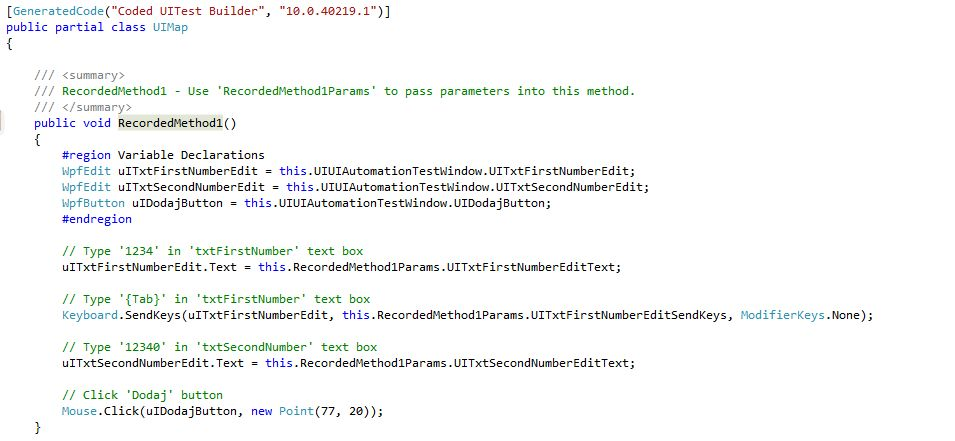](http://tpodolak.com/blog/wp-content/uploads/2011/12/coded-ui-test-tworzenie-testow-ui-przy-pomocy-visual-studio-ultimate/SourceUIMap.jpg) W celu odpalenia naszego testu z menu Test wybieramy Run, a następnie Tests in Current Context. Visual Studio przejdzie teraz wszystkie kroki, które zostały nagrane w teście. Ok, niby wszystko ładnie pięknie, ale tak naprawdę nic nie sprawdziliśmy. Jedyne co zrobiliśmy to wykonaliśmy pewne operacje na naszej aplikacji, jednakże nie zweryfikowaliśmy danych otrzymanych w wyniku operacji dodaj. W celu dodania warunku sprawdzającego do naszego testu, musimy dodać tzw. asercję. Aby to zrobić klikamy PPM na wolne pole edytora, pod funkcją this.UIMap.RecordedMethod1() (ta funkcja została wygenerowana podczas nagrywania testu). Następnie z menu contextowego wybieramy [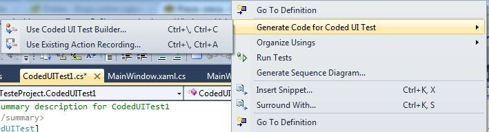](http://tpodolak.com/blog/wp-content/uploads/2011/12/coded-ui-test-tworzenie-testow-ui-przy-pomocy-visual-studio-ultimate/Generate.jpg) Otwiera nam się znane już wcześniej okienko nagrywania testu. Jednakże tym razem naciśnijmy przycisk celownika i przeciągnijmy go na textbox-a, w którym ma pojawić się wynik dodawania [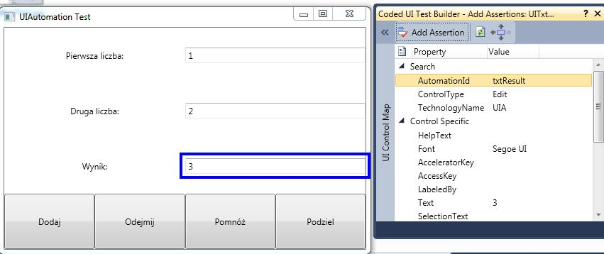](http://tpodolak.com/blog/wp-content/uploads/2011/12/coded-ui-test-tworzenie-testow-ui-przy-pomocy-visual-studio-ultimate/AutomationAdding.jpg) Nasz textbox zostanie obramowany, natomiast w prawym dolnym rogu pulpitu pojawi się nowe okno pokazujące propertisy naszego przycisku. Wybierzmy właściwość Text ,a następnie naciśnijmy przycisk Add Assertion [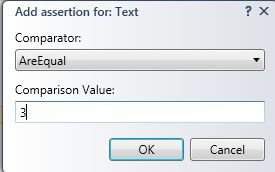](http://tpodolak.com/blog/wp-content/uploads/2011/12/coded-ui-test-tworzenie-testow-ui-przy-pomocy-visual-studio-ultimate/Assertion.jpg) W oknie, które się pojawi możemy wybrać warunek, który musi spełnić dana właściwość (w tym przypadku Text), aby test przeszedł. Ustawmy tam wartość np. 3. Następnie klikamy OK oraz nadajemy nazwę naszej assercji.Po wykonaniu tych czynności w kodzie naszego pojawi się dodatkowa linijka [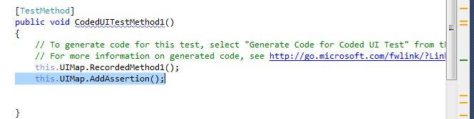](http://tpodolak.com/blog/wp-content/uploads/2011/12/coded-ui-test-tworzenie-testow-ui-przy-pomocy-visual-studio-ultimate/AddAssertion.jpg) Teraz za każdym razem gdy odpalimy test na samym jego końcu będzie sprawdzana nasza assercja. W przypadku gdy wartość właściwości Text nie będzie równa 3 nasz test nie przejdzie. [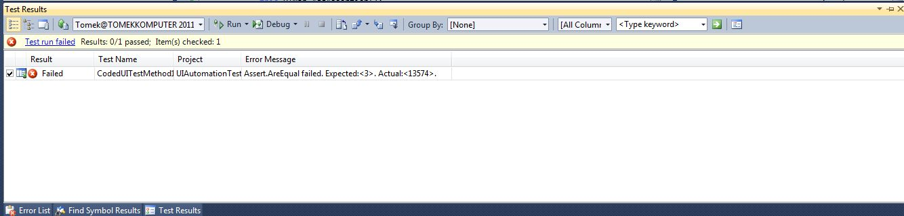](http://tpodolak.com/blog/wp-content/uploads/2011/12/coded-ui-test-tworzenie-testow-ui-przy-pomocy-visual-studio-ultimate/AssertionFailed.jpg)
