W dzisiejszym wpisie postaram się przedstawić moją koncepcję logowania do aplikacji `Silverlightowej` z wykorzystaniem `MembershipProviders` oraz własnego `AuthenticationService`.
Zacznijmy od stworzenia bazy danych, w której będziemy przetrzymywać informacje o użytkownikach - hasła, role itp. 
Bazę danych stworzymy przy użyciu narzędzia `aspnet_regsql.exe`, które to wygeneruje schemat bazy danych dostosowany do możliwości `SqlMembershipProvider-a`.
`aspnet_regsq.exe` znajduje się w katalogu `C:WINDOWS\Microsoft.NET\Framework\wersjaFrameworka\aspnet_regsql.exe`.
Czyli w moim przypadku jest to `C:WINDOWS\Microsoft.NET\Frameworkv\4.0.30319\aspnet_regsql.exe`.

[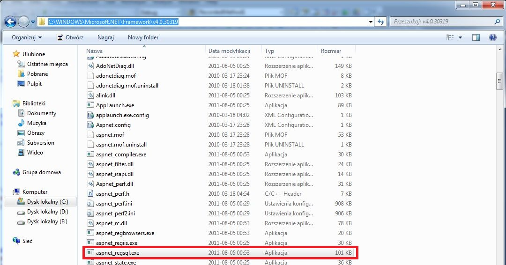](http://tpodolak.com/blog/wp-content/uploads/2011/12/silverlight-koncepcja-logowania-z-uzyciem-membershipproviders-oraz-wcf-ria-cz-1/regsql.jpg)

Klikając podwójnie na ikonę aplikacji pojawia nam się następujące okno

[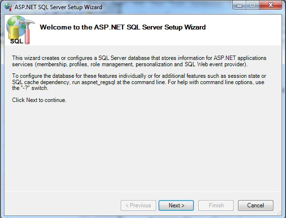](http://tpodolak.com/blog/wp-content/uploads/2011/12/silverlight-koncepcja-logowania-z-uzyciem-membershipproviders-oraz-wcf-ria-cz-1/wizzard.jpg)

Klikamy w przycisk `Dalej`. W kolejnym oknie mamy do wyboru dwie opcje

- Configure SQL Server for application services
- Remove application services from an existing database

Pierwsza opcja odpowiedzialna jest za stworzenie struktury danych do naszego sytemu logowania, natomiast druga usuwa z bazy danych tabele służące do logowania itp. Wybieramy opcję bramkę nr 1. W kolejnym oknie musimy podać connection string do naszego serwera bazy danych oraz login i hasło. W moim przypadku wygląda to w następujący sposób:

[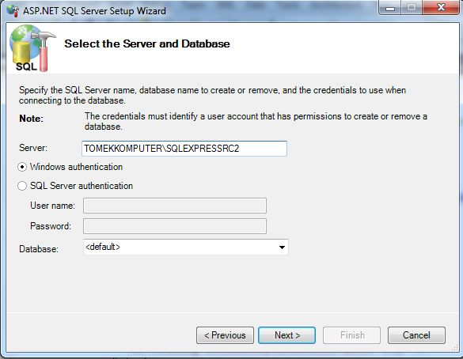](http://tpodolak.com/blog/wp-content/uploads/2011/12/silverlight-koncepcja-logowania-z-uzyciem-membershipproviders-oraz-wcf-ria-cz-1/wizzard2.jpg)

Jeżeli wszystko pójdzie `OK` pokaże się nam następujące okno, w którym to możemy zobaczyć, że została stworzona baz danych `aspnetdb`

[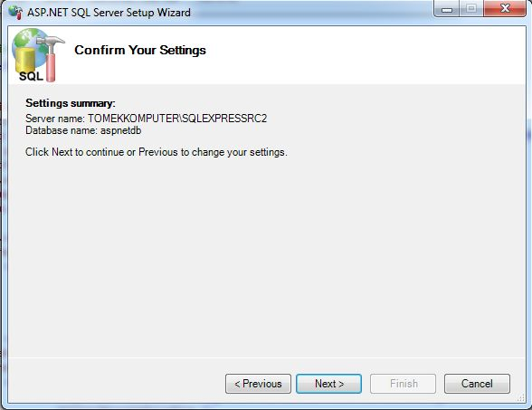](http://tpodolak.com/blog/wp-content/uploads/2011/12/silverlight-koncepcja-logowania-z-uzyciem-membershipproviders-oraz-wcf-ria-cz-1/wizzard3.jpg)

Ostatecznie klikamy na przycisk `Next`, a następnie w `Finish` aby dokończyć działanie kreatora

[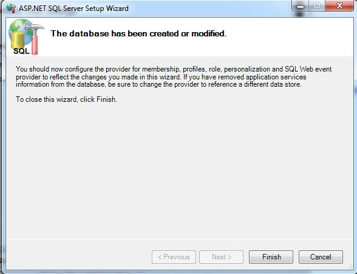](http://tpodolak.com/blog/wp-content/uploads/2011/12/silverlight-koncepcja-logowania-z-uzyciem-membershipproviders-oraz-wcf-ria-cz-1/wizzard4.jpg)

Mając gotową bazę danych możemy przystąpić do właściwego kodowania. Zacznijmy od stworzenia nowego projektu typu `Silverlight Application`

[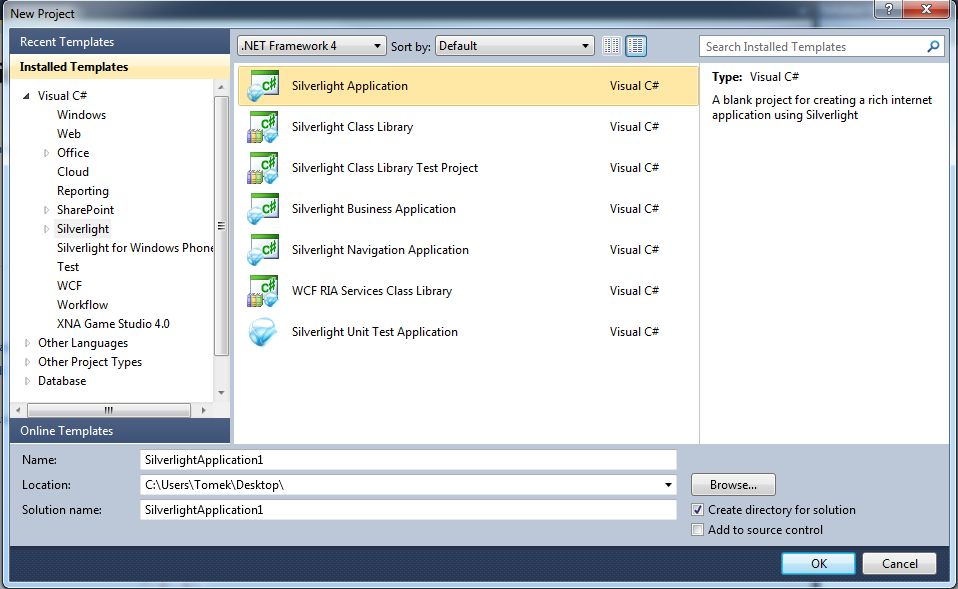](http://tpodolak.com/blog/wp-content/uploads/2011/12/silverlight-koncepcja-logowania-z-uzyciem-membershipproviders-oraz-wcf-ria-cz-1/silverlightapp.jpg)

po kliknięciu przycisku `OK` włączamy `WCF RIA Service`

[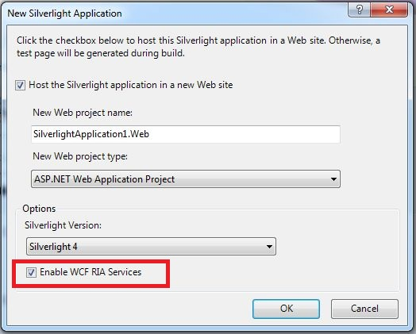](http://tpodolak.com/blog/wp-content/uploads/2011/12/silverlight-koncepcja-logowania-z-uzyciem-membershipproviders-oraz-wcf-ria-cz-1/EnableWCF.jpg)

Mając stworzony szkielet aplikacji możemy zabrać się za napisanie własnego `AuthenticationService`. Do projektu webowego (`nazwaprojektu.Web`) dodajmy nowy element typu `Domain Service`.
`PPM` na projekt, następnie `Add new item`, w oknie które się otworzy wybieramy `Domain Service`.
Nadajemu mu nazwę `CustomAuthenticationService.cs`

[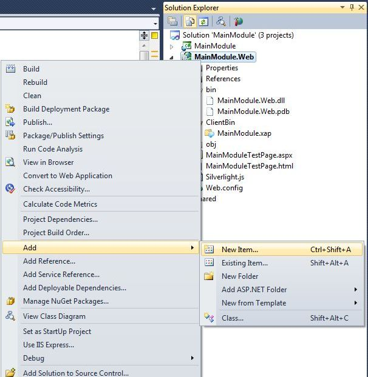](http://tpodolak.com/blog/wp-content/uploads/2011/12/silverlight-koncepcja-logowania-z-uzyciem-membershipproviders-oraz-wcf-ria-cz-1/AddItemSmall.jpg)

[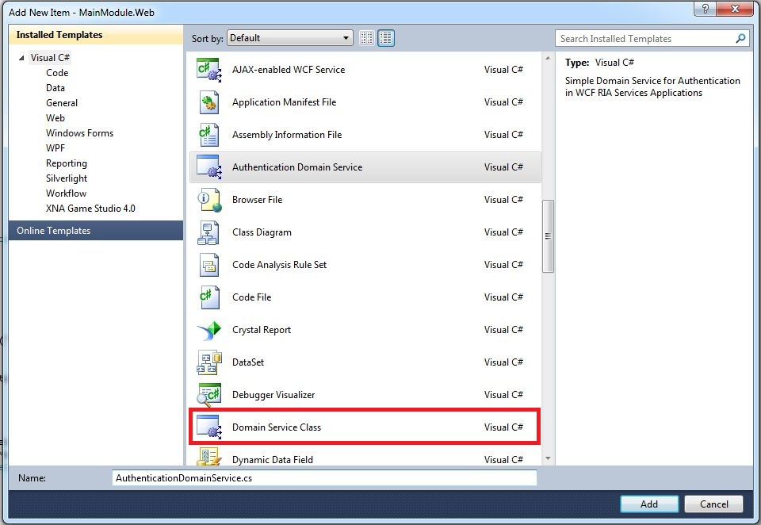](http://tpodolak.com/blog/wp-content/uploads/2011/12/silverlight-koncepcja-logowania-z-uzyciem-membershipproviders-oraz-wcf-ria-cz-1/DomainServiceClass.jpg)

Nasza właśnie dodana klasa powinna wyglądać mniej więcej w taki sposób

```csharp
namespace MainModule.Web
{
    using System;
    using System.Collections.Generic;
    using System.ComponentModel;
    using System.ComponentModel.DataAnnotations;
    using System.Linq;
    using System.ServiceModel.DomainServices.Hosting;
    using System.ServiceModel.DomainServices.Server;

    // TODO: Create methods containing your application logic.
    [EnableClientAccess()]
    public class CustomAuthenticationService: DomainService
    {
    }
}
```

W następnym kroku zaimplementujmy w klasie `CustomAuthenticationService` interfejs `IAuthentication where T: IUser`.
Interfejs ten wygląda w następujący sposób:

```csharp
public interface IAuthentication<T> where T: IUser
{
    T GetUser();
    T Login(string userName, string password, bool isPersistent, string customData);
    T Logout();
    void UpdateUser(UserDTO user);
}
```

Widzimy zatem, że zanim go zaimplementujemy musimy posiadać obiekt implementujący inny interfejs - `IUser`.
Przystąpmy zatem do stworzenia naszej klasy modelującej użytkownika - nazwijmy ją `UserDTO`.
Stwórzmy nowy projekt typu `Class library`.
W projekcie tym stwórzmy klasę `UserDTO`, która będzie dziedziczyła po klasie `UserBase` znajdującej się w przestrzeni nazw `System.ServiceModel.DomainServices.Server.ApplicationServices`

```csharp
public class UserDTO : UserBase
{
    public string Email { get; set; }
    public string DisplayName { get; set; }
}
```

Mając gotową klasę reprezentującą użytkownika zaimplementujmy w końcu w klasie `CustomAuthenticationService` interfejs `IAuthentication`.
Po implementacji interfejsu nasz serwis wygląda w następujący sposób:

```csharp
[EnableClientAccess()]
public class CustomAuthenticationService: DomainService, IAuthentication
{
    public UserDTO GetUser()
    {
        throw new NotImplementedException();
    }
    
    public UserDTO Login(string userName, string password, bool isPersistent, string customData)
    {
        throw new NotImplementedException();
    }
    
    public UserDTO Logout()
    {
        throw new NotImplementedException();
    }
    
    public void UpdateUser(UserDTO user)
    {
        throw new NotImplementedException();
    }
}
```

Pozostaje nam "tylko" zaimplementować odpowiednie metody. Funkcja która nas najbardziej interesuje to oczywiście funkcja logowania.
Przy jej implementacji posłuży się mechanizmem znanym z `ASP` mianowicie z `MembershipProviders`.
Klasa `MembershipProvider` jest to abstrakcyjna klasa posiadająca szereg funkcji mającej na celu walidowanie poprawnego użytkownika, rejestrację itp.
Stwórzmy zatem własną klasę providera dziedziczącą po klasie `MembershipProvicer`. `.NET` dostarcza nam domyślny provider, którym jest `SqlMembershipProvider`, jest on napisany w taki sposób, aby mógł porozumiewać się z bazą, którą stworzyliśmy na początku.
Aby wykorzystać wspomnianego wcześniej providera musimy odpowiednio zmodyfikować plik `Web.config`. Po pierwsze dodajemy do niego `ConnectionString` do naszej bazy danych, w moim przypadku będzie to wyglądało w następujący sposób
```xml
<connectionStrings>
    <add name="aspnetdbConnectionString" connectionString="Data Source=TOMEKKOMPUTERSQLEXPRESSRC2;Initial Catalog=aspnetdb;Integrated Security=True"
      providerName="System.Data.SqlClient" />
</connectionStrings>
```
Następnie musimy "pokazać" naszej aplikacji, że będziemy używać `FormsAuthentication` oraz `MembershipProvider-ow`.
Dorzućmy zatem do config następujące rzeczy:(w sekcji `system.web`)
```xml
<authentication mode="Forms" />
```
następnie dorzucamy do kolekcji providerów `SqlMembershipProvider`
```xml
<membership
            defaultProvider="PremiumHandsMembershipProvider"
            userIsOnlineTimeWindow="20">
      <providers>
        <clear/>
        <add name="PremiumHandsMembershipProvider"
             connectionStringName="aspnetdbConnectionString"
            type="System.Web.Security.SqlMembershipProvider"
            enablePasswordRetrieval="false"
            enablePasswordReset="false"
            requiresQuestionAndAnswer="true"
            passwordFormat="Hashed"
            applicationName="/" />
      </providers>
</membership>
```

We wpisach tych dorzuciliśmy możliwość autentykacji poprzez providery, ustawiliśmy `SqlMembershipProvider` jako domyślny provider, oraz dorzuciliśmy go do listy wszystkich providerów.
W celu sprawdzenia czy nasza konfiguracja jest poprawna możemy posłużyć się mechanizmem dostarczonym nam przez `Visual Studio`.
Klikamy `Projekt`, a następnie `ASP.NET Configuration`

[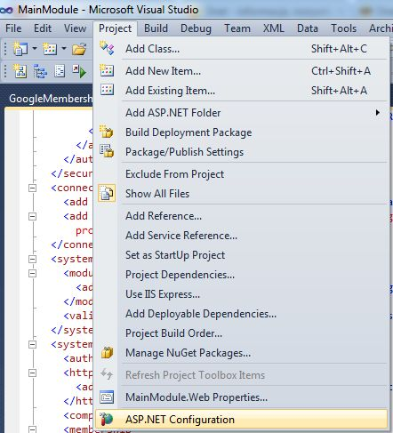](http://tpodolak.com/blog/wp-content/uploads/2011/12/silverlight-koncepcja-logowania-z-uzyciem-membershipproviders-oraz-wcf-ria-cz-1/ASPConfiguration.jpg)

Zostaniemy przeniesieni do domyślnej przeglądarki internetowej, a naszym oczom ukaże się następująca strona.

[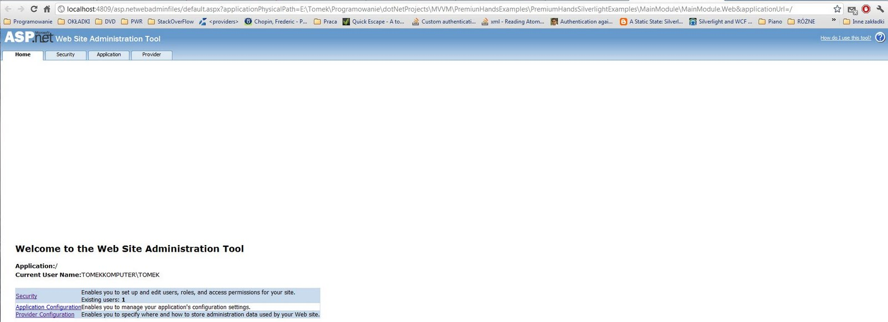](http://tpodolak.com/blog/wp-content/uploads/2011/12/silverlight-koncepcja-logowania-z-uzyciem-membershipproviders-oraz-wcf-ria-cz-1/AdminTool.jpg)

Z poziomu tej stronki możemy dodawać użytkowników, przydzielać im role itp, dzięki czemu możemy szybko sprawdzić czy podstawowe funkcje naszego providera działają, oraz czy nasza konfiguracja została przeprowadzona prawidłowo.
Wracając natomiast do naszego systemu logowania, pozostało nam jedynie odpowiednio zmodyfikować funkcję odpowiedzialną za logowanie.
Robimy to w następujący sposób:

```csharp
protected  UserDTO ValidateCredentials(string name, string password, string customData, out string userData)
{
    UserDTO user = null;
    userData = null;
    
    if (Membership.Provider.ValidateUser(name, password))
    {
        userData = name;
        user =  new UserDTO {DisplayName = name,Name = name,Email = name};
    }
    
    if (user != null) userData = name;
    
    return user;
}

public UserDTO Login(string userName, string password, bool isPersistent, string customData)
{
    string userData;
    UserDTO user = ValidateCredentials(userName, password, customData, out userData);
    
    if (user != null)
    {
        FormsAuthenticationTicket ticket = new FormsAuthenticationTicket(/* version */ 1, userName,
                                                   DateTime.Now, DateTime.Now.AddMinutes(30),
                                                   isPersistent,
                                                   userData,
                                                   FormsAuthentication.FormsCookiePath);
                                                   
        string encryptedTicket = FormsAuthentication.Encrypt(ticket);
        HttpCookie authCookie = new HttpCookie(FormsAuthentication.FormsCookieName, encryptedTicket);
        HttpContextBase httpContext = (HttpContextBase)ServiceContext.GetService(typeof(HttpContextBase));
        httpContext.Response.Cookies.Add(authCookie);
    }
    else
    {
        HttpContextBase httpContext = (HttpContextBase)ServiceContext.GetService(typeof(HttpContextBase));
        httpContext.AddError(new FormsAuthenticationLogonException("Nieprawidłowy login lub hasło"));
    }
    return user;
}
```

W funkcji `ValidateCredentials` odbywa się sprawdzanie czy użytkownik podał właściwe hasło oraz login.
Do walidacji wykorzystujemy dodany wcześniej `SqlMembershipProvider` - właściwość `Membership.Provider` zawsze zwraca obiekt domyślnie zdefiniowanego providera.
W przypadku gdy walidacja się powiedzie tworzymy obiekt użytkownika, a następnie tworzymy i szyfrujemy `FormsAuthenticationTicket` oraz tworzymy ciasteczko (`cookie`), które przesyłamy w responsie wysyłanym przez serwer do klienta.
Mechanizm logowania jest już prawie gotowy. Musimy jedynie zaimplementować jeszcze pozostałe funkcje interfejsu `IAuthentication`.
Nie ma raczej w nich nic trudnego

```csharp
public UserDTO Logout()
{
    FormsAuthentication.SignOut();
    return null;
}

public UserDTO GetUser()
{
    IPrincipal currentUser = ServiceContext.User;
    
    if ((currentUser != null) && currentUser.Identity.IsAuthenticated)
    {
        FormsIdentity userIdentity = currentUser.Identity as FormsIdentity;
        if (userIdentity != null)
        {
            FormsAuthenticationTicket ticket = userIdentity.Ticket;
            if (ticket != null && !ticket.Expired)
            {
                 return new UserDTO { DisplayName = currentUser.Identity.Name, Name = currentUser.Identity.Name };
            }
        }
    }
    
    return null;
}
```

Funkcja `Logout` po prostu wywołuje funkcję `SingOut` z klasy `FormsAuthentication`. Natomiast funkcja `GetUser` zwraca zalogowanego użytkownika.
W funkcji tej najpierw sprawdzamy czy użytkownik jest zalogowany (do tego celu używamy zmiennej `IsAuthenticated`), a następnie sprawdzamy czy przypadkiem jego sesja nie wygasła.
W przypadku gdy wszystko jest `OK` zwracamy obiekt typu `UserDTO`, w przeciwnym razie zwracamy `null`.

Podsumowując, udało nam się stworzyć mechanizm logowania. Jak na razie gotowa jest strona serwera. W następnym wpisie pokażę w jaki sposób należy wywołać logowanie od strony klienta. Przedstawię również pomysł w jaki sposób zmieniać providerów przez które użytkownik ma się logować. Może to być przydatne jeżeli chcielibyśmy logować się np. poprzez inne serwisy jak `Google`, `Facebook` itp.
