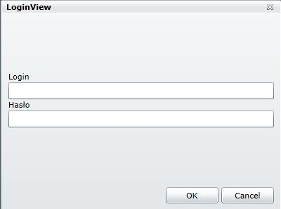
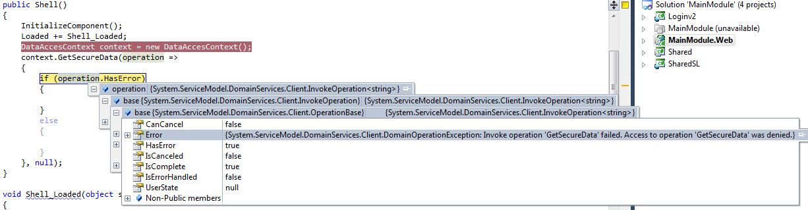

W poprzednim wpisie przedstawiłem w jaki sposób zaimplementować mechanizm logowania po stronie serwera. Wykorzystałem do tego celu WCF RIA oraz znane z ASP MembershipProvidery. Tym razem przedstawię jak wymusić logowanie po stronie klienta, oraz w jaki sposób można dynamicznie zmieniać providerów, którzy walidują usera. Poprzednim razem stworzyliśmy już szkielet aplikacji, zatem mamy projekt klienta oraz projekt serwera. Zacznijmy od "włączenia" FormsAuthentication po stronie klienta. W pliku App.xaml.cs , w konstruktorze dorzućmy następujące linijki

```csharp
WebContext context = new WebContext {Authentication = new FormsAuthentication()};
ApplicationLifetimeObjects.Add(context);

```

Następnie zanim pokażemy treść naszej strony, musimy sprawdzić czy użytkownik jest zalogowany.Jeżeli nie, należy pokazać okno logowania. Możemy to zrobić w następujący sposób.

```csharp
if (!WebContext.Current.User.IsAuthenticated)
{
    ModalDialogService.ShowDialog(_unityContainer.Resolve>(),
                                  val => { InitializeView();GetSecureData(); });
}
else
{
    InitializeView();
    GetSecureData();
}

```

WebContext jest to klasa generowana automatycznie przy buildowaniu solucji.Jej kod powinniśmy odnaleźć w katalogu Generated\_Code po stronie klienta. Klasa ta posiada właściwość Current, która zwraca obecny context zarejestrowany w kolekcji ApplicationLifetimeObjects. Okno logowania zostało zaimplementowane jako ChildWindow. Jego kod może wyglądać w następujący sposób

Kontrolka logowania jest bardzo prosta, składa się ona z dwóch labelek, textboxa oraz passwordBoxa. Powyższy kod powinien wygenerować mniej więcej takie oto okno [](http://tpodolak.com/blog/wp-content/uploads/2011/12/silverlight-koncepcja-logowania-z-uzyciem-membershipproviders-oraz-wcf-ria-cz-2/login.jpg) Mechanizm wywoływania operacji logowania znajduje się natomiast w ViewModelu kontrolki logowania. Po naciśnięciu przycisku OK, dzięki zastosowaniu DelegateCommand uruchamiany następującą funkcję

```csharp
private void OkCommandExecuted()
{
    if (Validate())
    {
        PerfomrLoginOperation();
    }
}

```

W funkcji tej najpierw sprawdzamy, czy użytkownik podał dane do logowania, a następnie wywołujemy kolejną funkcję PerfomrLoginOperation. Przedstawia się w następujący sposób

```csharp
private void PerfomrLoginOperation()
{      
    WebContext.Current.Authentication.Login(new LoginParameters(Login, Password, false,string.Empty, CompleteLoginOperation, Guid);
}

```

Widzimy zatem, że wywołujemy funkcję logowania z serwisu WCF, w parametrach natomiast podajemy login oraz hasło przechwycone z okna. Dodatkowo w parametrze podajemy delegata do funkcji, która zostanie wykonana po zakończeniu operacji logowania.

```csharp
private void CompleteLoginOperation(LoginOperation loginOperation)
{
    if (loginOperation.Error == null)
        OnOperationCompleted();
    else
    {
        if (loginOperation.Error is FormsAuthenticationLogonException)
            MessageBoxService.ShowMessageBox("Nieprawidłowy login lub hasło", MessageBoxButton.OK);
        else
            MessageBoxService.ShowMessageBox("Wystąpił problem podczas operacji logowania",
                                             MessageBoxButton.OK);
    }
}

```

Jeżeli odpowiedź z serwisu WCF zawiera błędy to wiemy, że operacja logowania się nie powiodła. Wyświetlamy zatem stosowny komunikat. Jeżeli natomiast wszystko jest Ok, pole loginOperation.Error będzie miało wartość null. Możemy wtedy pokazać naszą wiadomość dostępną jedynie dla zalogowanych użytkowników. Mamy zatem ochronę przeciwko nieautoryzowanemu dostępowi do klienta. Jednak co w przypadku gdy nasz klient musi w calach np. zassania danych pobrać je przy wykorzystaniu jakiegoś WebServicu. Na ogól wystawiany jest wtedy drugi WebService do pobierania danych z jakiejś bazy. Do takiego WebServicu w teorii może dostać się każdy - my natomiast chcemy żeby dane można było pobierać jedynie po zalogowaniu się do aplikacji. Na szczęście nasz dodatkowy WebServise można w prosty sposób zabezpieczyć przed dostępem osób trzecich. Stwórzmy zatem sobie nowy WebService służący do pobierania danych. Do projektu Webowego dodajmy nową klasę typu "Domain Service" oraz dopiszmy do nie jedną metodę symulującą pobieranie danych.

```csharp
[EnableClientAccess()]
public class DataAccesService : DomainService
{
    public string GetSecureData()
    {
        return "very secure data";
    }
}

```

Do takiego Servicu może dostać się każdy. Jeżeli natomiast naszą klasę udekorujemy atrybutem \[RequiresAuthentication()\] tylko użytkownicy, którzy pomyślnie przeszli autentykację przez nasz CustomAuthenticationService będą w stanie pobrać dane. W przeciwnym wypadku zostanie rzucony wyjątek. [](http://tpodolak.com/blog/wp-content/uploads/2011/12/silverlight-koncepcja-logowania-z-uzyciem-membershipproviders-oraz-wcf-ria-cz-2/debugger.jpg)

Zastanówmy się teraz w jaki sposób można byłoby logować się do naszej aplikacji np. przy pomocy konta Google. Zacznijmy od tego, że musimy stworzyć własny MembershipProvider. W tym celu dodajmy do projektu Webowego nową klasę "GoogleMembershipProvider", która będzie rozszerzać klasę MembershipProvider. Klasa MembershipProvider jest klasą abstrakcyjną zatem musimy zoverridować wszystkie jej funkcje (nie musimy wrzucać tam logiki, narazie po prostu wpiszmy tam cokolwiek aby przeszła kompilacja). Mając stworzony szkielet providera musimy go dorzucić do listy wszystkich providerów (tak jak to zrobiliśmy z SqlMembershipProvider-em). Modyfikujemy zatem sekcję podsekcję providers z sekcji membership na następującą.

Mając w kolekcji wszystkie nasze providery pozostaje nam się zastanowić, w jaki sposób raz używać GoogleMembershpProvidera, a innym razem SqlMembershipProvidera. Ja zrobiłem to w następujący sposób. Najpierw utworzyłem enuma, w którym przechowuje "nazwy" moich providerów

```csharp
public enum AccountType
{
    PremiumHandsMembershipProvider,
    GoogleMembershipProvider,
    Facebook
}

```

Następnie wykorzystałem parametr customData interfejsu IAuthentication. Po stronie klienta w funkcji logowania po prostu przesyłam typ konta do którego się loguję. Wygląda to w ten sposób:

```csharp
 WebContext.Current.Authentication.Login(new LoginParameters(Login, Password, false,AccountType.GoogleMembershipProvider.ToString("g")), CompleteLoginOperation, Guid);

```

Następnie po stronie serwera wybieram tego providera, przez którego loguje się użytkownik.

```csharp
protected UserDTO ValidateCredentials(string name, string password, string customData, out string userData)
{
    UserDTO user = null;
    userData = null;
    if (Membership.Providers[customData].ValidateUser(name, password))
    //if (Membership.Provider.ValidateUser(name, password))
    {
        userData = name;
        user = new UserDTO { DisplayName = name, Name = name, Email = name};
    }
    if (user != null) userData = name;
    return user;
}

```

Zauważmy, że linijka

```csharp
if (Membership.Provider.ValidateUser(name, password))

```

została zastąpiona przez

```csharp
if (Membership.Providers[customData].ValidateUser(name, password))

```

zatem teraz mamy wpływ na to, którego MembershipProvidera użyjemy. Jeżeli chodzi o samo sprawdzenie czy dany użytkownik podał poprawne dane do konta google, to sprawa jest trochę kłopotliwa(tak mi się wydaje :D). Nie udało mi się użyć biblioteki dotNetOpenAuth, gdyż z tego co widzę logowanie poprzez tą bibliotekę wymaga przekierowania na stronę Googla. Niestety taka operacja nie jest dozwolona w Silverlighcie (Silverlight nie wspiera cross-domain policy). Ponadto wykorzystanie tej biblioteki po stronie serwera również nie przyniosło oczekiwanych rezultatów. Ostatecznie zatem skorzystałem z opisu znajdującego się na stronie Googla http://code.google.com/intl/pl-PL/apis/accounts/docs/AuthForInstalledApps.html#Using. Czyli po prostu spreparowałem odpowiedni HTTPS Post Request. Funkcja ValidateUser z GoogleMembershipProvidera wygląda zatem następująco

```csharp
public override bool ValidateUser(string username, string password)
{
    string requestUrl = string.Format("https://www.google.com/accounts/ClientLogin?service=mail&Email={0}&Passwd={1}", username, password);
    byte[] data = Encoding.ASCII.GetBytes(requestUrl);
    HttpWebRequest req = (HttpWebRequest)WebRequest.Create(requestUrl);
    req.ProtocolVersion = HttpVersion.Version10;
    req.ContentLength = data.Length;
    req.ContentType = "application/x-www-form-urlencoded";
    req.Method = "POST";
    var stream = req.GetRequestStream();
    stream.Write(data,0,data.Length);
    stream.Close();
    
    try
    {
        HttpWebResponse response = (HttpWebResponse)req.GetResponse();
        return response.StatusCode == HttpStatusCode.OK;
    }
    catch (WebException e)
    {
        return false;
    }
}

```

Ciężko mi jednak stwierdzić czy takie logowanie jest bezpieczne. Co prawda nie udało mi się wyłapać nic konkretnego poprzez Wiresharka lub Fiddlera, jednakże ekspertem od zabezpieczeń niestety nie jestem. W następnym wpisie postaram się króciutko przedstawić bibliotekę Microsoft Enterprise Library, a właściwie jeden z jej bloków - Security Block.Wykorzystam go do zezwalania użytkownikom do dostępu do funkcji serwisu, w zależności od ich roli w systemie.
