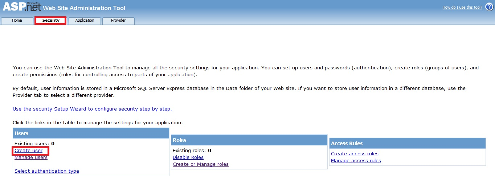
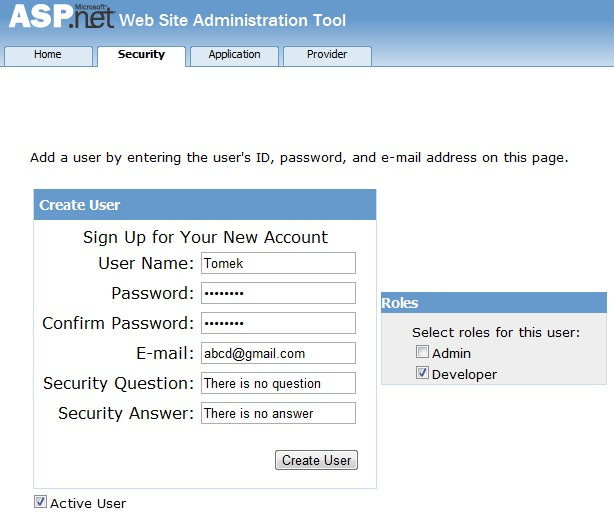
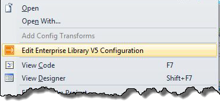
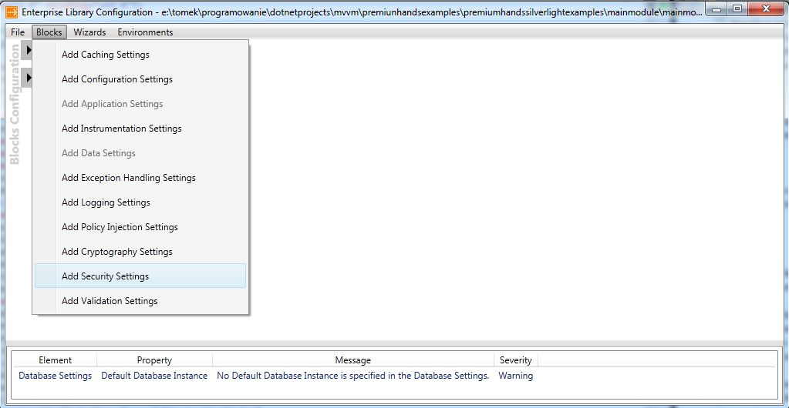
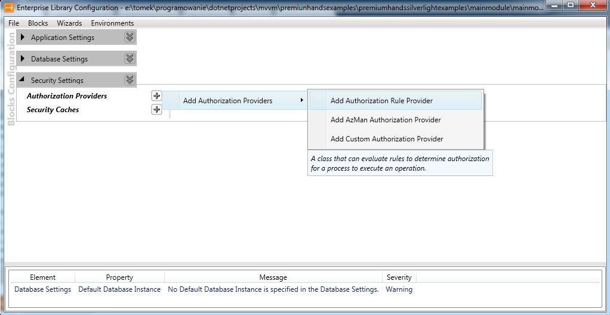
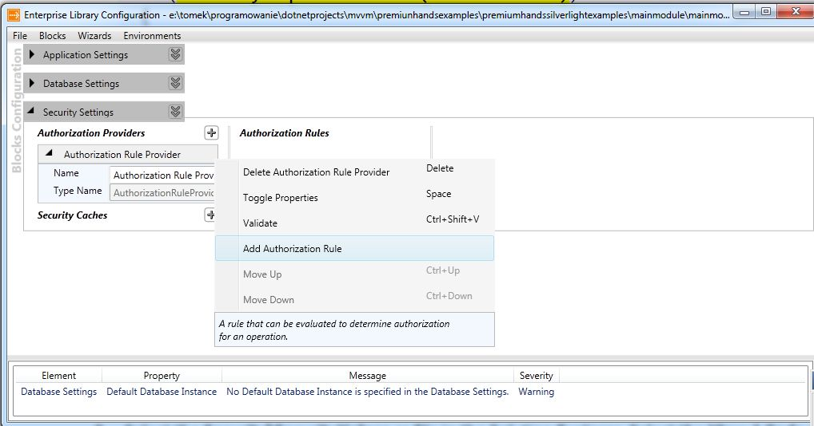
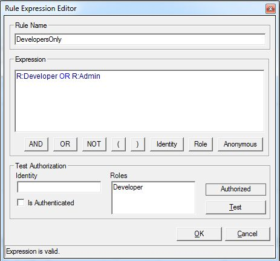

W tym wpisie postaram się krótko przedstawić blok bezpieczeństwa (Security Block) z biblioteki Microsoft Enterprise Library. Biblioteki tej użyjemy do sprawdzania rol i reguł dostępu do funkcji serwisu WCF. Najpierw oczywiście musimy pobrać bibliotekę Microsoft Enterprise Library, znajduje się ona pod tym adresem. http://www.microsoft.com/download/en/details.aspx?id=15104. Biblioteka ta jest również dostępna z poziomu NuGeta, jednakże instalacja poprzez ten plugin dorzuca do projektu tylko dll-ki. W pierwszym przypadku natomiast oprócz dll-ek zostaje również zainstalowane bardzo wygodne narzędzie ułatwiające konfigurację różnych modułów biblioteki. Mając zainstalowane wszystkie potrzebne komponenty możemy przystąpić do działania. Zacznijmy od zmodyfikowania pliku Web.config, tak aby umożliwić naszemu systemowi korzystanie z ról - a tak właściwie aby umożliwić edycję, tworzenie, usuwanie oraz przypisywanie ról użytkownikom.W sekcji

dorzucamy następujące wpisy

W tym momencie dodaliśmy do kolekcji menadżerów ról (Role managers) nowy provider -nie jest to jednak MembershipProvider lecz RoleProvider, a dokładniej dostarczony przez framework SqlRoleProvider. Provider ten jest przystosowany do działania na bazie danych o takiej strukturze, jak baza, którą stworzyliśmy w części pierwszej. Po konfiguracji providera przyszedł czas na dodanie przykładowego użytkownika oraz przypisanie mu jakiejś roli. Wybieramy opcję "ASP.NET Configuration" z menu "Project", następnie na stronie na którą zostaniemy przeniesieni, przechodzimy na zakładkę "Security" [](http://tpodolak.com/blog/wp-content/uploads/2012/01/silverlight-koncepcja-logowania-z-uzyciem-membershipproviders-oraz-wcf-ria-cz-3-microsoft-enterprise-library-security-block/Configuration.jpg) [](http://tpodolak.com/blog/wp-content/uploads/2012/01/silverlight-koncepcja-logowania-z-uzyciem-membershipproviders-oraz-wcf-ria-cz-3-microsoft-enterprise-library-security-block/admintool.jpg) W kolejnym kroku dodajemy role - klikamy w "Create or Manage roles",a w stronie, która się otworzy wpisujemy nazwę roli np."Developer". Postępując w podobny sposób dodajmy jeszcze role "Admin". Następnie tworzymy użytkownika - klikamy w "Create user", a następnie wypełniamy pola podobnie jak na załączonym poniżej screenie [](http://tpodolak.com/blog/wp-content/uploads/2012/01/silverlight-koncepcja-logowania-z-uzyciem-membershipproviders-oraz-wcf-ria-cz-3-microsoft-enterprise-library-security-block/admintoolpass.jpg) Mając stworzonego przykładowego użytkownika możemy przystąpić do ograniczenia dostępu do niektórych funkcji naszego serwisu. W tym celu, po pierwsze modyfikujemy funkcję logowania.

```csharp
 protected UserDTO ValidateCredentials(string name, string password, string customData, out string userData)
 {
     UserDTO user = null;
     userData = null;
     if (Membership.Providers[customData].ValidateUser(name, password))
     {
         userData = name;
         user = new UserDTO { DisplayName = name, Name = name, Email = name, Roles = Roles.GetRolesForUser(name) };
     }
     
     if (user != null) userData = name;
     
     return user;
 }

```

Jak widać, przy tworzeniu użytkownika dodatkowo pobieramy z bazy danych jego wszystkie role. Statyczna funkcja GetRolesForUser pobiera role przy pomocy domyślnego RoleProvidera. Dodajmy teraz do naszego DataAccesService-u dwie funkcje.

- OnlyAdminCanDownloadThis
- DevelopersCanDownloadThis

Dane pobierane przez pierwszą funkcję mogą być odczytane jedynie przez użytkowników, którzy są administratorami systemu. Natomiast dane z funkcji drugiej mogą być odczytane przez developerów (oczywiście admin również może pobrać te dane). Zastanówmy się teraz w jaki sposób sprawdzić czy dany użytkownik ma dostęp do danych. Możemy sprawdzać role ręcznie (niewygodne), użyć znanego z ASP.NET atrybutu PrincipalPermission (mało elastyczne) lub skorzystać z Microsoft Enterprise Library (całkiem dobra opcja). Security Block z biblioteki Microsoft Enterprise Library ma tę przewagę nad wcześniej wspomnianymi rozwiązaniami, że wprowadza on tzw. reguły(Rules). Dzięki nim możemy w łatwy sposób zdefiniować warunki jakie musi spełnić użytkownik aby zezwolić mu na dostęp w jakieś miejsce systemu. Skonfigurujmy zatem prostą regułę - regułą ta pozwoli na dostęp do danych jedynie tym użytkownikom,którzy mają prawo administratora. Klikamy PPM na plik Web.config i wybieramy z niego opcję "Edit Enterprise Library V5 Configuration" - opcja ta została dodana po instalacji biblioteki Microsoft Enterprise Library. [](http://tpodolak.com/blog/wp-content/uploads/2012/01/silverlight-koncepcja-logowania-z-uzyciem-membershipproviders-oraz-wcf-ria-cz-3-microsoft-enterprise-library-security-block/editenterprise.png) W oknie które się otworzy wybieramy "Add Security Settings" z menu "Blocks". [](http://tpodolak.com/blog/wp-content/uploads/2012/01/silverlight-koncepcja-logowania-z-uzyciem-membershipproviders-oraz-wcf-ria-cz-3-microsoft-enterprise-library-security-block/addsecurity.jpg) W głównym oknie aplikacji pojawi się nowy element - "Security Settings". Klikamy na znak "+" obok "Authorization Providers", następnie z rozwiniętego menu przechodzimy na "Add Authorization Providers" i ostatecznie klikamy na "Add Authorization Rule Provider" [](http://tpodolak.com/blog/wp-content/uploads/2012/01/silverlight-koncepcja-logowania-z-uzyciem-membershipproviders-oraz-wcf-ria-cz-3-microsoft-enterprise-library-security-block/authorization.jpg) W ten sposób dodaliśmy domyślny "Rule Provider", teraz możemy stworzyć reguły dostępu do naszej aplikacji. W tym celu musimy kliknąć w lewy dolny róg pola "Authorization Rule Provider", a następnie z menu, które się pojawi wybrać "Add Authorization Rule" [](http://tpodolak.com/blog/wp-content/uploads/2012/01/silverlight-koncepcja-logowania-z-uzyciem-membershipproviders-oraz-wcf-ria-cz-3-microsoft-enterprise-library-security-block/rule.jpg) W oknie aplikacji pojawi się nowy element - "Authorization Rule", nadajmy mu nazwę "DevelopersOnly", a następnie zdefiniujmy tzw. "Rule expression". "Rule expression" jest warunek jaki musi zostać spełniony, aby użytkownik uzyskał dostęp do części aplikacji chronionej przez regułę "DevelopersOnly". Wyrażenie to możemy wpisać ręcznie, lub poprzez prosty kreator - dostępny jest on pod przyciskiem "...". Stwórzmy więc regułę, która pozwoli tylko użytkownikom typu Developer oraz oczywiście adminowi mieć dostęp do jakieś części aplikacji. Otwórzmy zatem "Rule Expression Editor" (dostępny on jest pod przyciskiem "..."), kliknijmy na przycisk "Role", wpiszmy "Developer", następnie kliknijmy w przycisk "OR", wpiszmy "Admin".Możemy również wpisać następujące wyrażenie ręcznie

```text
R:Developer OR R:Admin

```

[](http://tpodolak.com/blog/wp-content/uploads/2012/01/silverlight-koncepcja-logowania-z-uzyciem-membershipproviders-oraz-wcf-ria-cz-3-microsoft-enterprise-library-security-block/ruleeditor.jpg) Stworzyliśmy zatem regułę pozwalającą na dostęp użytkownikom typu Developer (R:Developer) oraz administratorom (R:Admin). Aby zatwierdzić zmiany wybieramy "Save" z menu "File". W pliku Web.config pojawiły się teraz następujące linijki

Do powyżej konfiguracji musimy jeszcze dorzucić wybór domyślnego providera - dodajmy zatem następujący wpis do linii

```xml
defaultAuthorizationInstance="Authorization Rule Provider"

```

Wykorzystajmy teraz stworzoną właśnie regułę aby zabezpieczyć wspomnianą wcześniej funkcję "DevelopersCanDownloadThis". Po pierwsze stwórzmy pomocniczą klasę pomocniczą SecurityHelper i dodajmy do niej metodę IsAuthorized, która wygląda w następujący sposób:

```csharp
public static bool IsAuthorized(this IPrincipal principal, string rule)
{
    IAuthorizationProvider ruleProvider = EnterpriseLibraryContainer.Current.GetInstance();
    return ruleProvider.Authorize(principal, rule);
}

```

Następnie w funkcji "DevelopersCanDownloadThis" musimy sprawdzić czy użytkownik może wykorzystać tą funkcję - w tym celu wykorzystujemy funkcję IsAuthorized. Może wyglądać to w następujący sposób

```csharp
public string DevelopersCanDownloadThis()
{
    if (ServiceContext.User.IsAuthorized("DevelopersOnly"))
        return "very secure data";
    throw new PermisionDeniedException("Brak dostępu");
}

```

Logując się na użytkownika, który posiada prawo/rolę "Developer" będziemy mogli pobrać dane wykorzystując funkcję "DevelopersCanDownloadThis" w przeciwnym razie do klienta zostanie rzucony wyjątek z odpowiednim komunikatem. Niestety Security Block nie został jeszcze przeniesiony na platformę Silverlightową, zatem przedstawionych powyżej sposobów sprawdzania praw dostępu(np. do jakiejś funkcjonalności) nie możemy zastosować po stronie klienta.
