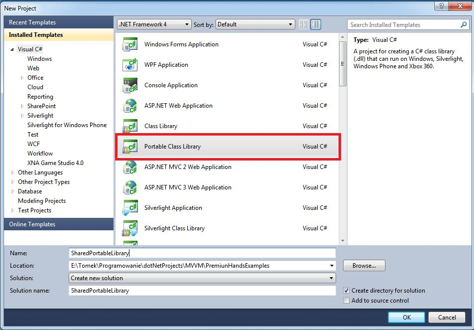
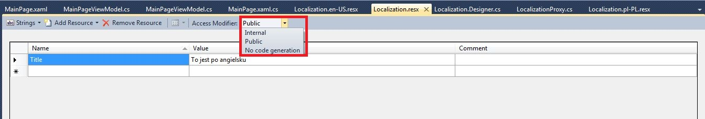
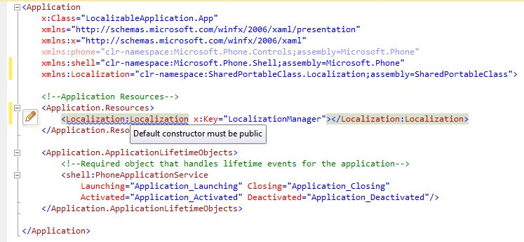
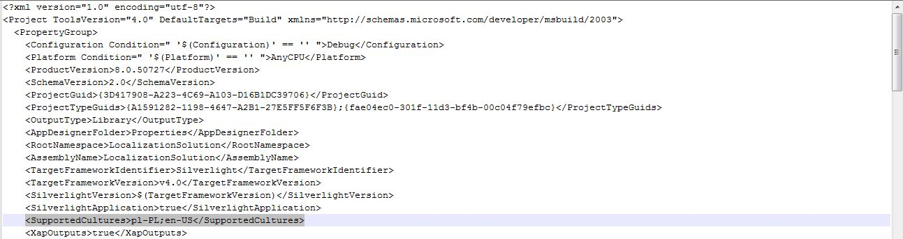
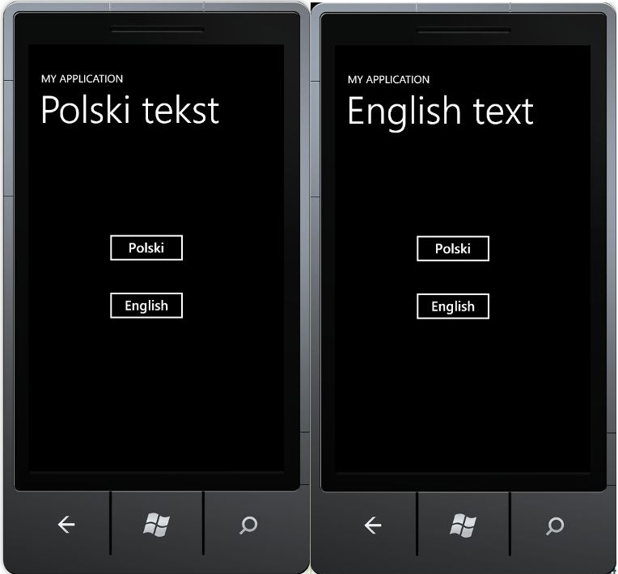

Witam W dzisiejszym wpisie postaram się przedstawić w jaki sposób lokalizować treści aplikacji typu Silverlight oraz WindowsPhone. Założenie jest takie, że chcemy zbudować multiplatformową aplikację, która będzie obsługiwała platformę Silverlight oraz Windows Phone. Rozsądnym zatem podejściem jest trzymanie wszystkich tłumaczeń w jednym miejscu - najlepiej aby mechanizm tłumaczenia był obsługiwany zarówno przez Windows Phona jak i Silverlighta. W pierwszym kroku musimy doinstalować do środowiska Visual Studio projekt typu Portable Class Library. Referencje do tego typu projektów możemy dodawać zarówno do projektów Silverlightowych, WindowsPhonowych - zatem idealnie nadaje się na przetrzymywanie w nim mechanizmu tłumaczenia aplikacji. W celu zainstalowania wyżej wspomnianego typu projektu musimy odwiedzić następującą stronę http://visualstudiogallery.msdn.microsoft.com/b0e0b5e9-e138-410b-ad10-00cb3caf4981, a następnie zassać plik instalacyjny. Mając już przygotowane środowisko, stwórzmy nową solucję i dodajmy do niej projekt typu Portable Class Library - nazwijmy go SharedPortableClasses. [](http://tpodolak.com/blog/wp-content/uploads/2012/01/lokalizowanie-aplikacji-silverlight-i-windows-phone-z-wykorzystaniem-portable-shared-library/Create.jpg) Następnie dodajmy do tego projektu nowy folder "Localization", w którym to umieścimy pliki typu \*.resx. Pierwszy plik nazywamy po prostu Localization.resx natomiast następne nazywamy według wzorca Localization..resx, gdzie: <culture> - oznacza kulturę/język komunikatów jaki dany plik będzie przechowywać Dla przykładu aby mechanizm tłumaczący obsługiwał język polski oraz angielski, powinniśmy stworzyć następującą strukturę plików

Localization.resx Localization.pl-PL.resx Localization.en-US.resx

W kolejnym kroku musimy zmienić modyfikator dostępu do naszych plików zasobów na publiczny. W tym celu klikamy podwójnie na każdy plik \*.resx i z comboboxa wybieramy public [](http://tpodolak.com/blog/wp-content/uploads/2012/01/lokalizowanie-aplikacji-silverlight-i-windows-phone-z-wykorzystaniem-portable-shared-library/Public.jpg) Mając przygotowane pliki zasobów, możemy teraz umieszczać w nich tłumaczone elementy interfejsów oraz komunikatów. Robimy to w następujący sposób:

- W pliku Localization.resx wypełniamy pole w kolumnie "Name" jakąś wartością(kluczem), która identyfikuje nasz tekst (w moim przypadku będzie to "Title")
- W plikach Localization.pl-PL.resx oraz Localization.en-US powtarzamy tę czynność (uzupełniamy pola w kolumnie "Name" tymi samymi wartościami co w pliku Localization.resx) oraz wypełniamy pole w kolumnie "Value" tekstem w odpowiednim języku.

Mając już prawie gotowy mechanizm tłumaczący stwórzmy teraz projekt typu "Silverlight Application" oraz dodajmy mu referencję do projektu SharedPortableClasses. Dodajmy teraz do zasobów naszej aplikacji obiekt typu Localization

Niestety z powodu tego, że klasa Localization nie posiada publicznego konstruktora bezparametrowego, nie uda nam się odpalić naszej aplikacji. Resharper od razu wyrzuci ostrzeżenie następującej treści [](http://tpodolak.com/blog/wp-content/uploads/2012/01/lokalizowanie-aplikacji-silverlight-i-windows-phone-z-wykorzystaniem-portable-shared-library/ConstructorWarning.jpg) Zatem w jaki sposób wykorzystać nasz mechanizm tłumaczący ? Rozwiązania są dwa

- Zmodyfikować plik Localization.Designer.cs i ustawić konstruktor domyślny na publiczny. Takie rozwiązanie jednak nie jest eleganckie, gdyż za każdym razem gdy dodamy nowy wpis do pliku Localization.resx kod w pliku Localization.Designer.cs zostanie przegenerowany.
- Drugim sposobem jest stworzenie klasy pośredniczącej, która będzie w sobie trzymała instancję obiektu Localization, oraz dodanie obiektu tej klasy pośredniczącej do zasobów aplikacji

Jako, że podejście drugi jest wg mnie dużo lepsze to postaram się je teraz przedstawić. Do projektu SharedPortableClasses dodajmy klasę LocalizationProxy.cs.

```
public class LocalizationProxy : INotifyPropertyChanged
{
    public Localization LocalizationManager { get; private set; }

    public LocalizationProxy()
    {
        LocalizationManager = new Localization();
    }

    public void ResetResources()
    {
        OnPropertyChanged("LocalizationManager");
    }

    #region INotifyPropertyChanged region
    public event PropertyChangedEventHandler PropertyChanged;

    public void OnPropertyChanged(string propertyName)
    {
        if (PropertyChanged != null)
        {
            PropertyChanged(this, new PropertyChangedEventArgs(propertyName));
        }
    }
    #endregion
}

```

Teraz stwórzmy instancję tej klasy w zasobach aplikacji

Zanim przystąpimy do tłumaczenia samego interfejsu musimy jeszcze zmodyfikować plik projekty \*.csproj. Otwieramy nasz plik projektu w dowolnym edytorze tekstowym, a następnie w sekcji SupportedCultures dorzucamy kultury w jakich nasza aplikacja ma pracować. W moim przypadku będzie to wyglądać w następujący sposób: [](http://tpodolak.com/blog/wp-content/uploads/2012/01/lokalizowanie-aplikacji-silverlight-i-windows-phone-z-wykorzystaniem-portable-shared-library/CSProjCultures.jpg) Jak widać moja aplikacja będzie wspierała język angielski oraz język polski. Mając już wszystko gotowe przystąpmy do tworzenia interfejsu. Zmodyfikujmy plik MainPage.xaml tak aby wyglądał w następujący sposób

Widok ten jest bardzo prosty. Posada on dwa przyciski służące do zmiany aktualnego języka oraz labelkę, na której dany tekst będzie się pojawiać. Najciekawszą rzeczą w tym kodzie jest sposób wyświetlania tłumaczonego tekstu. Jak widać do właściwości Text elementu typu TextBlok nie jest przypisywana wartość stała, ale używany jest binding

```
Text="{Binding Source={StaticResource LocalizationProxy},Path=LocalizationManager.Title,Mode=TwoWay}"

```

To co wyświetli się w danym TextBloku zależne jest od tego co zwróci nam nasz mechanizm tłumaczący. Odnosimy się do niego poprzez wskazanie zasobu, który nazwaliśmy LocalizationProxy (taki klucz nadaliśmy mu w zasobach aplikacji). Następnie do konkretnego tekstu odnosimy się podając odpowiednią ścieżkę - w tym przypadku jest to LocalizationManager.Title. LocalizationManager jest to właściwość, którą stworzyliśmy w klasie LocalizationProxy, natoamist Title jest to klucz jaki wpisaliśmy w pliku zasobów Localization.resx. Przeglądając plik Localization.Designer.cs można zauważyć, że została tam wygenerowana właściwość Title.

```
public static string Title 
{
    get { return ResourceManager.GetString("Title", resourceCulture); }
}

```

Właściwość tak zwraca nam tekst w odpowiednim języku. Sam mechanizm zwracania tekstu dla wybranego przez nas języka jest już dostarczony z Frameworkiem. Tekst wyświetlany w aplikacji będzie w takim języku/kulturze jaka zostania przypisana do właściwości Thread.CurrentThread.CurrentUICulture. Możemy to w łatwy sposób sprawdzić zmieniając dynamicznie kulture wątku. Stwórzmy nową klasę i nazwijmy ją MainPageViewModel. Wygląda ona w następujący sposób

```
public class MainPageViewModel
{
    public DelegateCommand PolisLanguageCommand { get; set; }
    public DelegateCommand EnglishLanguageCommand { get; set; }
    public MainPageViewModel()
    {
        PolisLanguageCommand = new DelegateCommand(() =>
        {
            Thread.CurrentThread.CurrentCulture = new System.Globalization.CultureInfo("pl-PL");
            Thread.CurrentThread.CurrentUICulture = new System.Globalization.CultureInfo("pl-PL");
            ResetResources();

        });

        EnglishLanguageCommand = new DelegateCommand(() =>
        {
            Thread.CurrentThread.CurrentCulture = new System.Globalization.CultureInfo("en-US");
            Thread.CurrentThread.CurrentUICulture = new System.Globalization.CultureInfo("en-US");
            ResetResources();
        });
    }

    private void ResetResources()
    {
        ((LocalizationProxy)Application.Current.Resources["LocalizationProxy"]).ResetResources();
    }
}

```

Następnie stwórzmy obiekt tej klasy i przypiszmy go do DataContext-u okna MainPage.

```
public partial class MainPage : UserControl
{
    public MainPage()
    {
        InitializeComponent();
        DataContext = new MainPageViewModel();
    }         
}

```

Dzięki wykorzystaniu komend po naciśnięciu przycisku "Polski" zostanie odpalana komenda PolishLangugeCommand, która z kolei odpali anonimową funkcję do niej przypisaną. W funkcji tej zmienimy kulturę wątku na "pl-PL". Ważnym elementem jest tutaj funkcja ResetResources(), która znajduje się w klasie LocalizationProxy. Funkcja ta informuje widok (poprzez zdarzenie NotifyPropertyChanged), że należy odświeżyć wszystkie elementy, które zostały zbindowane do właściwości LocalizationManager.

Postępując w analogiczny sposób możemy stworzyć aplikację WindowsPhone, która będzie wykorzystywałą nasz mechanizm tłumaczący. Co więcej dzięki temu, że dwie aplikacje będą korzystały z tego samego mechanizmu oraz z tych samych resourców, nie musimy podwójnie wpisywać tłumaczonych tekstów. [](http://tpodolak.com/blog/wp-content/uploads/2012/01/lokalizowanie-aplikacji-silverlight-i-windows-phone-z-wykorzystaniem-portable-shared-library/PhoneResults.jpg) Projekt można znaleźć pod tym linkiem http://www.4shared.com/rar/i9cd3EGD/LocalizationSolution.html
