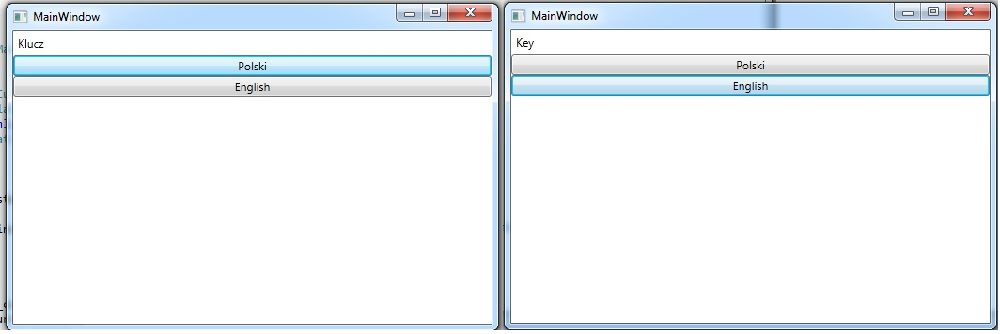

W poprzednim wpisie przedstawiłem w jaki sposób można lokalizować aplikację napisaną w `Silverlight 4` oraz `Windows Phone`, wykorzystując do tego ten sam mechanizm.
Tym razem zademonstruje w jaki sposób można nieco uprościć składnie tłumaczenia wykorzystując do tego `MarkupExtension`.
Jeżeli kiedykolwiek pisałeś coś w `Silverlighcie`, `Windows Phonie` lub `WPF-ie` istnieje duża szansa, że używałeś już `MarkupExtension`.
Do najpopularniejszych `MarkupExtensions` należą takie słowa kluczowe (używane w `XAML-u`) jak:

- `Binding`
- `StaticResource`
- `DynamicResource`
- `TemplateBinding`

Na potrzeby mechanizmu lokalizowania aplikacji `WPF` (ewentualnie `Silverlight 5`) stworzymy customowe `MarkupExtenssion`, które będzie odpowiedzialne za tłumaczenie elementów `UI` naszej aplikacji.
Zacznijmy od przygotowania plików zasobów. Podobnie jak w poprzednim wpisie utwórzmy trzy pliki:

- `Localization.resx`
- `Localization.pl-PL.resx`
- `Localization.en-US.resx`

W plikach tych będziemy przechowywać nasze tłumaczenia.
Następnie stwórzmy klasę Translator, która będzie dziedziczyła po klasie MarkupExtension.
Do klasy tej dodajmy właściwość

```csharp
public string Key { get; set; }
```

, która będzie przechowywać klucz dzięki któremu z pliku zasobów wyciągniemy tekst w odpowiednim języku.
W kolejnym kroku musimy przeciążyć funkcję

```csharp
public abstract object ProvideValue(IServiceProvider serviceProvider)
```

tak aby dostarczyła nam ona przetłumaczony tekst.
W moim pierwszym podejściu funkcja ta wyglądała w następujący sposób

```csharp
public override object ProvideValue(IServiceProvider serviceProvider)
{
    Binding binding = new Binding(Key) { Source = new Localization(),Mode = BindingMode.OneWay};
    return binding.ProvideValue(serviceProvider);
}
```

Wadami takiego rozwiązania było:

- duża liczba tworzonych obiektów - przy każdym tłumaczeniu tworzyłem nowy obiekt Localization(), który prawdopodobnie może być dość ciężkim obiektem (zwłaszcza gdy będzie przechowywał dużo tłumaczonego tekstu)
- brak możliwości dynamicznej zmiany języka

Ostatecznie zatem zrezygnowałem z przedstawionej wyżej opcji i zdecydowałem się na metodę odrobinę bardziej zaawansowaną.
Po pierwsze utworzyłem klasę `TranslationManager`

```csharp
public class TranslationManager
{
    public event Action<CultureInfo> LanguageChanged = val => { };
    private static TranslationManager _instance;
    private static readonly object LockInstance = new object();
    public static TranslationManager Instance
    {
        get
        {
            lock (LockInstance)
            {
                return _instance = _instance ?? new TranslationManager();
            }
        }
    }
    
    private CultureInfo _currentCulture;
    public CultureInfo CurrentCulture
    {
        get { return _currentCulture ?? (CurrentCulture = Thread.CurrentThread.CurrentUICulture); }
        set
        {
            _currentCulture = value;
            OnLanguageChanged(CurrentCulture);
        }
    }
    
    protected void OnLanguageChanged(CultureInfo culture)
    {
        LanguageChanged(culture);
    }
    
    private TranslationManager()
    {
    }
    
    public string Translate(string key)
    {
        return Localization.ResourceManager.GetString(key, CurrentCulture);
    }
}
```

która będzie zarządzała tłumaczeniami. Najważniejszą metodą tej klasy jest oczywiście funkcja

```csharp
public string Translate(string key)
```

która to zwraca tekst w odpowiednim języku - w zależności od kultury, która zostanie ustawiona w `TranslationManagerze`.
Ponadto `TranslationManager` posiada jedno zdarzenie

```csharp
public event Action<CultureInfo> LanguageChanged
```

które ma za zadanie poinformować `UI` o potrzebie odświeżenia zbindowanych elementów. W jaki sposób się to odbywa?
Wszystko zawdzięczamy interfejsowi `INotifyPropertyChanged` oraz bindingom.
Funkcja `ProvideValue` została zmodyfikowana w następujący sposób

```csharp
public override object ProvideValue(IServiceProvider serviceProvider)
{
    Binding binding = new Binding("Value") { Source = new TranslationItem(Key), Mode = BindingMode.OneWay };
    return binding.ProvideValue(serviceProvider);
}
```

W funkcji tej tworze binding, który binduje się do właściwości `Value` obiektu `TranslationItem`.
`TranslationItem` jest to prosty obiekt który udostępnia właściwość `Value` zwracającą przetłumaczony tekst.
Dodatkowo obiekt ten podpina się do zdarzenia `LanguageChanged` z klasy `TranslationManager`.
W przypadku gdy ktoś zmieni język aplikacji, odpalone zostanie zdarzenie `NotifyPropertyChanged`, które poinformuje widok o potrzebie odświeżenia odpowiednich elementów.
Klasa TranslationItem wygląda zatem w następujący sposób

```csharp
public sealed class TranslationItem : INotifyPropertyChanged, IDisposable
{
    public event PropertyChangedEventHandler PropertyChanged = delegate { };
    private readonly string _key;
    public TranslationItem(string key)
    {
        _key = key;
        TranslationManager.Instance.LanguageChanged += Instance_LanguageChanged;
    }

    ~TranslationItem()
    {
        Dispose();
    }

    void Instance_LanguageChanged(System.Globalization.CultureInfo obj)
    {
        PropertyChanged(this, new PropertyChangedEventArgs("Value"));
    }

    public string Value
    {
        get { return TranslationManager.Instance.Translate(_key); }
    }

    public  void Dispose()
    {
        TranslationManager.Instance.LanguageChanged -= Instance_LanguageChanged;
    }
}
```

Mając gotowy mechanizm tłumaczący możemy wykorzystać go w następujący sposób w `XAML-u`
```xml
<Label Content="{WPFMarkupExtension:Translator Key=Title}"/>
```

Zauważmy, że tekst do labelki jest przypisywany z wykorzystywaniem naszego customoweog `MarkupExtension` - `WPFMarkupExtension:Translator` (`WPFMarkupExtension` - jest to alias na namespace, w którym znajduje się nasza klasa `Translator`).
W składni przekazujemy do właściwości `Key` klucz do tekstu (znajdującego się w resourcach), który chcemy tłumaczyć.
W celu zmiany języka wystarczy, że ustawimy interesującą nas kulturę w klasie `TranslationManager`

```csharp
TranslationManager.Instance.CurrentCulture = new CultureInfo("en-US")
```

Przykładowy widok wykorzystujący napisany translator, oraz pokazujący dynamiczną zmianę języka może wyglądać w następujący sposób (dorzucamy następujące linijki do `MainWindow.xaml`)

```xml
<StackPanel>
    <Label Content="{WPFMarkupExtension:Translator Key=Key}"/>
    <Button Command="{Binding PolishCommand}">Polski</Button>
    <Button Command="{Binding EnglishCommand}">English</Button>
</StackPanel>
```

Następnie tworzymy `ViewModel` do naszego okna

```csharp
public class MainPageViewModel
{
        public DelegateCommand PolishCommand { get; set; }
        public DelegateCommand EnglishCommand { get; set; }
        
        public MainPageViewModel()
        {
            PolishCommand = new DelegateCommand(()=> TranslationManager.Instance.CurrentCulture = new CultureInfo("pl-PL"));
            EnglishCommand = new DelegateCommand(()=>TranslationManager.Instance.CurrentCulture = new CultureInfo("en-US"));
        }
}
```

Ostatecznie przypisujemy obiekt klasy `MainPageViewModel` do `DataContextu` `MainWindow.xaml`

```csharp
public MainWindow()
{
    InitializeComponent();
    DataContext = new MainPageViewModel();
}
```

[](http://tpodolak.com/blog/wp-content/uploads/2012/01/lokalizowanie-aplikacji-wpf-oraz-silverlight-5-przy-uzyciu-markupextension/result.jpg)

Kod do projektu można znaleźć pod tym [linkiem](http://www.4shared.com/rar/SwDXay7V/WPFMarkupExtension.html)
