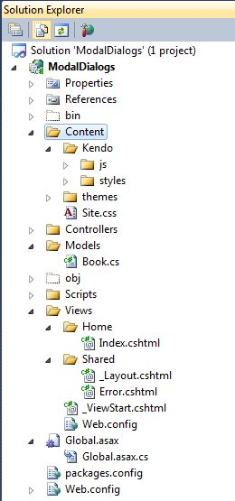
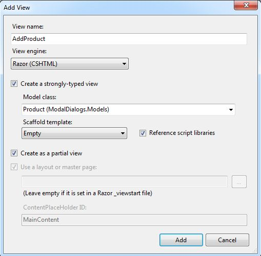
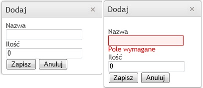

Ostatnimi czasy w pracy eksperymentujemy z ASP.NET MVC. Jednym z problemów na jakie natknąłem się poznając tą technologię było utworzenie okien modalnych. Po niezbyt owocnej walce z kontrolkami ze stajni Devexpressa postanowiliśmy, że skorzystamy z darmowej biblioteki Kendo UI napisanej w jQuery. Wspomnianą wcześniej bibliotekę możemy znaleźć pod adresem http://www.kendoui.com/get-kendo-ui.aspx. Aby uzyskać dostęp do plików należy zarejestrować się w systemie - oczywiście rejestracja jest darmowa. Po zassaniu wszystkich plików kopiujemy zawartość katalogu "source" do naszego projektu MVC. W moim przypadku utworzyłem katalog Kendo w katalogu Content i tam umieściłem zawartość katalogu "source". [](http://tpodolak.com/blog/wp-content/uploads/2012/02/asp-net-mvc-okna-modalne-z-wykorzystaniem-kendo-ui/Structure.jpg)

Mając wszystkie pliki w komplecie musimy wskazać naszej aplikacji aby zaczęła z nich korzystać. Dodajmy zatem w pliku \_Layout.cshtml następujące elementy

```html
<script src="@Url.Content("~/Content/Kendo/js/jquery.min.js")" type="text/javascript"></script>
<link href="@Url.Content("~/Content/Site.css")" rel="stylesheet" type="text/css" />
<link href="@Url.Content("~/Content/Kendo/styles/kendo.common.css")" rel="stylesheet"/>
<link href="@Url.Content("~/Content/Kendo/styles/kendo.default.css")" rel="stylesheet"/>
<script src="@Url.Content("~/Scripts/jquery-1.5.1.min.js")" type="text/javascript"></script>
<script src="@Url.Content("~/Content/Kendo/js/jquery.min.js")" type="text/javascript"></script>
<script src="@Url.Content("~/Content/Kendo/js/kendo.core.js")" type="text/javascript"></script>
<script src="@Url.Content("~/Content/Kendo/js/kendo.data.js")" type="text/javascript"></script>
<script src="@Url.Content("~/Content/Kendo/js/kendo.pager.js")" type="text/javascript"></script>
<script src="@Url.Content("~/Content/Kendo/js/kendo.selectable.js")" type="text/javascript"></script>
<script src="@Url.Content("~/Content/Kendo/js/kendo.draganddrop.js")" type="text/javascript"></script>
<script src="@Url.Content("~/Content/Kendo/js/kendo.groupable.js")" type="text/javascript"></script>
<script src="@Url.Content("~/Content/Kendo/js/kendo.grid.js")" type="text/javascript"></script>
<script src="@Url.Content("~/Content/Kendo/js/kendo.fx.js")" type="text/javascript"></script>
<script src="@Url.Content("~/Content/Kendo/js/kendo.resizable.js")" type="text/javascript"></script>
<script src="@Url.Content("~/Content/Kendo/js/kendo.window.js")" type="text/javascript"></script>

```

Przejdźmy teraz do najważniejszej części, a mianowicie do tworzenia okna modalnego. Biblioteka Kendo UI udostępnia nam funkcję kendoWindow, dzięki której jesteśmy w stanie utworzyć okno modalne. Okno to jednak nie ma w sobie żadnej zawartości - nie posiada nawet przycisków typu "Zapisz" oraz "Anuluj". Utworzenie i załadowanie zawartości okna oraz reakcja na kliknięcia w potencjalne przyciski musi zostać obsłużona przez nas. Zacznijmy zatem od utworzenia zawartości okna. Załóżmy, że okno, które za chwilę stworzymy będzie służyło do dodawania nowego produktu do bazy danych. Klasa produkt jest bardzo prostą klasą prezentującą się w następujący sposób:

```csharp
public class Product
{
    public string Id { get; set; }
    public string Name { get; set; }
    public int Quantity { get; set; }
}

```

Stwórzmy zatem strongly-typed partial view, który będzie zawartością naszego okna modalnego. Widok ten będzie posiadał dwa textboxy do wypełniania propertisów obiektu, oraz przyciski "Zapisz" oraz "Anuluj". Zacznijmy od dodania odpowiednich funkcji w kontrolerze. Pierwszą z nich będzie akcja AddProduct();

```csharp
public PartialViewResult AddProduct()
{
    return PartialView("AddProduct", new Product());
}

```

W celu dodania widoku klikamy PPM na nazwę funkcji i wybieramy opcję "Add View". W otwartym oknie zaznaczmy opcję "Create Strongly Typed View", a w comboboxie wpisujemy "Product". Ponadto zaznaczamy checkboxa "Create as a partial view". [](http://tpodolak.com/blog/wp-content/uploads/2012/02/asp-net-mvc-okna-modalne-z-wykorzystaniem-kendo-ui/addcontroller.jpg) W katalogu Home pojawił się nowy plik AddProduct.cshtml. W pliku tym zdefiniujemy wygląd zawartości naszego okna modalnego. Jako, że nasze dane będą musiały zostać wysłane na serwer do zapisu, skorzystamy z funkcji pomocniczej Html.BeginForm, w której to umieścimy wszystkie potrzebne elementy do edycji produktu.

```csharp
@model ModalDialogs.Models.Product

    @using (Html.BeginForm("AddProduct", "Home", FormMethod.Post, new { id = "fmAddProduct" }))
    {
        @Html.ValidationSummary(true)
        
            @Html.Label("lblName", "Nazwa")
            @Html.TextBoxFor(val => val.Name)
            @Html.ValidationMessageFor(val => val.Name)
        
        
            @Html.Label("lblQuantity", "Ilość")
            @Html.TextBoxFor(val => val.Quantity)
            @Html.ValidationMessageFor(val => val.Quantity)
        
        
        
    }

```

Dodajmy teraz na naszej stronie głównej linka, który wywoła nasze okno modalne.

```csharp
@Html.ActionLink("Dodaj produkt", "AddProduct", "Home", null, new { id = "addProduct" })

```

Przyszedł teraz czas na najważniejszą część wpisu, a mianowicie na wykorzystaniu jQuery oraz kendoWindow do pokazania okna edycji/dodawania produktu. Najpierw podpinamy się do zdarzenia(dodajemy handler) click utworzonego przed chwilą odnośnika. W funkcji obsługującej zdarzenie click musimy utworzyć okno,wypełnić jego zawartość oraz pokazać okno.

```javascript
$(document).ready(function () {
        var $kendoWindow;
        $("#addProduct").click(function (event) {
            debugger;
            event.preventDefault(); // anulujemy domyślną akcję
            var $dialog = $('');
            var $url = $(this).attr('href'); //wyciągamy  url-a
            $dialog.empty();
            $kendoWindow = $dialog.kendoWindow({ //tworzmy okno
                height: "200px", //o wysokosci 200px
                title: "Dodaj", // z tytulem "Dodaj"
                width: "200px", // o szerokosci 200px
                actions: ["Close"], // ktore mozna jedynie zamknac - nie mozna przesuwac, odswiezac itp
                content: $url // ktorego zawartosc pobieramy z urla przechwyconego z clica

            }).data("kendoWindow");
            $kendoWindow.center(); //centrujemy okno
            $kendoWindow.open(); // otwieramy
        });
...
...
...
}
```

Korzystając z selektora jQuery znajdujemy link opisany id-kiem "addProduct", a następnie podłączamy się do zdarzenia click. W funkcji obsługującej zdarzenie musimy najpierw zapobiec wywołaniu się domyślnej akcji wykonującej się po naciśnięciu na link. Robimy to przy pomocy funkcji prefentDefault(). W kolejnych krokach tworzymy okno modalne zgodnie ze wskazówkami znajdującymi się w dokumentacji Kendo UI http://demos.kendoui.com/web/window/index.html. Najważniejszym elementem przy tworzeniu okna jest dynamiczne załadowanie jego zawartości poprzez podanie linka do akcji w kontrolerze. Linka tego jesteśmy w stanie wyciągnąć wykorzystując kolejną użyteczną funkcję jQuery - attr('nazwaAtrybutu'). Od tej chwili po naciśnięciu odnośnika "Dodaj produkt" zawsze będzie odpalane okno modalne dodawania nowego produktu. Teraz musimy jeszcze obsłużyć zdarzenia click na przyciskach "Zapisz" oraz "Anuluj". Do funkcji przedstawionej powyżej dopisujemy następujące linijki

```javascript
$("#btnSave").live("click", function (event) {
            event.preventDefault(); // anulujemy domyślną akcję
            var $url = $("#fmAddProduct").attr("action"); //wyciągamy  url-a
           // odpalamy ajaxa w celu wywołania akcji kontrolera
            $.ajax(
                {
                    url: $url,  // podajemy url z akcja kontrolera
                    type: "POST", // okreslamy metode 
                    data: $("#fmAddProduct").serialize(), // przekazujemy dane 
                    success: function (response) {       //w przypadku gdy wszystko OK
                        $("#btnSave").unbind(); // odpinamy zdarzenia
                        $("btnCancel").unbind();
                        $kendoWindow.close(); //zamykamy i 
                        $kendoWindow.destroy(); // niszczymy okno
                    },
                    error: function (response) {
                        $("#btnSave").unbind(); //odpinamy zarzenia
                        $("btnCancel").unbind();
                        $kendoWindow.content(response.responseText); //odswiezamy zawartosc okna
                    }
                });
        });

        $("#btnCancel").live("click", function (event) {
            event.preventDefault();// anulujemy domyślną akcję
            $("#btnSave").unbind(); //odpinamy zdarzenia
            $("btnCancel").unbind();
            $kendoWindow.close(); //zamykamy i
            $kendoWindow.destroy(); // niszczymy okno
        });

```

Tutaj sytuacja odrobinę się komplikuje gdyż musimy wysłać wprowadzone dane do kontrolera oraz obsłużyć ewentualne błędy walidacji. Zaczynamy od znalezienia przycisku opisanego id-kiem "btnSave" oraz podpięcia się do zdarzenia click. Ponownie anulujemy domyślną akcję wywołując funkcję preventDefault(). W kolejnym kroku wyciągamy url-a, który miał zostać wywołany po naciśnięciu przycisku. Robimy to, ponownie wykorzystując funkcję attr('nazwaAtrybutu'). Jednakże teraz wyszukujemy tego atrybutu na obiekcie o id ="fmAddProduct" (taki id nadaliśmy "formie" na której są pola edycyjne produktu).Ostatnim elementem jest wykonanie asynchronicznego zapytania AJAX. Do tego zapytania przekazujemy wcześniej uzyskany url,określamy typ zapytania jako "POST" oraz przesyłamy dane wykorzystując funkcję serialize z biblioteki jQuery. Na samym końcu musimy sprecyzować co ma się stać w przypadku gdy wszystko pójdzie ok - parametr success, a co w przypadku gdy coś będzie nie tak - parametr error. Musimy oczywiście dodać do kontrolera jeszcze jedną akcję. Tym razem będzie to również akcja AddProduct, jednakże będzie to akcja HttpPost posiadająca jeden parametr typu Product

```csharp
[HttpPost]
public ActionResult AddProduct(Product product)
{
    if (ModelState.IsValid)
        return new EmptyResult();
    Response.StatusCode = (int)HttpStatusCode.BadRequest;
    return PartialView("AddProduct", product);
}

```

[](http://tpodolak.com/blog/wp-content/uploads/2012/02/asp-net-mvc-okna-modalne-z-wykorzystaniem-kendo-ui/save.jpg) Ostatnią rzeczą jaką musimy zrobić jest wyłączenie cachowania widoków, które są pokazywane w oknie modalnym - można to zrobić wykorzystując atrybut OutputCaching. W przypadku gdy nie wyłączymy cachowania, okna modalne, które raz nie przeszły walidacji nie będą mogły zostać zapisane. W celu wyłączenia cachowania dla poszczególnych widoków najpierw musimy stworzyć profil cachowania. Dodajemy taki oto wpis do pliku Web.config

a następnie dekorujemy atrybutem

```csharp
[OutputCache(CacheProfile = "DisableCaching")]

```

akcje AddProduct() oraz AddProduct(Product product) To by było na tyle, projekt można zassać z tego linka http://www.4shared.com/rar/F4pNi3VH/ModalDialogs.html
