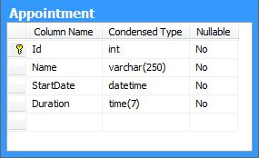
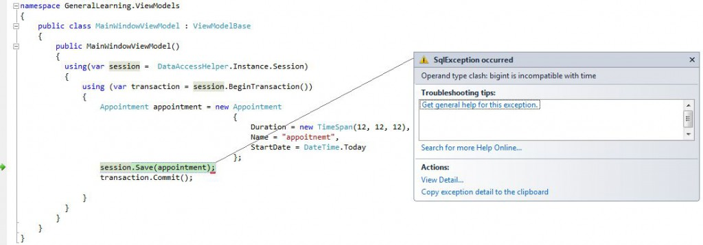
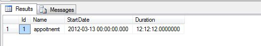

Witam Ostatnio napotkałem na dość ciekawy wyjątek podczas wykonywania NHibernatowego inserta. W bazie danych mam prostą tabelę [](http://tpodolak.com/blog/wp-content/uploads/2012/03/fluentnhibernate-mapowanie-kolumn-typu-time/Table.jpg) Do takiej tabeli został stworzony model

```
namespace Model
{
    public class Appointment
    {
        public virtual int Id { get; set; }
        public virtual string Name { get; set; }
        public virtual DateTime StartDate { get; set; }
        public virtual TimeSpan Duration { get; set; }
    }
}
```

oraz mapping

```
namespace Model.Mappings
{
    public class AppointmentMapping : ClassMap
    {
        public AppointmentMapping()
        {
            Id(val => val.Id).GeneratedBy.Native();
            Map(val => val.Name).Not.Nullable();
            Map(val => val.StartDate).Not.Nullable();
            Map(val => val.Duration).Not.Nullable();
        }
    }
}

```

Niestety ku mojemu zaskoczeniu próbując zapisać do bazy obiekt typu Appointment dostałem następujący wyjątek _SqlException: Operand type clash: bigint is incompatible with time_ [](http://tpodolak.com/blog/wp-content/uploads/2012/03/fluentnhibernate-mapowanie-kolumn-typu-time/Exception.jpg) Mówiąc szczerze wyjątek ten niewiele mi powiedział, zwłaszcza, że zapytanie wygenerowane przez NHibernata (przechwycone w NHibernateProfilerze) wyglądało jak najbardziej poprawnie. Jednakże zapytanie przechwycone przez SqlProfilera wyglądało w następujący sposób

```
exec sp_executesql N'INSERT INTO [Appointment] (Name,StartDate,Duration) VALUES (@p0,@p1,@p2); 
select SCOPE_IDENTITY()',
N'@p0 nvarchar(4000),
@p1 datetime,
@p2 bigint',
@p0=N'appoitnemt',
@p1='2012-03-13 00:00:00',
@p2=439320000000

```

Widać tutaj, że drugi parametr (@p2) został oznaczony jako bigint, a nie time (tak jak jest to oznaczone w bazie). Przyczyną takiego stanu rzeczy jest zły mapping. Z tego co wyczytałem, jeżeli chcemy aby poprawnie zmapować TimeSpana na kolumnę typu time, musimy zmodyfikować interesujący nas mapping na następujący.

```
Map(val => val.Duration).Not.Nullable().CustomType("TimeAsTimeSpan");

```

Mając taki mapping nasze zapytanie zostanie wygenerowane poprawnie i operacja insertu zakończy się powodzeniem [](http://tpodolak.com/blog/wp-content/uploads/2012/03/fluentnhibernate-mapowanie-kolumn-typu-time/Result.jpg)
