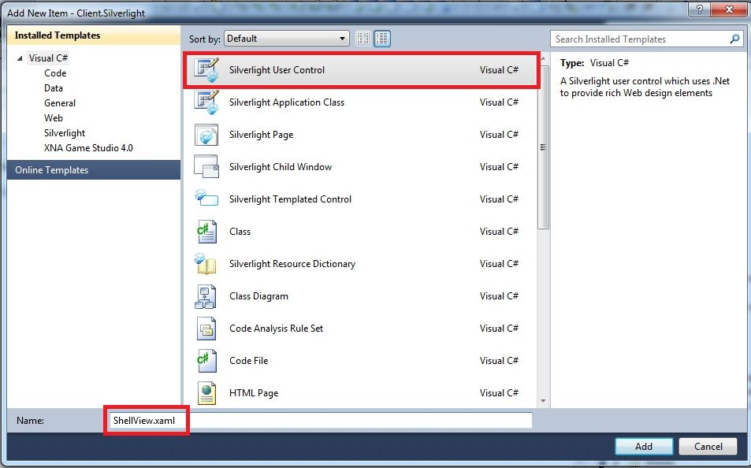
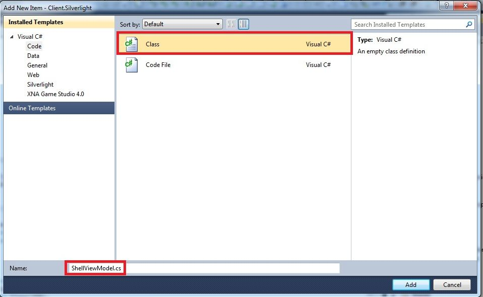
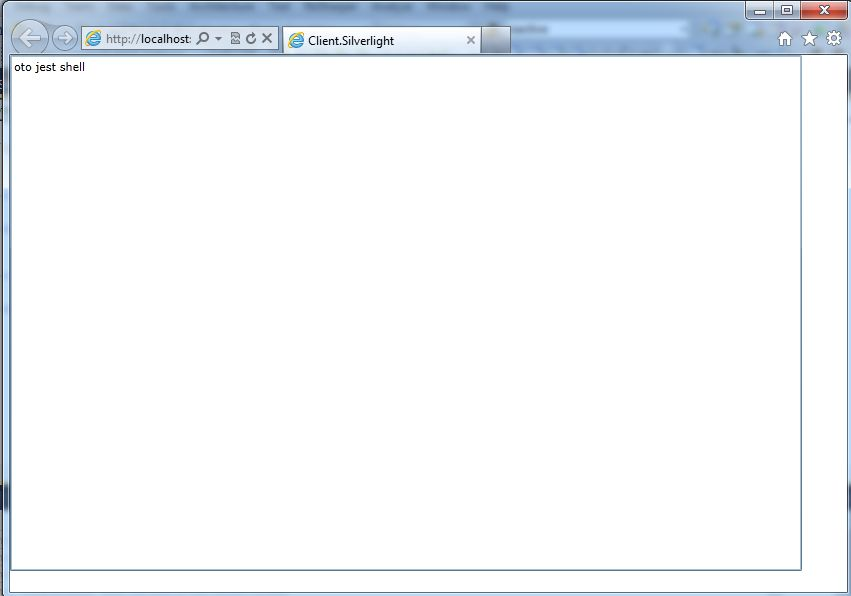

Witam po długiej przerwie. W dzisiejszym wpisie postaram się krótko opisać w jaki sposób stworzyć bootstrapper aplikacji przy użyciu CaliburnMicro. Ponadto przedstawię w jaki sposób skonfigurować bootstrapper w taki sposób, aby Caliburn wykorzystywał nasz własny kontener IOC.

### 1\. Wstęp

CaliburnMicro jest to framework MVVM, który w znacznym stopniu ułatwia i przyśpiesza pisanie aplikacji pod WPF,Silverlight,WindowsPhone oraz WinRT. Zdecydowałem się poznać ten framework z uwagi na jego przenośność na różne platformy. Wcześniej całkiem sporo czasu poświęciłem Prismowi, jednakże z powodu licznych problemów z jego działaniem pod WindowsPhonem chciałem spróbować czegoś nowego.

### 2\. Bootstrapper - Silverlight

Bootstrapper jest to ogólnie rzecz biorąc klasa inicjalizująca całą aplikację. W trakcie odpalania bootstrappera na ogół konfiguruje się kontener IOC(rejestruje wszystkie potrzebne typu), inicjalizuje się połączenie z serverem, oraz odpala się główne okno aplikacji - tzw. Shella. Dlatego też musimy odchudzić plik App.xaml.cs i zostawić w nim jedynie konstruktor wraz z wywołaniem funkcji InitializeComponents()

```
public partial class App : Application
{
    public App()
    {          
        InitializeComponent();
    }
}

```

Zacznijmy od utworzenia nowego projektu typu SilverlightApplication, do którego dodajemy referencje do dll-ek Cliburna. Możemy to zrobić poprzez NuGetta (niestety u mnie one nie działały :D), jak również możemy je ściągnąć z oficjalnej strony projektu http://caliburnmicro.codeplex.com/releases/view/81466. Następnie stwórzmy główne okno aplikacji(wspomnianego wcześniej Shella) oraz jego viewmodel. W tym celu dodajemy do projektu Silverlight User Control o nazwie ShellView [](http://tpodolak.com/blog/wp-content/uploads/2012/05/tworzenie-bootstrappera-aplikacji-przy-uzyciu-caliburnmicro/ShellView.jpg) oraz nową klasę ShellViewModel. [](http://tpodolak.com/blog/wp-content/uploads/2012/05/tworzenie-bootstrappera-aplikacji-przy-uzyciu-caliburnmicro/ShellViewModel.jpg) Dorzućmy jeszcze jakiegoś TextBox-a do naszego ShellView, tak aby mieć pewność, że rzeczywiście odpowiednie okno jest widoczne przy starcie aplikacji

W kolejnym kroku musimy stworzyć właściwy bootstrapper - dodajmy nową klasę o nazwie SilverlightBootstrapper, która dziedziczyć będzie po klasie Bootstrapper

```
namespace Client.Silverlight
{
    public class SilverlightBootstrapper : Bootstrapper
    {
    
    }
}

```

Klasa Bootstrapper jest to klasa dostarczona przez CaliburnMicro, generyczny parametr T określa nam viewmodel na podstawie którego framework będzie wyszukiwał odpowiedni widok shella ze swojego wbudowanego kontenera IOC (Caliburn podczas uruchomienia aplikacji rejestruje dostępne typu w kontenerze). Zgodnie z domyślną konwencją, CaliburnMicro jako główne okno aplikacji ustawi widok, który nazywać się będzie ShellView. W celu odpalenia naszego bootstrappera musimy jeszcze umieścić go w zasobach aplikacji. Zmodyfikujmy zatem plik App.xaml aby wyglądał w następujący sposób

Kompilując, a następnie uruchamiając nasz projekt naszym oczom powinien ukazać się następujący widok [](http://tpodolak.com/blog/wp-content/uploads/2012/05/tworzenie-bootstrappera-aplikacji-przy-uzyciu-caliburnmicro/Client.Silverlight.jpg)

Powyżej przedstawiłem w jaki sposób stworzyć najprostszą wersję bootstrapera z wykorzystaniem CaliburnMicro oraz jego domyślnego kontenera IOC. Jednakże najczęściej jest tak, że w aplikacji wykorzystujemy już jakiś bardziej zaawansowany kontener i po prostu nie chcemy wykorzystywać jednego kontenera do "rozwiązywania" widoków, a drugiego do pozostałych rzeczy. Dlatego też pokaże teraz w jaki sposób skonfigurować napisany wcześniej bootstrapper tak aby widoki były wyciągane z naszego kontenera IOC. Zacznijmy do dodania do naszego projektu referencji do NInjecta, a następnie utwórzmy klasę IOCContainer (będącą naszym customowym kontenerem), wyglądającą w następujący sposób

```
public class IOCContainer
{
    private static readonly IKernel Kernel = new StandardKernel();

    protected IOCContainer()
    {

    }

    public static void Dispose()
    {
        Kernel.Dispose();
    }

    public static object Get(Type type)
    {
        return Kernel.Get(type);
    }

    public static object Get(Type type,string key)
    {
        return Kernel.Get(type, key);
    }
  
    public static IEnumerable  GetAll(Type instanceType)
    {
        return Kernel.GetAll(instanceType);
    }
  
    public static void Bind() where TS : T
    {
        Kernel.Bind().To();
    } 
}

Następnie w klasie SilverlightBootstraper musimy przeciążyć funkcję Configure,GetAllInstances oraz GetInstance. Jako, że będziemy korzystali z naszego własnego kontenera w funkcji Configure rejestrujemy wszystkie potrzebne nam viewmodele oraz widoki. Zatem funkcja Configure powinna od teraz wyglądać tak
protected override void Configure()
{
    IOCContainer.Bind();
    IOCContainer.Bind();
}

Następnie musimy "pokazać" Caliburn-owi gdzie powinien szukać widoków. Dlatego też przeciążamy funkcje GetInstance oraz GetAllInstances i zmieniamy ich postać na następującą
protected override object GetInstance(Type serviceType, string key)
{
    return IOCContainer.Get(serviceType, key);
}

protected override IEnumerable GetAllInstances(Type serviceType)
{
    return IOCContainer.GetAll(serviceType);
}

Od tej pory, za każdym razem gdy użyjemy mechanizmów Caliburna do bindowania viewmodelu z widokiem itp.,Caliburm będzie szukał widoków oraz viewmodeli w naszym kontenerze IOC.

2.2 Własna konwencja wyszukiwania widoków

W przedstawionym powyżej przykładzie bootstrappera, nasz bootstrapper korzystał z domyślnej konwencji rozwiązywania widoków na podstawie viewmodeli (do ShellViewModel został dopasowany widok ShellView). Czasem jednak konwencja ta, nie pasuje do konwencji przyjętej w danym projekcie. Sam biorę udział w projekcie, w którym widoki w kontenerze są rejestrowane następujący sposób
IOCContainer.Bind,View>

Czy zatem oznacza to, że nie mogę korzystać już mechanizmów Caliburna i musze zrezygnować chociażby z bootstrappera ?Oczywiście,że nie. Framework dostarcza nam możliwość zdefiniowania własnej konwencji wyszukiwania widoków na podstawie viewmodeli. W celu zastąpienia domyślnej konwencji musimy podpiąć się pod propercję LocateForModelType znajdującą się w klasie ViewLocator i zdefiniować własną funkcję wyszukującą widok na podstawie viewmodelu. W moim przypadku wygląda to w następujący sposób
ViewLocator.LocateForModelType = (modelType, displayLocation, context) =>
                                                 {
                                                     string viewTypeName = string.Format("{0}[[{1}]],{2}", typeof(IView<>).FullName, modelType.AssemblyQualifiedName, typeof(IView<>).Assembly.FullName);
                                                     Type viewType = Type.GetType(viewTypeName);
                                                     if (viewType == null)
                                                         throw new ArgumentNullException(string.Format("Nie odnaleziono typu widoku dla viewModelu"), modelType.FullName);

                                                     return ViewLocator.GetOrCreateViewType(viewType);
                                                 };

Funkcja ViewLocator.LocateForModelType odpalana jest za każdym razem, gdy CaliburnMicro chce wyszukać widok na podstawie viewmodleu. Najważniejszym argumentem funkcji LocateForModelType jest modelType - czyli typ viewmodelu, który posłuży nam do znalezienia widoku - a właściwie jego typu. Po odnalezieniu typu widoku, wywołujemy funkcję
ViewLocator.GetOrCreateViewType(viewType);

(które z kolei znajdzie nam w kontenerze pożądanym przez nas typ widoku) i zwracamy jej rezultat.

3. Bootstrapper - Windows Phone

W przypadku bootstrappera dla Windows Phona sytuacja wygląda odrobinę inaczej. W celu utworzenia własnego bootstrappera musimy rozszerzyć klasę PhoneBootstrapper. Utwórzmy zatem nowy projekt typu Windows Phone Application, oraz dodajmy do niego nową kontrolkę typu Windows Phone Portrait Page.

Podobnie jak w przypadku projektu Silverlightowego dodajemy referencję do CaliburnMicro ,dorzucamy klasę viewmodelu (którą nazywamy ShellViewModel) oraz dodajemy jakiegoś textboxa do ShellView. Następnie musimy utworzyć nasz bootstrapper, dodajmy zatem klasę WindowsPhoneBootstrapper rozszerzającą klasę PhoneBootstrapper. Podobnie jak w przypadku bootstrappera silverlightowego przeciążamy funkcje odpowiedzialne za konfigurację kontenera IOC.
public class WindowsPhoneBootstrapper : PhoneBootstrapper
{
    protected override void Configure()
    {
      
       IOCContainer.BindToConstant(new FrameAdapter(RootFrame));
       IOCContainer.BindToConstant(new PhoneApplicationServiceAdapter(RootFrame));
       IOCContainer.BindAsSingleton();
    }

    protected override void OnExit(object sender, EventArgs e)
    {
        IOCContainer.Dispose();
        base.OnExit(sender, e);
    }

    protected override object GetInstance(Type serviceType, string key)
    {
        return IOCContainer.Get(serviceType, key);
    }

    protected override IEnumerable GetAllInstances(Type serviceType)
    {
        return IOCContainer.GetAll(serviceType);
    }

    protected override void BuildUp(object instance)
    {
        IOCContainer.Inject(instance);
    }
}

Zwróćmy uwagę, że w kontenerze IOC zostały zarejestrowane usługi nawigacji Windows Phona, do których został przekazany RootFrame. RootFrame jest to główne okno aplikacji, zostaje ono utworzone przez CliburnMicro. Tak samo jak w przypadku projektu Silverlightowego w pliku App.xaml.cs zostawiamy jedynie konstruktor z wywołaniem funkcji InitializeComponents(). W celu ustawienia ShellView jako RootFram-a musimy zmodyfikować plik WMAppManifest.xml (znajdujący się w katalogu Properties). Odnajdujemy tam wpis

i zamieniamy go na

Jak widać WindowsPhone wymusza tutaj podejście ViewFirst. Przy uruchomieniu aplikacji mechanizm nawigacji WindowsPhona odpali widok ShellView (bez wiedzy Caliburn'a), natomiast CaliburnMicro dopasuje odpowiedni ViewModel do naszego widoku - na podstawie domyślnej konwencji. Jeżeli chcielibyśmy zmodyfikować sposób wyszukiwania ViewModeli do widoków musimy podpiąć się do propertisa LocateForViewType znajdującego się w klasie ViewModelLocator
ViewModelLocator.LocateForViewType = type => { return //tutaj zwroc odpowiedni viewmodel na podstawie parametru type; };

W ostatnim kroku musimy jeszcze tylko dodać nasz bootstrapper do zasobów aplikacji

        

odpalając teraz program naszym oczom powinien ukazać się taki oto widok

```
