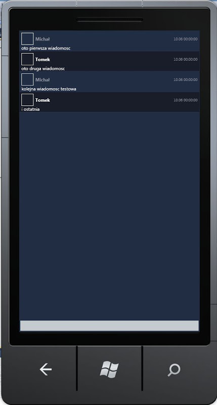

Pisząc moją małą aplikację pod `Windows Phone` po raz kolejny natknąłem się na problem.
Pod `WP7` nie ma tak przydatnej rzeczy jaką jest `DataTemplateSelector` znany nam bardziej, lub mniej z Silverlighta oraz `WPF-a`.
Na szczęście napisane własnego `DataTemplateSelector-a` nie jest specjalnie skomplikowane.
Nasz customowy `DataTemplateSelector` zostanie oparty o kontrolkę `ContentControl`.
Po pierwsze stwórzmy klasę bazową `DataTemplateSelectora` dziedziczącą po `ContentControl`, w której przeciążamy funkcję `OnContentChanged`,

```csharp
public abstract class AbstractDataTemplateSelector : ContentControl
{
    public abstract DataTemplate SelectTemplate(object item, DependencyObject container);
    
    protected override void OnContentChanged(object oldContent, object newContent)
    {
        base.OnContentChanged(oldContent, newContent);
        ContentTemplate = SelectTemplate(newContent, this);
    }
}
```

Klasa ta będzie klasą z której będą wywodzić się wszystkie nasze `TemplateSelectory`.
Załóżmy, że chcemy zbudować `DataTemplateSelector`, który będzie obsługiwał aplikację chata.
Powinien on zatem reagować na dwa typy elementów:

- wiadomości przychodzące
- wiadomości wychodzące

Stwórzmy zatem "wyspecjalizowany" `DataTemplateSelector`, który w zależności od typu wiadomości zwróci odpowiedni `DataTemplate`.

```csharp
public class ChatMessageTemplateSelector : AbstractDataTemplateSelector
{
    public DataTemplate Out { get; set; }
    public DataTemplate In { get; set; }

    public override DataTemplate SelectTemplate(object item, DependencyObject container)
    {
        ChatMessage message = item as ChatMessage;
        if (message != null)
        {
            switch (message.MessageDirection)
            {
                case MessageDirection.In:
                    return In;
                case MessageDirection.Out:
                    return Out;
                default:
                    return Out;
            }
        }
        return In;
    }
}
```

W klasie `ChatMessageTemplateSelector` przeciążyliśmy metodę `SelectTemplate`.
W metodzie tej, na podstawie zbindowanego obiektu (parametr item) określamy jaki template powinniśmy zwrócić.
Templaty do wiadomości przychodzących oraz wychodzących zostały zdefiniowane jako propertisy.

- `Out` - template wiadomości wychodzącej
- `In` - template wiadomości przychodzącej

Pozostaje nam tylko zdefiniować wymienione wyżej templaty. Nie będziemy robić tego w kodzie, ale w `XAML-u`.
Nasz nowo stworzony `DataTemplateSelector` wykorzytamy w `ListBox-ie`

```xml
<ListBox  ItemsSource="{Binding MessageList,Mode=TwoWay}" Grid.ColumnSpan="2" HorizontalContentAlignment="Stretch" VerticalAlignment="Stretch"
                     ItemTemplate="{StaticResource GeneralChatMessageTemplate}" />
```

Jako, że nasz `ChatMessageTemplateSelector` jest tak naprawdę obiektem typu `ContentControl`, zatem możemy go zbindować do właściwości `ItemTemplate` `ListBox-a`.
Zasób `GeneralChatMessageTemplate` wygląda w następujący sposób

```xml
<DataTemplate x:Key="GeneralChatMessageTemplate">
            <Client:ChatMessageTemplateSelector HorizontalContentAlignment="Stretch" Content="{Binding}" In="{StaticResource IncomingChatMessageTemplate}" Out="{StaticResource OutcomingChatMessageTemplate}">
            </Client:ChatMessageTemplateSelector>
</DataTemplate>
```

Jak widać jest to obiekt typu `ChatMessageTemplateSelector`, którego właściwość `Content` jest zbindowana do aktualnego kontekstu (pojedyncze słowo kluczowe `Binding`).
Widzimy również, że ustawiliśmy wartości właściwości odpowiadających za templaty poszczególnych wiadomości (`In="{StaticResource IncomingChatMessageTemplate}" Out="{StaticResource OutcomingChatMessageTemplate}"`).
Wspomniane templaty wyglądają w następujący sposób

```xml
<DataTemplate x:Key="IncomingChatMessageTemplate">
            <Border BorderThickness="0,0,0,1" BorderBrush="#2d3550" >
                <Grid Background="#181c2a" HorizontalAlignment="Stretch">
                    <Grid.ColumnDefinitions>
                        <ColumnDefinition />
                        <ColumnDefinition />
                    </Grid.ColumnDefinitions>
                    <Grid.RowDefinitions>
                        <RowDefinition></RowDefinition>
                        <RowDefinition></RowDefinition>
                    </Grid.RowDefinitions>
                    <StackPanel Orientation="Horizontal">
                        <Border BorderThickness="1" BorderBrush="White" Margin="5,5,0,0">
                            <Image Stretch="None"  Width="30" Height="30" MaxWidth="30" MinHeight="30" MaxHeight="30"  Source="..avatar_4934.bmp"></Image>
                        </Border>
                        <TextBlock Padding="5,5,5,0" Foreground="White" FontFamily="Segoe UI, Tahoma" FontSize="12" FontWeight="Bold" TextTrimming="WordEllipsis"  TextAlignment="Left" VerticalAlignment="Center" HorizontalAlignment="Left"  Text="{Binding Sender.UserName,Mode=TwoWay}"></TextBlock>
                    </StackPanel>
                    <TextBlock FontFamily="Segoe UI, Tahoma" FontSize="10" Padding="5,5,5,0" Foreground="#8e929f" TextTrimming="WordEllipsis"  Grid.Column="1" TextAlignment="Right" VerticalAlignment="Center" HorizontalAlignment="Right" Text="{Binding SendTime, Mode=TwoWay, StringFormat='{0:dd.MM HH:mm:ss}'}"></TextBlock>
                    <TextBlock FontFamily="Segoe UI, Tahoma" FontSize="12" Margin="5,0,0,0" TextWrapping="Wrap" Grid.ColumnSpan="2" Grid.Row="1" Text="{Binding Message,Mode=TwoWay}" ></TextBlock>
                </Grid>
            </Border>
</DataTemplate>
```

```xml
<DataTemplate x:Key="OutcomingChatMessageTemplate">
            <Border BorderThickness="0,0,0,1" BorderBrush="#2d3550">
                <Grid HorizontalAlignment="Stretch">
                    <Grid.ColumnDefinitions>
                        <ColumnDefinition />
                        <ColumnDefinition />
                    </Grid.ColumnDefinitions>
                    <Grid.RowDefinitions>
                        <RowDefinition></RowDefinition>
                        <RowDefinition></RowDefinition>
                    </Grid.RowDefinitions>
                    <StackPanel Orientation="Horizontal">
                        <Border BorderThickness="1" BorderBrush="White" Margin="5,5,0,0">
                            <Image Stretch="None"  Width="30" Height="30" MaxWidth="30" MinHeight="30" MaxHeight="30"  ></Image>
                        </Border>
                        <TextBlock Padding="5,5,5,0" Foreground="#8e929f" FontFamily="Segoe UI, Tahoma" FontSize="12" FontWeight="Bold" TextTrimming="WordEllipsis"  TextAlignment="Left" VerticalAlignment="Center" HorizontalAlignment="Left"  Text="{Binding Sender.UserName,Mode=TwoWay}"></TextBlock>
                    </StackPanel>
                    <TextBlock FontFamily="Segoe UI, Tahoma" FontSize="10" Padding="5,5,5,0" Foreground="#8e929f" TextTrimming="WordEllipsis"  Grid.Column="1" TextAlignment="Right" VerticalAlignment="Center" HorizontalAlignment="Right" Text="{Binding SendTime, Mode=TwoWay, StringFormat='{0:dd.MM HH:mm:ss}'}"></TextBlock>
                    <TextBlock FontFamily="Segoe UI, Tahoma" FontSize="12" Margin="5,0,0,0" TextWrapping="Wrap" Grid.ColumnSpan="2" Grid.Row="1" Text="{Binding Message,Mode=TwoWay}" ></TextBlock>
                </Grid>
            </Border>
</DataTemplate>
```

Od teraz gdy do `ListBox-a` zostanie dodany nowy item, pierwszą rzeczą jaka się odpali będzie funkcja `OnContentChanged`.
W funkcji tej `AbstractDataTemplateSelector` na podstawie nowo przybyłego itemu ustawi właściwość `ContentTemplate`, na taki template jaki zwróci mu funkcja `SelectTemplate`.
Wynik działania `ChatMessageTemplateSelector` wygląda w następujący sposób

[](http://tpodolak.com/blog/wp-content/uploads/2012/06/windows-phone-wlasny-datatemplateselector/Result.jpg)
