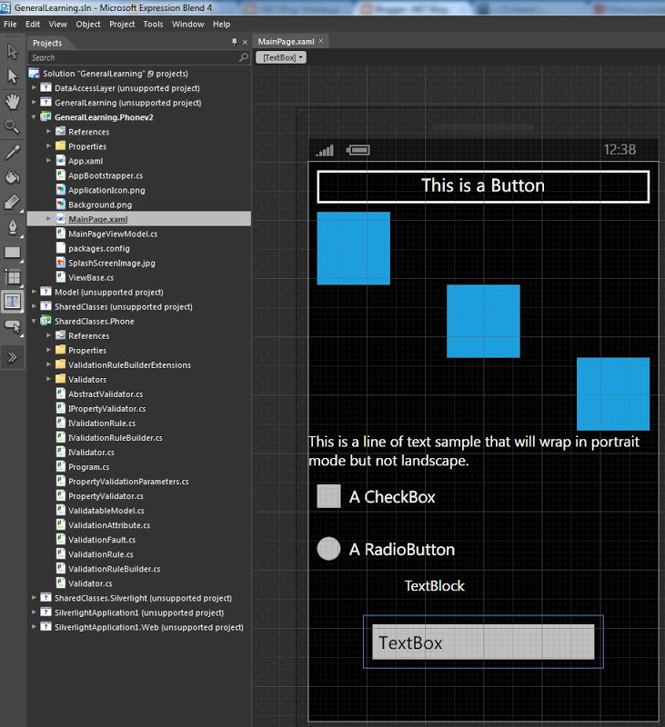
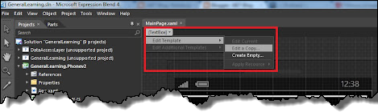
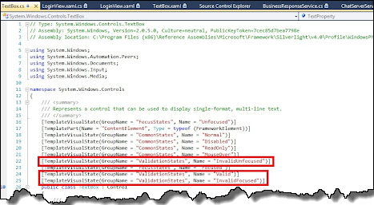
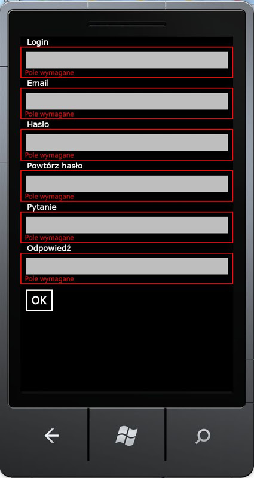

Kilka miesięcy temu w [tym](http://tpodolak.com/blog/2011/11/28/walidacja) poście przedstawiałem różne sposoby walidacji jakie są dostępne na platformie Silverlight. Jako, że ostatnio mam więcej czasu aby pisać jakieś proste aplikacje pod Windows Phonem potrzebowałem mechanizmu walidacji działającego pod tą platformą. Według MSDN-u wszystkie metody walidacji przedstawione we wspomnianym wcześniej poście powinny działać. Niestety po przerzuceniu mechanizmu z Silverlighta na Windows Phona okazało się, że błędy walidacji nie zostają wyświetlone na interfejsie. Po przeszukaniu kilku for oraz blogów dowiedziałem się, że przyczyną takiego stanu rzeczy jest brak obsługi reakcji na błędy w templacie TextBoxów (i innych elementów typu input). Zatem aby wyświetlić błędy walidacji, pozostaje nam zmodyfikować istniejący template TextBox-a. Zacznijmy od wyciągnięcia standardowego templatu TextBox-a z Windows Phona. W tym celu możemy użyć aplikacji Expression Blend. Otwórzmy w niej jakikolwiek projekt typu Windows Phone Application, w którym na kontrolce mamy naniesionego Textboxa. W moim przypadku, po wczytaniu projektu do Blenda ekran wygląda w następujący sposób [](http://tpodolak.com/blog/wp-content/uploads/2012/06/windows-phone-wyswietlanie-bledow-walidacji/blend.jpg) Następnie zaznaczamy w Blendzie TextBox-a i z opcji znajdujących się w lewym górnym rogu aktualnej zakładki wybieramy TextBox->Edit Template-> Edit Copy. [](http://tpodolak.com/blog/wp-content/uploads/2012/06/windows-phone-wyswietlanie-bledow-walidacji/BlendTemplateExtraction.png) W oknie, które się pojawi klikamy OK. Następnie możemy przejść do widoku XAML-a, w sekcji phone:PhoneApplicationPage.Resources powinien pojawić się nam nowy styl wyglądający w ten sposób

```xml
<ControlTemplate x:Key="PhoneDisabledTextBoxTemplate" TargetType="TextBox">
   <ContentControl x:Name="ContentElement" BorderThickness="0" HorizontalContentAlignment="Stretch" Margin="{StaticResource PhoneTextBoxInnerMargin}" Padding="{TemplateBinding Padding}" VerticalContentAlignment="Stretch"/>
   </ControlTemplate>
   <Style x:Key="TextBoxStyle1" TargetType="TextBox">
      <Setter Property="FontFamily" Value="{StaticResource PhoneFontFamilyNormal}"/>
      <Setter Property="FontSize" Value="{StaticResource PhoneFontSizeMediumLarge}"/>
      <Setter Property="Background" Value="{StaticResource PhoneTextBoxBrush}"/>
      <Setter Property="Foreground" Value="{StaticResource PhoneTextBoxForegroundBrush}"/>
      <Setter Property="BorderBrush" Value="{StaticResource PhoneTextBoxBrush}"/>
      <Setter Property="SelectionBackground" Value="{StaticResource PhoneAccentBrush}"/>
      <Setter Property="SelectionForeground" Value="{StaticResource PhoneTextBoxSelectionForegroundBrush}"/>
      <Setter Property="BorderThickness" Value="{StaticResource PhoneBorderThickness}"/>
      <Setter Property="Padding" Value="2"/>
      <Setter Property="Template">
       <Setter.Value>
        <ControlTemplate TargetType="TextBox">
         <Grid Background="Transparent">
          <VisualStateManager.VisualStateGroups>
           <VisualStateGroup x:Name="CommonStates">
            <VisualState x:Name="Normal"/>
            <VisualState x:Name="MouseOver"/>
            <VisualState x:Name="Disabled">
             <Storyboard>
              <ObjectAnimationUsingKeyFrames Storyboard.TargetProperty="Visibility" Storyboard.TargetName="EnabledBorder">
               <DiscreteObjectKeyFrame KeyTime="0">
                <DiscreteObjectKeyFrame.Value>
                 <Visibility>Collapsed</Visibility>
                </DiscreteObjectKeyFrame.Value>
               </DiscreteObjectKeyFrame>
              </ObjectAnimationUsingKeyFrames>
              <ObjectAnimationUsingKeyFrames Storyboard.TargetProperty="Visibility" Storyboard.TargetName="DisabledOrReadonlyBorder">
               <DiscreteObjectKeyFrame KeyTime="0">
                <DiscreteObjectKeyFrame.Value>
                 <Visibility>Visible</Visibility>
                </DiscreteObjectKeyFrame.Value>
               </DiscreteObjectKeyFrame>
              </ObjectAnimationUsingKeyFrames>
             </Storyboard>
            </VisualState>
            <VisualState x:Name="ReadOnly">
             <Storyboard>
              <ObjectAnimationUsingKeyFrames Storyboard.TargetProperty="Visibility" Storyboard.TargetName="EnabledBorder">
               <DiscreteObjectKeyFrame KeyTime="0">
                <DiscreteObjectKeyFrame.Value>
                 <Visibility>Collapsed</Visibility>
                </DiscreteObjectKeyFrame.Value>
               </DiscreteObjectKeyFrame>
              </ObjectAnimationUsingKeyFrames>
              <ObjectAnimationUsingKeyFrames Storyboard.TargetProperty="Visibility" Storyboard.TargetName="DisabledOrReadonlyBorder">
               <DiscreteObjectKeyFrame KeyTime="0">
                <DiscreteObjectKeyFrame.Value>
                 <Visibility>Visible</Visibility>
                </DiscreteObjectKeyFrame.Value>
               </DiscreteObjectKeyFrame>
              </ObjectAnimationUsingKeyFrames>
              <ObjectAnimationUsingKeyFrames Storyboard.TargetProperty="Background" Storyboard.TargetName="DisabledOrReadonlyBorder">
               <DiscreteObjectKeyFrame KeyTime="0" Value="{StaticResource PhoneTextBoxBrush}"/>
              </ObjectAnimationUsingKeyFrames>
              <ObjectAnimationUsingKeyFrames Storyboard.TargetProperty="BorderBrush" Storyboard.TargetName="DisabledOrReadonlyBorder">
               <DiscreteObjectKeyFrame KeyTime="0" Value="{StaticResource PhoneTextBoxBrush}"/>
              </ObjectAnimationUsingKeyFrames>
              <ObjectAnimationUsingKeyFrames Storyboard.TargetProperty="Foreground" Storyboard.TargetName="DisabledOrReadonlyContent">
               <DiscreteObjectKeyFrame KeyTime="0" Value="{StaticResource PhoneTextBoxReadOnlyBrush}"/>
              </ObjectAnimationUsingKeyFrames>
             </Storyboard>
            </VisualState>
           </VisualStateGroup>
           <VisualStateGroup x:Name="FocusStates">
            <VisualState x:Name="Focused">
             <Storyboard>
              <ObjectAnimationUsingKeyFrames Storyboard.TargetProperty="Background" Storyboard.TargetName="EnabledBorder">
               <DiscreteObjectKeyFrame KeyTime="0" Value="{StaticResource PhoneTextBoxEditBackgroundBrush}"/>
              </ObjectAnimationUsingKeyFrames>
              <ObjectAnimationUsingKeyFrames Storyboard.TargetProperty="BorderBrush" Storyboard.TargetName="EnabledBorder">
               <DiscreteObjectKeyFrame KeyTime="0" Value="{StaticResource PhoneTextBoxEditBorderBrush}"/>
              </ObjectAnimationUsingKeyFrames>
             </Storyboard>
            </VisualState>
            <VisualState x:Name="Unfocused"/>
           </VisualStateGroup>
          </VisualStateManager.VisualStateGroups>
          <Border x:Name="EnabledBorder" BorderBrush="{TemplateBinding BorderBrush}" BorderThickness="{TemplateBinding BorderThickness}" Background="{TemplateBinding Background}" Margin="{StaticResource PhoneTouchTargetOverhang}">
           <ContentControl x:Name="ContentElement" BorderThickness="0" HorizontalContentAlignment="Stretch" Margin="{StaticResource PhoneTextBoxInnerMargin}" Padding="{TemplateBinding Padding}" VerticalContentAlignment="Stretch"/>
          </Border>
          <Border x:Name="DisabledOrReadonlyBorder" BorderBrush="{StaticResource PhoneDisabledBrush}" BorderThickness="{TemplateBinding BorderThickness}" Background="Transparent" Margin="{StaticResource PhoneTouchTargetOverhang}" Visibility="Collapsed">
           <TextBox x:Name="DisabledOrReadonlyContent" Background="Transparent" Foreground="{StaticResource PhoneDisabledBrush}" FontWeight="{TemplateBinding FontWeight}" FontStyle="{TemplateBinding FontStyle}" FontSize="{TemplateBinding FontSize}" FontFamily="{TemplateBinding FontFamily}" IsReadOnly="True" SelectionForeground="{TemplateBinding SelectionForeground}" SelectionBackground="{TemplateBinding SelectionBackground}" TextAlignment="{TemplateBinding TextAlignment}" TextWrapping="{TemplateBinding TextWrapping}" Text="{TemplateBinding Text}" Template="{StaticResource PhoneDisabledTextBoxTemplate}"/>
          </Border>
         </Grid>
        </ControlTemplate>
       </Setter.Value>
      </Setter>
   </Style>
</ControlTemplate>
```

W ten oto sposób udało nam się wydobyć domyślny styl oraz template TextBoxa w Windows Phonie. W kolejnym kroku musimy zmodyfikować ten template w taki sposób, aby zaczął reagować na zmiany stanu walidacji. Zacznijmy od sprawdzenia jakie stany wizualne może obsługiwać TextBox. W tym celu musimy przeglądnąć metadane TextBoxa - możemy to zrobić klikając PPM na klasie TextBox-a i wybierając Go To Definition. Naszym oczom powinno ukazać się coś takiego. [](http://tpodolak.com/blog/wp-content/uploads/2012/06/windows-phone-wyswietlanie-bledow-walidacji/validationstates.png) Widzimy, że klasa TextBox jest opatrzona atrybutami TemplateVisualState, nas interesują najbardziej trzy z tych atrybutów:

- \[TemplateVisualState(GroupName = "ValidationStates", Name = "Valid")\]
- \[TemplateVisualState(GroupName = "ValidationStates", Name = "InvalidFocused")\]
- \[TemplateVisualState(GroupName = "ValidationStates", Name = "InvalidUnfocused")\]

Mówią nam one, że w przypadku gdy wystąpią błędy walidacji nasza kontrolka przechodzi w stan InvalidFocused lub InvalidUnfocused. Natomiast, w przypadku gdy nie ma błędów znajduje się ona w stanie Valid. Analizując kod domyślnego templatu TextBoxa widzimy, że stany z grupy ValidationStates nie są obsługiwane - czas zatem to zmienić. Po pierwsze do templatu musimy dorzucić elementy, które będą wyświetlały błędy walidacji. Zmieńmy zatem opakowujący wszystko element Grid na StackPanel, a następnie dodajmy element typu TextBlock oraz Border. Elementy wyświetlające błędy walidacji musimy umieścić w jednym kontenerze z elementami odpowiadającymi za wyświetlanie tekstu. Zatem musimy je opakować w Grida. Po zastosowaniu powyższych wskazówek nasz template będzie wyglądał w następujący sposób

```xml
<StackPanel>
...
...
...
    <Grid>
       <Grid.RowDefinitions>
           <RowDefinition Height="Auto"></RowDefinition>
           <RowDefinition Height="Auto"></RowDefinition>
       </Grid.RowDefinitions>
       <Border x:Name="EnabledBorder" BorderBrush="{TemplateBinding BorderBrush}" BorderThickness="{TemplateBinding BorderThickness}" Background="{TemplateBinding Background}" Margin="{StaticResource PhoneTouchTargetOverhang}">
             <ContentControl x:Name="ContentElement" BorderThickness="0" HorizontalContentAlignment="Stretch"   Padding="{TemplateBinding Padding}" VerticalContentAlignment="Stretch"/>
       </Border>
       <Border x:Name="DisabledOrReadonlyBorder" BorderBrush="{StaticResource PhoneDisabledBrush}" BorderThickness="{TemplateBinding BorderThickness}" Background="Transparent" Margin="{StaticResource PhoneTouchTargetOverhang}" Visibility="Collapsed">
          <TextBox x:Name="DisabledOrReadonlyContent" Background="Transparent" Foreground="{StaticResource PhoneDisabledBrush}" FontWeight="{TemplateBinding FontWeight}" FontStyle="{TemplateBinding FontStyle}" FontSize="{TemplateBinding FontSize}" FontFamily="{TemplateBinding FontFamily}" IsReadOnly="True" SelectionForeground="{TemplateBinding SelectionForeground}" SelectionBackground="{TemplateBinding SelectionBackground}" TextAlignment="{TemplateBinding TextAlignment}" TextWrapping="{TemplateBinding TextWrapping}" Text="{TemplateBinding Text}" Template="{StaticResource PhoneDisabledTextBoxTemplate}"/>
       </Border>
       <Border x:Name="ValidationBorder" Grid.RowSpan="2" BorderBrush="Red" BorderThickness="2" Visibility="Collapsed"  >
       </Border>
       <TextBlock x:Name="ValidationMessage" Foreground="Red" FontSize="16" Visibility="Collapsed" Grid.Row="1" Text="{Binding (Validation.Errors)[0].ErrorContent, RelativeSource={RelativeSource TemplatedParent}}"  Padding="0,0,0,2" Margin="10,-14,0,0"  />
    </Grid>
</StackPanel>
```

Dodanie elementów wyświetlających błędy to nie wszystko, musimy jeszcze określić kiedy nasze elementy mają być widoczne. W chwili obecnej ich właściwość Visibility jest ustawiona na Collapsed. Zatem elementy te nie będą widoczne, jak również nie będą zajmowały miejsca na interfejsie. Jak już wcześniej wspomniałem kontrolka TextBoxa w przypadku wystąpienia błędów walidacji przejdzie do stanów InvalidFocused lub InvalidUnfocused. Pozostaje nam zatem zareagować na przejście kontrolki w te stany i odpowiednio zmodyfikować właściwość Visibility bordera oraz textblocka. W tym celu posłużymy się VisualStateManagerem oraz animacjami. Do naszego templatu dodajmy następujący wpis
```xml
<VisualStateGroup x:Name="ValidationStates">
                                <VisualState x:Name="Valid" >
                                    <Storyboard>
                                        <ObjectAnimationUsingKeyFrames Storyboard.TargetProperty="Visibility" Storyboard.TargetName="ValidationBorder">
                                            <DiscreteObjectKeyFrame KeyTime="0" Value="Collapsed" />
                                        </ObjectAnimationUsingKeyFrames>
                                        <ObjectAnimationUsingKeyFrames Storyboard.TargetProperty="Visibility" Storyboard.TargetName="ValidationMessage">
                                            <DiscreteObjectKeyFrame KeyTime="0" Value="Collapsed" />
                                        </ObjectAnimationUsingKeyFrames>
                                    </Storyboard>
                                </VisualState>
                                <VisualState x:Name="InvalidFocused" >
                                    <Storyboard>
                                        <ObjectAnimationUsingKeyFrames Storyboard.TargetProperty="Visibility" Storyboard.TargetName="ValidationBorder">
                                            <DiscreteObjectKeyFrame KeyTime="0" Value="Visible" />
                                        </ObjectAnimationUsingKeyFrames>
                                        <ObjectAnimationUsingKeyFrames Storyboard.TargetProperty="Visibility" Storyboard.TargetName="ValidationMessage">
                                            <DiscreteObjectKeyFrame KeyTime="0" Value="Visible" />
                                        </ObjectAnimationUsingKeyFrames>
                                    </Storyboard>
                                </VisualState>
                                <VisualState x:Name="InvalidUnfocused" >
                                    <Storyboard>
                                        <ObjectAnimationUsingKeyFrames Storyboard.TargetProperty="Visibility" Storyboard.TargetName="ValidationBorder">
                                            <DiscreteObjectKeyFrame KeyTime="0" Value="Visible" />
                                        </ObjectAnimationUsingKeyFrames>
                                        <ObjectAnimationUsingKeyFrames Storyboard.TargetProperty="Visibility" Storyboard.TargetName="ValidationMessage">
                                            <DiscreteObjectKeyFrame KeyTime="0" Value="Visible" />
                                        </ObjectAnimationUsingKeyFrames>
                                    </Storyboard>
                                </VisualState>
</VisualStateGroup>
```

W ten oto sposób zdefiniwaliśmy w XAML-u grupę (VisualStateGroup ) o nazwie ValidationStates - zauważmy, że nazwa grupy jest taka sama jak nazwa grupy z atrybutów klasy TextBox. Dodaliśmy również trzy stany wizualne (VisualState), których nazwy również odpowiadają nazwą zdefiniowanym w atrubytach klasy TextBox. Od tej chwili gdy kontrolka TextBoxa będzie posiadała błędy walidacji, zostanie odpalona animacja zmieniająca właściwość Visibility bordera "ValidationBorder" oraz TextBlocka "ValidationMessage" na Visible. Ostatecznie cały gotowy template będzie wyglądał w następujący sposób

```xml
<ControlTemplate x:Key="PhoneDisabledTextBoxTemplate" TargetType="TextBox">
    <ContentControl x:Name="ContentElement" BorderThickness="0" HorizontalContentAlignment="Stretch" Margin="{StaticResource PhoneTextBoxInnerMargin}" Padding="{TemplateBinding Padding}" VerticalContentAlignment="Stretch"/>
    </ControlTemplate>
    <Style TargetType="TextBox">
        <Setter Property="FontFamily" Value="{StaticResource PhoneFontFamilyNormal}"/>
        <Setter Property="FontSize" Value="{StaticResource PhoneFontSizeMediumLarge}"/>
        <Setter Property="Background" Value="{StaticResource PhoneTextBoxBrush}"/>
        <Setter Property="Foreground" Value="{StaticResource PhoneTextBoxForegroundBrush}"/>
        <Setter Property="BorderBrush" Value="{StaticResource PhoneTextBoxBrush}"/>
        <Setter Property="SelectionBackground" Value="{StaticResource PhoneAccentBrush}"/>
        <Setter Property="SelectionForeground" Value="{StaticResource PhoneTextBoxSelectionForegroundBrush}"/>
        <Setter Property="BorderThickness" Value="{StaticResource PhoneBorderThickness}"/>
        <Setter Property="Padding" Value="2"/>
        <Setter Property="Template">
            <Setter.Value>
                <ControlTemplate TargetType="TextBox">
                    <StackPanel Background="Transparent">
                        <VisualStateManager.VisualStateGroups>
                            <VisualStateGroup x:Name="CommonStates">
                                <VisualState x:Name="Normal"/>
                                <VisualState x:Name="MouseOver"/>
                                <VisualState x:Name="Disabled">
                                    <Storyboard>
                                        <ObjectAnimationUsingKeyFrames Storyboard.TargetProperty="Visibility" Storyboard.TargetName="EnabledBorder">
                                            <DiscreteObjectKeyFrame KeyTime="0">
                                                <DiscreteObjectKeyFrame.Value>
                                                    <Visibility>Collapsed</Visibility>
                                                </DiscreteObjectKeyFrame.Value>
                                            </DiscreteObjectKeyFrame>
                                        </ObjectAnimationUsingKeyFrames>
                                        <ObjectAnimationUsingKeyFrames Storyboard.TargetProperty="Visibility" Storyboard.TargetName="DisabledOrReadonlyBorder">
                                            <DiscreteObjectKeyFrame KeyTime="0">
                                                <DiscreteObjectKeyFrame.Value>
                                                    <Visibility>Visible</Visibility>
                                                </DiscreteObjectKeyFrame.Value>
                                            </DiscreteObjectKeyFrame>
                                        </ObjectAnimationUsingKeyFrames>
                                    </Storyboard>
                                </VisualState>
                                <VisualState x:Name="ReadOnly">
                                    <Storyboard>
                                        <ObjectAnimationUsingKeyFrames Storyboard.TargetProperty="Visibility" Storyboard.TargetName="EnabledBorder">
                                            <DiscreteObjectKeyFrame KeyTime="0">
                                                <DiscreteObjectKeyFrame.Value>
                                                    <Visibility>Collapsed</Visibility>
                                                </DiscreteObjectKeyFrame.Value>
                                            </DiscreteObjectKeyFrame>
                                        </ObjectAnimationUsingKeyFrames>
                                        <ObjectAnimationUsingKeyFrames Storyboard.TargetProperty="Visibility" Storyboard.TargetName="DisabledOrReadonlyBorder">
                                            <DiscreteObjectKeyFrame KeyTime="0">
                                                <DiscreteObjectKeyFrame.Value>
                                                    <Visibility>Visible</Visibility>
                                                </DiscreteObjectKeyFrame.Value>
                                            </DiscreteObjectKeyFrame>
                                        </ObjectAnimationUsingKeyFrames>
                                        <ObjectAnimationUsingKeyFrames Storyboard.TargetProperty="Background" Storyboard.TargetName="DisabledOrReadonlyBorder">
                                            <DiscreteObjectKeyFrame KeyTime="0" Value="{StaticResource PhoneTextBoxBrush}"/>
                                        </ObjectAnimationUsingKeyFrames>
                                        <ObjectAnimationUsingKeyFrames Storyboard.TargetProperty="BorderBrush" Storyboard.TargetName="DisabledOrReadonlyBorder">
                                            <DiscreteObjectKeyFrame KeyTime="0" Value="{StaticResource PhoneTextBoxBrush}"/>
                                        </ObjectAnimationUsingKeyFrames>
                                        <ObjectAnimationUsingKeyFrames Storyboard.TargetProperty="Foreground" Storyboard.TargetName="DisabledOrReadonlyContent">
                                            <DiscreteObjectKeyFrame KeyTime="0" Value="{StaticResource PhoneTextBoxReadOnlyBrush}"/>
                                        </ObjectAnimationUsingKeyFrames>
                                    </Storyboard>
                                </VisualState>
                            </VisualStateGroup>
                            <VisualStateGroup x:Name="FocusStates">
                                <VisualState x:Name="Focused">
                                    <Storyboard>
                                        <ObjectAnimationUsingKeyFrames Storyboard.TargetProperty="Background" Storyboard.TargetName="EnabledBorder">
                                            <DiscreteObjectKeyFrame KeyTime="0" Value="{StaticResource PhoneTextBoxEditBackgroundBrush}"/>
                                        </ObjectAnimationUsingKeyFrames>
                                        <ObjectAnimationUsingKeyFrames Storyboard.TargetProperty="BorderBrush" Storyboard.TargetName="EnabledBorder">
                                            <DiscreteObjectKeyFrame KeyTime="0" Value="{StaticResource PhoneTextBoxEditBorderBrush}"/>
                                        </ObjectAnimationUsingKeyFrames>
                                    </Storyboard>
                                </VisualState>
                                <VisualState x:Name="Unfocused"/>
                            </VisualStateGroup>
                            <VisualStateGroup x:Name="ValidationStates">
                                <VisualState x:Name="Valid" >
                                    <Storyboard>
                                        <ObjectAnimationUsingKeyFrames Storyboard.TargetProperty="Visibility" Storyboard.TargetName="ValidationBorder">
                                            <DiscreteObjectKeyFrame KeyTime="0" Value="Collapsed" />
                                        </ObjectAnimationUsingKeyFrames>
                                        <ObjectAnimationUsingKeyFrames Storyboard.TargetProperty="Visibility" Storyboard.TargetName="ValidationMessage">
                                            <DiscreteObjectKeyFrame KeyTime="0" Value="Collapsed" />
                                        </ObjectAnimationUsingKeyFrames>
                                    </Storyboard>
                                </VisualState>
                                <VisualState x:Name="InvalidFocused" >
                                    <Storyboard>
                                        <ObjectAnimationUsingKeyFrames Storyboard.TargetProperty="Visibility" Storyboard.TargetName="ValidationBorder">
                                            <DiscreteObjectKeyFrame KeyTime="0" Value="Visible" />
                                        </ObjectAnimationUsingKeyFrames>
                                        <ObjectAnimationUsingKeyFrames Storyboard.TargetProperty="Visibility" Storyboard.TargetName="ValidationMessage">
                                            <DiscreteObjectKeyFrame KeyTime="0" Value="Visible" />
                                        </ObjectAnimationUsingKeyFrames>
                                    </Storyboard>
                                </VisualState>
                                <VisualState x:Name="InvalidUnfocused" >
                                    <Storyboard>
                                        <ObjectAnimationUsingKeyFrames Storyboard.TargetProperty="Visibility" Storyboard.TargetName="ValidationBorder">
                                            <DiscreteObjectKeyFrame KeyTime="0" Value="Visible" />
                                        </ObjectAnimationUsingKeyFrames>
                                        <ObjectAnimationUsingKeyFrames Storyboard.TargetProperty="Visibility" Storyboard.TargetName="ValidationMessage">
                                            <DiscreteObjectKeyFrame KeyTime="0" Value="Visible" />
                                        </ObjectAnimationUsingKeyFrames>
                                    </Storyboard>
                                </VisualState>
                            </VisualStateGroup>
                        </VisualStateManager.VisualStateGroups>
                        <Grid>
                            <Grid.RowDefinitions>
                                <RowDefinition Height="Auto"></RowDefinition>
                                <RowDefinition Height="Auto"></RowDefinition>
                            </Grid.RowDefinitions>
                            <Border x:Name="EnabledBorder" BorderBrush="{TemplateBinding BorderBrush}" BorderThickness="{TemplateBinding BorderThickness}" Background="{TemplateBinding Background}" Margin="{StaticResource PhoneTouchTargetOverhang}">
                                <ContentControl x:Name="ContentElement" BorderThickness="0" HorizontalContentAlignment="Stretch"   Padding="{TemplateBinding Padding}" VerticalContentAlignment="Stretch"/>
                            </Border>
                            <Border x:Name="DisabledOrReadonlyBorder" BorderBrush="{StaticResource PhoneDisabledBrush}" BorderThickness="{TemplateBinding BorderThickness}" Background="Transparent" Margin="{StaticResource PhoneTouchTargetOverhang}" Visibility="Collapsed">
                                <TextBox x:Name="DisabledOrReadonlyContent" Background="Transparent" Foreground="{StaticResource PhoneDisabledBrush}" FontWeight="{TemplateBinding FontWeight}" FontStyle="{TemplateBinding FontStyle}" FontSize="{TemplateBinding FontSize}" FontFamily="{TemplateBinding FontFamily}" IsReadOnly="True" SelectionForeground="{TemplateBinding SelectionForeground}" SelectionBackground="{TemplateBinding SelectionBackground}" TextAlignment="{TemplateBinding TextAlignment}" TextWrapping="{TemplateBinding TextWrapping}" Text="{TemplateBinding Text}" Template="{StaticResource PhoneDisabledTextBoxTemplate}"/>
                            </Border>
                            <Border x:Name="ValidationBorder" Grid.RowSpan="2" BorderBrush="Red" BorderThickness="2" Visibility="Collapsed"  >
                            </Border>
                            <TextBlock x:Name="ValidationMessage" Foreground="Red" FontSize="16" Visibility="Collapsed" Grid.Row="1" Text="{Binding (Validation.Errors)[0].ErrorContent, RelativeSource={RelativeSource TemplatedParent}}"  Padding="0,0,0,2" Margin="10,-14,0,0"  />

                        </Grid>

                    </StackPanel>
                </ControlTemplate>
            </Setter.Value>
        </Setter>
    </Style>
</ControlTemplate>
```

Tak natomiast przedstawiają się błędy walidacji wyświetlone na TextBoxach [](http://tpodolak.com/blog/wp-content/uploads/2012/06/windows-phone-wyswietlanie-bledow-walidacji/result.jpg)
