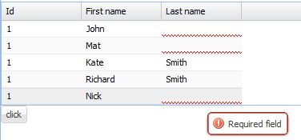

In this post I will present a simple plugin to `Ext.panel.Grid` which displays validation errors on a grid.
The validation mechanism is based on the model validation - useful feature of `Extjs` framework.
Let's start from creating a simple model:

```javascript
Ext.define('CustomerModel', {
    extend: 'Ext.data.Model',
    fields: [
        {name: 'id',  type: 'int'},
        { name: 'lastname', type: 'string' },
        {name: 'firstname',type:'string'}
    ],
    validations: [{type: 'presence', field: 'lastname', message:'Required field'}]
});
```

As we can see, this model has a `validation` field where we can define a validation mechanism for every field in our model.
In this example the `lastname` field is required, I use build in Extjs validator of the `presence` type.
More build-in validation types might be found [here](http://www.sencha.com/learn/using-validations-and-associations-in-sencha-touch).
Of course, it is possible to define custom validation types, simple example can be found on [Stackoverflow](http://stackoverflow.com/questions/7414115/how-to-add-a-custom-validation-rule-to-a-model-in-sencha-touch).
Having defined model validation, let's create `ValidatableGrid`plugin.
The main function of `ValidatableGrid` plugin is function called `validate` which is attached to grid component.
This function looks this way:

```javascript
validate: function(){
       var me = this, view = this.getView(),isValid = true;
       var columnLength = me.columns.length;
       me.getStore().each(function(record,idx){
           // remove existing validation errors
           for (var j = 0; j < columnLength; j++) {
               var cell = view.getCellByPosition({row: idx, column: j});
               cell.removeCls(me.clsInvalidField);
           }
           var validationResult = record.validate();
           if(!validationResult.isValid()){
               isValid= false;
               for(var i =0;i < validationResult.items.length;i++){
                   for (var j = 0; j < columnLength; j++) {
                       var cell = view.getCellByPosition({row: idx, column: j});
                       if(validationResult.items[i].field == me.columns[j].dataIndex){
                           cell.addCls("x-form-invalid-field");
                           cell.set({'data-errorqtip': validationResult.items[i].message});
                       }
                   }
               }
           }
       })
       return isValid;
   }
```

This function iterates through every model in grid's store and runs validation method.
As a result, we get a `validationResult` object which holds information about errors of model.
This object has a function `isValid` which returns true if there is no errors or false otherwise.
Having checked the model, we have to show errors on the grid.
In order to do that, we have to find a cell, in which invalid field is displayed using `getCellByPosition` function.
In the last step, we only have to modify `CSS` classes of cell.
That is why, I added `x-form-invalid-field` class to show red line in cell and also `data-errorqtip` class to show validation error tooltip.
The entire listing looks this way:

```javascript
Ext.define('ValidatableGrid', {
    grid:null,
    init: function (grid) {
        var me = this;
        me.grid = grid;
        me.grid.validate = me.validate;
    },

   validate: function(){
        var me = this, view = this.getView(),isValid = true;
        var columnLength = me.columns.length;
        me.getStore().each(function(record,idx){
            //remove existing validation errors
            for (var j = 0; j < columnLength; j++) {
                var cell = view.getCellByPosition({row: idx, column: j});
                cell.removeCls(me.clsInvalidField);
            }
            var validationResult = record.validate();
            if(!validationResult.isValid()){
                isValid= false;
                for(var i =0;i < validationResult.items.length;i++){
                    for (var j = 0; j < columnLength; j++) {
                        var cell = view.getCellByPosition({row: idx, column: j});
                        if(validationResult.items[i].field == me.columns[j].dataIndex){
                            cell.addCls("x-form-invalid-field");
                            cell.set({'data-errorqtip': validationResult.items[i].message});
                        }
                    }
                }
            }
        })
        return isValid;
    }
})
```

here is example of usage;

```javascript
Ext.QuickTips.init();

var store = Ext.create('Ext.data.Store', {
    model: 'CustomerModel'
});
store.add([{
    id: 1,
    firstname: 'John'
}, {
    id: 1,
    firstname: 'Mat'
}, {
    id: 1,
    firstname: 'Kate',
    lastname:  'Smith'
}, {
    id: 1,
    firstname: 'Richard',
    lastname:  'Smith'
}, {
    id: 1,
    firstname: 'Nick'
}]);

vGrid = Ext.create('Ext.grid.Panel', {
    store: store,
    plugins: [Ext.create('ValidatableGrid')],
    columns: [ { text: 'Id', dataIndex: 'id' },
               { text: 'First name', dataIndex: 'firstname' },
               { text: 'Last name', dataIndex: 'lastname' }]});

vGrid.validate();
```

and the result

[](http://tpodolak.com/blog/wp-content/uploads/2012/09/extjs-4-1-1-validatable-grid/ValidatableGridWithTooltip.jpg)

Source code for this post can be found [here](https://github.com/tpodolak/Blog/tree/master/ExtjsValidatableGrid)
