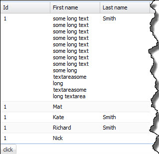
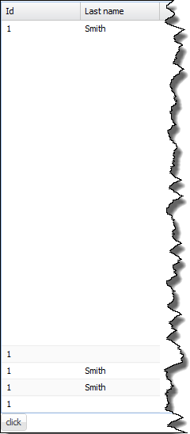
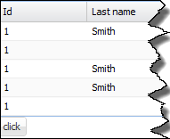

Recently I've encountered annoying problem with `Extjs` grid.
After hiding columns with long wrapped text, height of rows was dramatically increased.
Here are some screens presenting this particular situation. Grid with all columns shown

[](http://tpodolak.com/blog/wp-content/uploads/2012/09/extjs-4-1-1-how-to-fix-row-resize-phenomena/problembeforeshow.jpg)

and grid with one column hidden

[](http://tpodolak.com/blog/wp-content/uploads/2012/09/extjs-4-1-1-how-to-fix-row-resize-phenomena/problemaftershow.png)

The code responsible for rendering this grid is shown below

```css
.x-grid-cell-inner { white-space: normal; }
```

```javascript
Ext.onReady(function () {
        Ext.QuickTips.init();
        var store = Ext.create('Ext.data.Store', {
            fields: ['Id', 'firstname', 'lastname'],
            data: {
                items: [{
                    Id: 1,
                    firstname: 'some long text some long text some long text some long text some long text some long text some long text some long text some long textareasome long textareasome long textarea',
                    lastname: 'Smith'
                },{
                    Id: 1,
                    firstname: 'Mat'
                },{
                    Id: 1,
                    firstname: 'Kate',
                    lastname: 'Smith'
                },{
                    Id: 1,
                    firstname: 'Richard',
                    lastname: 'Smith'
                }]
            },
            proxy: {
                type: 'memory',
                reader: {
                    type: 'json',
                    root: 'items'
                }
            }
        });

       var visible = true;
       var grid = Ext.create('Ext.grid.Panel', {
            store: store,
            renderTo: Ext.getBody(),
            columns: [
                      { text: 'Id', dataIndex: 'Id' },
                      { text: 'First name', dataIndex: 'firstname' },
                      { text: 'Last name', dataIndex: 'lastname' }]});

        Ext.create('Ext.button.Button', {
            text: 'click',
            renderTo: Ext.getBody(),
            handler: function() {
                visible = !visible;
                grid.columns[1].setVisible(visible);
                grid.validate();
            }
        });
    });
```

After some digging, it turned out that `Extjs` hides columns by setting their width to `0px`.
In order to solve this problem and preverse text wrap in cells, I implemented small workaround.
Let's start from creating `CSS` class which disables word wrapping in grid cells.

```css
.noWrap .x-grid-cell-inner {white-space: nowrap;}
```

Next, we have to start listening for two events

- `columnhide`
- `columnshow`

In handlers of these events, we have to modify `tdCls` property of hidden column - add `noWrap` class, if column is hidden and delete this class otherwise.

```javascript
grid.headerCt.on({
            columnhide: function (headerCt, column) {
                column.tdCls = "noWrap";
                this.getView().refresh();
            },
            columnshow: function (headerCt, column) {
                column.tdCls = "";
                this.getView().refresh();
            },
            scope: grid
        });
```

From now hiding and showing columns works fine

[](http://tpodolak.com/blog/wp-content/uploads/2012/09/extjs-4-1-1-how-to-fix-row-resize-phenomena/fixedAfterHide.png)

Entire code listing is presented below

```javascript
``Ext.onReady(function () {
        Ext.QuickTips.init();
        var store = Ext.create('Ext.data.Store', {
            fields: ['Id', 'firstname', 'lastname'],
            data: {
                items: [{
                    Id: 1,
                    firstname: 'some long text some long text some long text some long text some long text some long text some long text some long text some long textareasome long textareasome long textarea',
                    lastname: 'Smith'
                },{
                    Id: 1,
                    firstname: 'Mat'
                },{
                    Id: 1,
                    firstname: 'Kate',
                    lastname: 'Smith'
                },{
                    Id: 1,
                    firstname: 'Richard',
                    lastname: 'Smith'
                }]
            },
            proxy: {
                type: 'memory',
                reader: {
                    type: 'json',
                    root: 'items'
                }
            }
        });

       var visible = true;
       var grid = Ext.create('Ext.grid.Panel', {
            store: store,
            renderTo: Ext.getBody(),
            columns: [
        { text: 'Id', dataIndex: 'Id' },
        { text: 'First name', dataIndex: 'firstname' },
        { text: 'Last name', dataIndex: 'lastname' }]});

        grid.headerCt.on({
            columnhide: function (headerCt, column) {
                column.tdCls = "noWrap";
                this.getView().refresh();
            },
            columnshow: function (headerCt, column) {
                column.tdCls = "";
                this.getView().refresh();
            },
            scope: grid
        });

        Ext.create('Ext.button.Button', {
            text: 'click',
            renderTo: Ext.getBody(),
            handler: function() {
                visible = !visible;
                grid.columns[1].setVisible(visible);
                grid.validate();
            }
        });
    });
```
