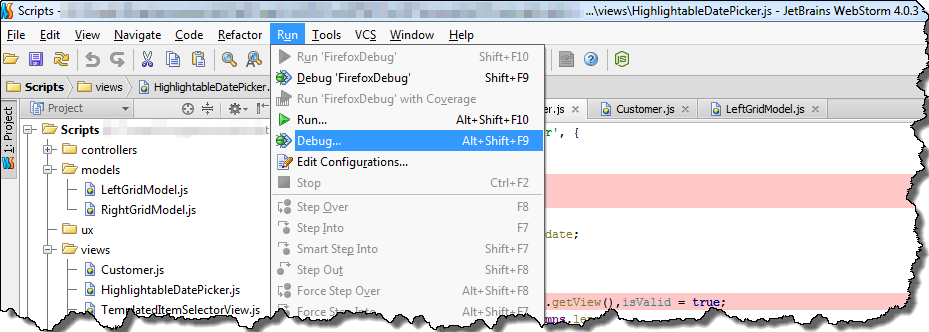
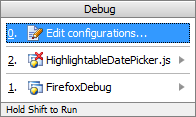
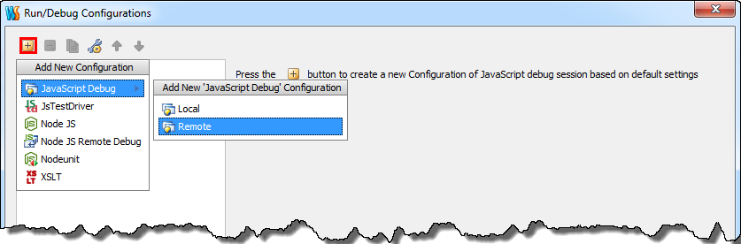
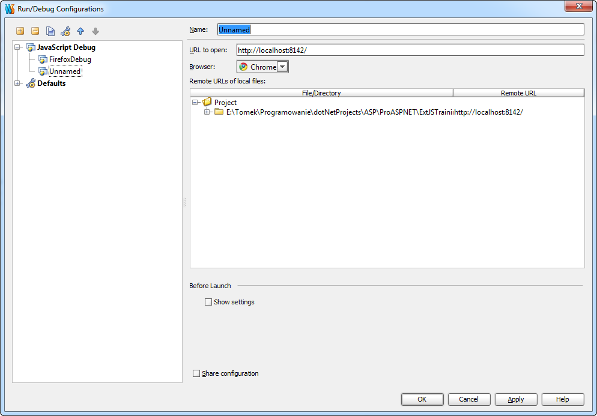
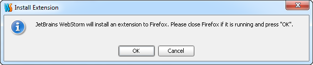
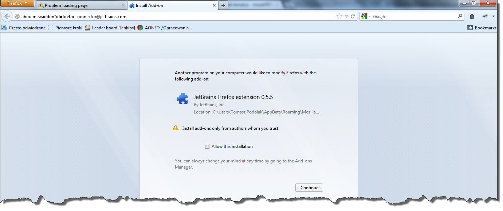
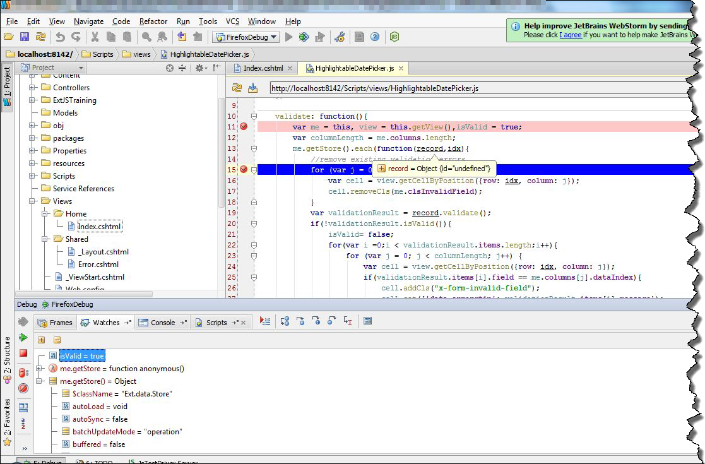

I've been working with `ASP .NET` combined with `Extjs` for about half a year. All this time for debugging I've been using `Firebug` in `Firefox`, or `Developer Tools` in `Chrome`. Although both of these tools are great, I decided to try to use build in `WebStorm` debugger. According to documentation this debugger should work with `Firefox` as well as with `Chrome`. However I've only managed to run it correctly with `Firefox`. In order to start debugging session, we have to make some preparation. Let's choose option `Debug...` from `Run` menu

In opened small window, we have to choose first option - `Edit configurations...`

In the next window we can create new debugging profile. In order to do that, click on `+` sign in the left upper corner of window, then choose `JavascriptDebug` and `Remote` option

This is the final step of the configuration. The most important fields in configuration window is `URL to open` field, in which we specify adress of our site. In my case it is localhost on port `8142`. We also have to specify mapping from remote host direcotry structure to our directory structure. Sample configuration is presented below

We also have a possibility to choose browser in which our site will be displayed. I decided to choose `Firefox` because of the fact, that `WebStorm` debugger had some problems with `Chrome`. Now we can try to run debugging session by pressing `ALT+F9`. If we choose `Firefox`, in the very first time we run debugger, we will see this window

which informs us that `WebStorm` must install extension to `Firefox`. Clicking `OK` button starts `Firefox`

which warns us that external program is trying to install extension. Clicking `continue` button will finish configuration process, and `WebStorm` will successfully attach debugger.

