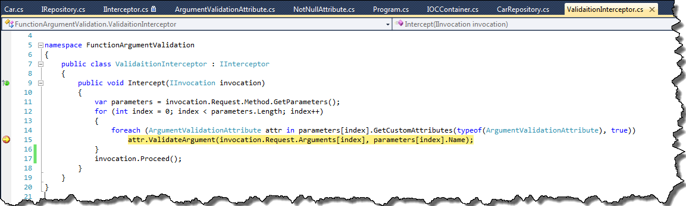
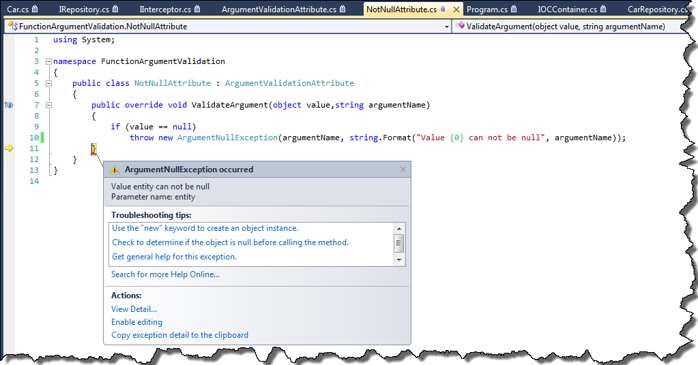

### 1\. Introduction

It is a common practice to validate function arguments before running actual code. Usually validation looks like that:

```csharp
public  void Update(Car entity)
{
    if(entity ==null)
        throw new ArgumentNullException("entity");
}

```

There is nothing wrong with this code, however we have to repeat this piece of code in every function. Of course we could create some helper class for argument validation and call approperiate validation function before launching rest of the code

```csharp
public static class ValidationHelper
{
    public static void CheckNotNull(object entity, string argumentName)
    {
        if (entity == null)
            throw new ArgumentNullException(argumentName);
    }
}

public  void Update(Car entity)
{
    ValidationHelper.CheckNotNull(entity, "entity");
    //rest of the code
}

```

However I was searching for more universal way for argument validation. That is why, I decided to try function interceptors and attributes.

### 2\. Creating validation attributes

Let's start for creating base attribute

```csharp
[AttributeUsage(AttributeTargets.Parameter)]
public abstract class ArgumentValidationAttribute : Attribute
{
    public abstract void ValidateArgument(object value, string argumentName);
}

```

In the next step let's create specialized attribute for "not null" validation. This argument may look this way:

```csharp
public class NotNullAttribute : ArgumentValidationAttribute
{
    public override void ValidateArgument(object value,string argumentName)
    {
        if (value == null)
            throw new ArgumentNullException(argumentName, string.Format("Value {0} can not be null", argumentName));
    }
}

```

### 3\. Using IInterceptor interface

That was an easy part, now it's necessary to somehow intercept function execution and run attribute validation.In .NET there is no build-in mechanism to do that,that is why I'll use extension for Ninject - Ninject Interception. First of all we have to add to our project three dll's

- Ninject
- Ninject.Extensions.Interception
- Ninject.Extensions.Interception.LinFu

You can easily add them using NuGet. Having all necessary files added to solution,let's create function interceptor - _ValidaitionInterceptor_.

```csharp
public class ValidationInterceptor : IInterceptor
{
    public void Intercept(IInvocation invocation)
    {
        var parameters = invocation.Request.Method.GetParameters();
        for (int index = 0; index < parameters.Length; index++)
        {
            foreach (ArgumentValidationAttribute attr in parameters[index].GetCustomAttributes(typeof(ArgumentValidationAttribute), true))
                attr.ValidateArgument(invocation.Request.Arguments[index], parameters[index].Name);
        }
        invocation.Proceed();       
    }
}

```

As You can see _ValidationInterceptor_ implements interface _IInterceptor_which belongs to _Ninject.Extensions.Interception_. This interface has one method _Intercept_ which is called before function from registered component is called. In this function I iterate over all function attributes of type ArgumentValidationAttribute and call _ValidateArgument_ function. If validation passess function _invocation.Proceed()_ is called, which continues execution of original function.

### 4\. Example of usage

In order to take advantage of benefits of function interceptors, we have to resolve objects from Ninject container. First of all I'll create some examplorary classes

```csharp
public interface IRepository where T:class
{
    List GetAll();
    void Update([NotNull] T entity);
}

public class Car
{
    public int Id { get; set; }
    public string Model { get; set; }
}

public class CarRepository : IRepository
{
    public  List GetAll()
    {
        return null;
    }

    public  void Update(Car entity)
    {
            
    }
}

```

In the next step I'll create simple wrapper for Ninject container and register CarRepository in Kernel

```csharp
public static class IOCContainer
{
    private static readonly IKernel Kernel;
    static IOCContainer()
    {
        Kernel = new StandardKernel();
    }

    public static void Configure()
    {
        Kernel.Bind(typeof(IRepository)).To(typeof(CarRepository)).Intercept().With();
    }

    public static T Get()
    {
        return Kernel.Get();
    }
}

```

Please, notice that registration of _CarRepository_ was used with option _Intercept().With()_. Thanks to this configuration,everytime we call method from CarRepository, _Intercept_ method from _ValidaitionInterceptor_ will be called first. Now, it is time to use our repository,we could do that this way

```csharp
class Program
{
    static void Main(string[] args)
    {
        IOCContainer.Configure();
        var carRepository = IOCContainer.Get>();
        carRepository.Update(null);
    }
}

```

Argument _entity_ in method _Update_ from interface _IRepository_ was decorated with _NotNull_, that is why our validation mechanism should throw exception. [](http://tpodolak.com/blog/wp-content/uploads/2012/10/argument-validation-with-attributes-and-ninject-interceptor/CallingValidationInInterceptor.png) [](http://tpodolak.com/blog/wp-content/uploads/2012/10/argument-validation-with-attributes-and-ninject-interceptor/Throw.png)

### 5\. Validation of return value

Using _IInterceptor_ we could go one step further and also validate return value of method. In order to do that, we have to slightly modify _Intercept_ method in _ValidaitionInterceptor_ class.

```csharp
public class ValidaitionInterceptor : IInterceptor
{
    public void Intercept(IInvocation invocation)
    {
        var parameters = invocation.Request.Method.GetParameters();
        for (int index = 0; index < parameters.Length; index++)
        {
            foreach (ArgumentValidationAttribute attr in parameters[index].GetCustomAttributes(typeof(ArgumentValidationAttribute), true))
                attr.ValidateArgument(invocation.Request.Arguments[index], parameters[index].Name);
        }

        invocation.Proceed();

        foreach (ArgumentValidationAttribute attr in invocation.Request.Method.ReturnTypeCustomAttributes.GetCustomAttributes(typeof(ArgumentValidationAttribute), true))
        {
            attr.ValidateArgument(invocation.ReturnValue, "return value");
        }
    }
}

```

We also have to change attribute usage of _ArgumentValidationAttribute_ to

```csharp
[AttributeUsage(AttributeTargets.Parameter | AttributeTargets.ReturnValue)]

```

Now, we can decorate function _GetAll_ with _NotNull_attribute

```csharp
[return: NotNull]
List GetAll();

```

Since this moment, everytime function _GetAll_ returns null, the ArgumentNullException will be thrown.

### 6\. Drawbacks

Unfortunately using attributes for argument validation have some drawbacks. First of all, argument validation is based on function interceptors, and as I mentioned before only function, which are in objects, which are resolved from IoC container can be intercepted. What is more, interceptors allow us to intercept only functions marked as virtual or inhirited from interface. Source code for this post can be found [here](https://github.com/tpodolak/Blog/tree/master/NInjectInterceptors)
