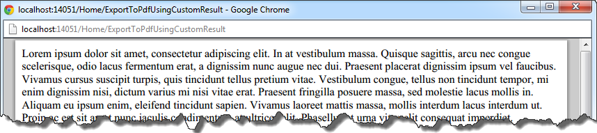

### 1\. Introduction

In the company I'm currently working for, it is a common practice to use Devexpress XtraReports to create all kind of reports. Usually these reports are embedded into html page and used along with DevexpressReportViewer. However, lately I have been asked to open a report as a PDF file, without putting a viewer into a html page.

### 2\. First approach

After some digging, I created an action in controller which looks like this

```csharp
public void ExportToPdf()
{
    using (MemoryStream stream = new MemoryStream())
    {
        var testReport = new TestReport();
        testReport.CreateDocument();
        testReport.ExportToPdf(stream);
        Response.Clear();
        Response.ContentType = "application/pdf"
        Response.BinaryWrite(stream.ToArray());
    }
}

```

In the first step I made a new instance of a devexpress report(TestReport), then I called a method _CreateDocument_ which is responsible for creating a content of report. Having prepared the report, I could use the _ExportToPdf_ function which creates a stream in a PDF format. In the last step, I cleared Response property and added an array of bytes into it. I also had to change _Response.ContentType_ to "application/pdf" in order to inform a browser that I'm sending a pdf file.

### 3\. Second approach - custom ActionResult

The solution presented above works fine, however, I wanted to create something more reusable, that is why I decided to create a custom _ActionResult - PDFActionResult_. In order to create my own _ActionResult_, I created a _PDFActionResult_ class which inherits from an abstract ActionResult class.

```csharp
public class PDFActionResult : ActionResult
{
    private readonly byte[] _byteArray;
    private const string ContentType = "application/pdf";
    
    public PDFActionResult(byte[] byteArray)
    {
        _byteArray = byteArray;
    }
    
    public PDFActionResult(XtraReport report)
    {
        using(MemoryStream stream = new MemoryStream())
        {
            report.CreateDocument();
            report.ExportToPdf(stream);
            _byteArray = stream.ToArray();
        }
    }
    
    public override void ExecuteResult(ControllerContext context)
    {
        var response = context.HttpContext.Response;
        response.Clear();
        response.ContentType = ContentType;
        response.BinaryWrite(_byteArray);
    }
}

```

As you can see, all logic from the _ExportToPdf_ action was transferred to the PDFActionResult class. Now, all you have to do to return Pdf from DevexpressReport is to return the PDFActionResult from your controller action.

```csharp
public PDFActionResult ExportToPdfUsingCustomResult()
{
    var testReport = new TestReport();
    return new PDFActionResult(testReport);
}

```

[](http://tpodolak.com/blog/wp-content/uploads/2012/12/asp-net-mvc-custom-actionresult-pdfresult/ResultPDF.bmp) Source code for this post can be found [here](https://github.com/tpodolak/Blog/tree/master/AspCustomActionResult)
