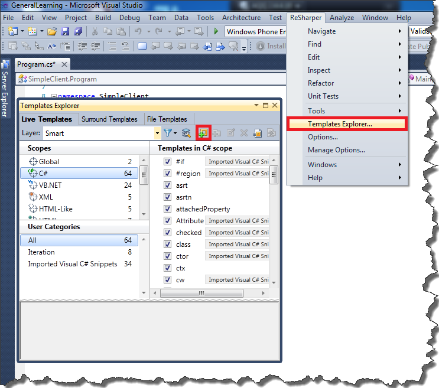
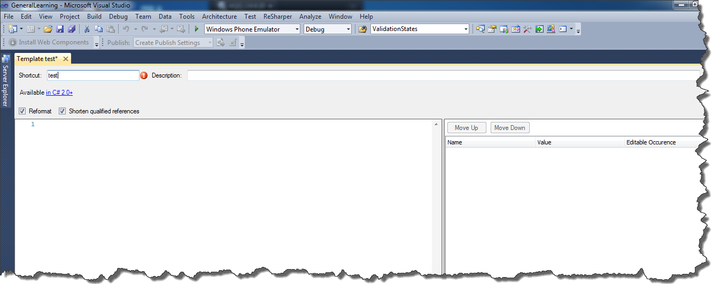
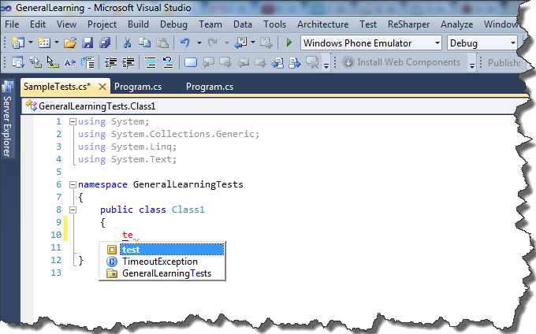
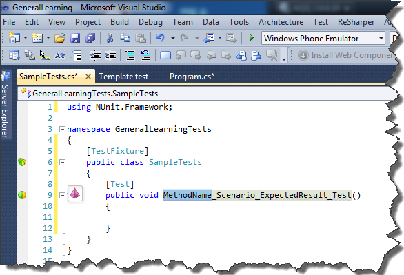

I think all Resharper users are familiar with snippets. Resharper's snippet basically generates a piece of code, which can be easily customised on the fly. All you have to do is to press _TAB_, and you can change names of auto-generated variables etc. Today, I decided to write my own snippet, which would make writing unit tests easier. In general, all my unit test methods looks like this

```csharp
[Test]
public void MethodName_Scenario_ExpectedResult_Test()
{
    //test logic goes in here            
}

```

So let's write a snippet which will generate a method with this signature. In order to do this, let's choose a _Templates Explorer..._ from the Resharper’s menu. [](http://tpodolak.com/blog/wp-content/uploads/2013/01/resharper-custom-snippet/TemplateExplorerFirstWindow.png) In the opened window, click on the plus sign and a new tab should appear. [](http://tpodolak.com/blog/wp-content/uploads/2013/01/resharper-custom-snippet/TemplateExplorerFullView.png) Let's name our snippet _test_ and paste the following code into the main editor.

```csharp
[Test]
public void MethodName_Scenario_ExpectedResult_Test()
{
           
}

```

Now, we've created a simplified snippet for generating our test function signature. However, this snippet is not really useful as its user cannot navigate through the underscored chunks. In order to employ the Resharper’s navigation features, we have to slightly modify our snippet. Let's replace the previous code with this one:

```csharp
[Test]
public void $MethodName$_$Scenario$_$ExpectedResult$_Test()
{
    $END$
}

```

Please notice that now some parts of the method’s name are written between dollar signs. Thanks to this syntax, the Resharper is able to iterate over these parts and lets us change their names on the fly. _$END$_ is a special control sequence which tells the Resharper where to stop iteration over variables. At this moment, our snippet is fully functional and we can use it by typing the word test and hitting the _TAB_ button. [](http://tpodolak.com/blog/wp-content/uploads/2013/01/resharper-custom-snippet/CustomSnippetIntellisense.png) [](http://tpodolak.com/blog/wp-content/uploads/2013/01/resharper-custom-snippet/SnippetFirstChunk.png)
