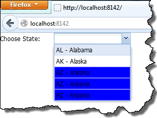

I've recently been asked to create `ComboBox` with custom styled `drop-down` list. Colors of items of drop-dow list should be picked based on values of record bounded to given item. After reading some post on Extjs forum, I decided to overwrite default template of `drop-down` list.

```javascript
Ext.create('Ext.XTemplate',
                     '<tpl for=".">',
                       '<div class="{[this.getClass(values)]}">{abbr} - {name}</div>',
                     '</tpl>',{
                            getClass: function (rec) {
                                return rec.name == 'Arizona' ? 'x-boundlist-item x-highlighted-item' : 'x-boundlist-item';
                        }
                    }
    )
```

As You can see I decided to use `XTemplate`, which (to the contrary to `Template`) allows to call user defined function. Function `getClass` from `XTemplate` will be called for each element in ComboBox's store. The result of this function will be inserted into class attribute of `div` element, which is resposible for displaying single item in drop-down list. Please notice, that in order to maintain ability to select items from `drop-down` list, it is necessary to specify `x-boundlist-item` class in template. Here is example of usage

```css
div.x-highlighted-item {
    background: blue !important; 
}
```

```javascript

var states = Ext.create('Ext.data.Store', {
            fields: ['id', 'abbr', 'name'],
            data: [
                { id: 1, abbr: "AL", name: "Alabama" },
                { id: 2, abbr: "AK", name: "Alaska" },
                { id: 3, abbr: "AZ", name: "Arizona" },
                { id: 4, abbr: "AZ", name: "Arizona" },
                { id: 5, abbr: "AZ", name: "Arizona" }
            ]
        });

  Ext.create('Ext.form.ComboBox', {
       fieldLabel: 'Choose State',
       store: states,
       queryMode: 'local',
       valueField: 'abbr',
       displayField: 'name',
       renderTo: Ext.getBody(),
       tpl: Ext.create('Ext.XTemplate',
                '<tpl for=".">',
                  '<div class="{[this.getClass(values)]}">{abbr} - {name}</div>',
                 '</tpl>',
                    {
                        getClass: function (rec) {
                            return rec.name == 'Arizona' ? 'x-boundlist-item x-highlighted-item' : 'x-boundlist-item';
                        }
                    }
    )
});
```

and the result

[](http://tpodolak.com/blog/wp-content/uploads/2013/03/extjs-changing-style-of-items-in-dropdownlist/Result.png)

Source code for this post can be found [here](https://github.com/tpodolak/Blog/tree/master/ExtjsChangeStyleInDropDown)
