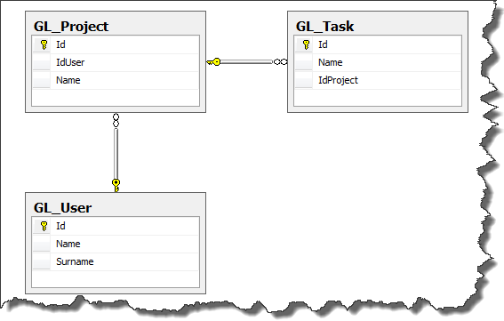
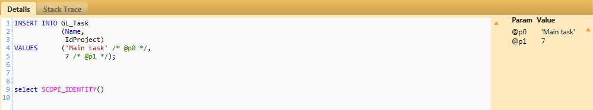
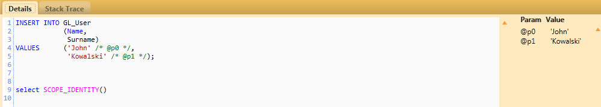
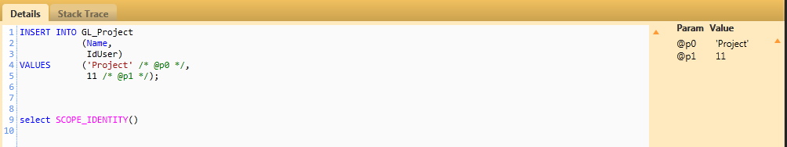
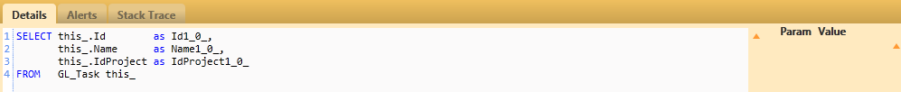

### 1\. Introduction

Writing mappings for models in large application is quite boring task. Fortunatelly, Fluent NHibernate provides possibility for automatic mapping creation - so called automappings.

### 2\. Creating database and model

In order to show you, how to configure automappings in Fluent NHibernate, let's create simple database along with model classes. The database structure is presented in the picture below. [](http://tpodolak.com/blog/wp-content/uploads/2013/03/fluent-nhibernate-automappings/DBDiagram.png) Model classes which represent database tables look this way

```csharp
public abstract class ModelBase
{
    public virtual int Id { get; set; }
}

public class Project : ModelBase
{
    public virtual string Name { get; set; }
    public virtual User User { get; set; }
    public virtual IList Tasks { get; set; }
}

public class Task : ModelBase
{
    public virtual string Name { get; set; }
    public virtual Project Project { get; set; }
}

public class User : ModelBase
{
    public virtual string Name { get; set; }
    public virtual string Surname { get; set; }
}

```

### 3\. Automappings configuration

Having our database and models prepared, now we can create and configure SessionFactory to use automappings.

```javascript
var factory = Fluently.Configure().Database(MsSqlConfiguration.MsSql2008.ConnectionString("YourConnectionString"))
                      .Mappings(val => val.AutoMappings.Add(AutoMap.AssemblyOf))
                      .BuildSessionFactory();

```

As You can see I used the static AutoMap.AssemblyOf method. This method takes a generic type parameter from which Fluent NHibernate can deduce which assembly to look in for mappable entities. From now all classes defined in the assemlby of _Project_ are mapped using build-in convention.

### 4\. Mapping only specified classes

Mapping all classes from specyfic assembly may not be very useful. That is why, we need to "tell" Automapper which classes should be mapped. It can be achieved by creating custom configuration class which implements _IAutomappingConfiguration_ interface or which is subclass of _DefaultAutomappingConfiguration_. _IAutomappingConfiguration_ interface has quite a lot of functions, that is why I decided to craete class which inherits from _DefaultAutomappingConfiguration_ and override only one method - _ShouldMap_

```csharp
public class AutomappingConfiguration : DefaultAutomappingConfiguration
{
    public override bool ShouldMap(Type type)
    {
        return type.IsSubclassOf(typeof (ModelBase));
    }
}

```

As You can see by overriding _ShouldMap_ function,I specified that only classes which inherit from _ModelBase_ class should be mapped. To use our new configuration, we need to pass an instance of it to AutoMap setup

```javascript
var factory = Fluently.Configure().Database(MsSqlConfiguration.MsSql2008.ConnectionString("YourConnectionString"))
                      .Mappings(val => val.AutoMappings.Add(AutoMap.AssemblyOf(new  DefaultAutomappingConfiguration())))
                      .BuildSessionFactory();

```

### 5\. Defining custom conventions

It is rather obvious that default automapping conventions may not come along with our database naming conventions. Fortunately we can create custom conventions(which override default ones), and pass them to AutoMap configuration. Here are examples of conventions I use _IClassConvention_ - gives us access to properties and functions which allow us to change a default table name format for our entities.

```csharp
public class DefaultTableNameConvention : IClassConvention
{
    public void Apply(IClassInstance instance)
    {
        instance.Table(string.Format("{0}{1}", "GL_", instance.EntityType.Name));
    }
}

```

_IIdConvention_ is used for altering default identity conventions.

```csharp
public class DefaultPrimaryKeyConvention : IIdConvention
{
    public void Apply(IIdentityInstance instance)
    {
        instance.Column("Id");
        instance.GeneratedBy.Native();
    }
}

```

_IPropertyConvention_ - allows us to modify properties mappings (lazy load, nullability,length etc)

```csharp
public class DefaultStringLengthConvention : IPropertyConvention
{
    public void Apply(IPropertyInstance instance)
    {
        instance.Length(50);
    }
}

```

_IReferenceConvention_ - allows us to modify entities relationship convention

```csharp
public class DefaultReferenceConvention : IReferenceConvention
{
    public void Apply(IManyToOneInstance instance)
    {
        instance.Column(string.Format(instance.Class.Name.StartsWith("Id") ? "{1}" : "{0}{1}", "Id",
                                      instance.Class.Name));
        instance.LazyLoad();
    }
}

```

_IHasManyConvention_ - allow us to modify default has-many relationship convention

```csharp
public class DefaultHasManyConvention : IHasManyConvention
{
    public void Apply(IOneToManyCollectionInstance instance)
    {
        instance.Key.Column(string.Format("{0}{1}", "Id", instance.EntityType.Name));
        instance.LazyLoad();
    }
}

```

In order to use new conventions we need to pass them into AutoMap configuration.

```csharp
Fluently.Configure()
                .Database(
                    MsSqlConfiguration.MsSql2008.ConnectionString("YourConnectionString"))
                .Mappings(val => val.AutoMappings.Add(AutoMap.AssemblyOf(new DefaultAutomappingConfiguration()).Conventions.Setup(con =>
                                                                           {
                                                                               con.Add();
                                                                               con.Add();
                                                                               con.Add();
                                                                               con.Add();
                                                                               con.Add();
                                                                           })))
                .BuildSessionFactory();

```

### 6\. Overriding mappings

Sometimes it is necessary to slightly modify entity mapping. It can be achieved by creating class which implements _IAutoMappingOverride_ interface

```csharp
public class ProjectMapping: IAutoMappingOverride
{
    public void Override(AutoMapping mapping)
    {
        mapping.IgnoreProperty(val=>val.SomeIgnoredProperty);
    }
}

```

_Override_ method gives us access to all actions known from fluent mappings. After creating class map, we have to call function _UseOverridesFromAssemblyOf_ in our automapping configuration

```javascript
var factory = Fluently.Configure().Database(MsSqlConfiguration.MsSql2008.ConnectionString("YourConnectionString"))
                                  .Mappings(val => val.AutoMappings.Add(AutoMap.AssemblyOf(new DefaultAutomappingConfiguration()).UseOverridesFromAssemblyOf()
                                  .Conventions.Setup(con =>
                                                                           {
                                                                               con.Add();
                                                                               con.Add();
                                                                               con.Add();
                                                                               con.Add();
                                                                               con.Add();
                                                                           }))).BuildSessionFactory();

```

### 7\. It works

Here just couple of screens from NHibernateProfiler with basic queries [](http://tpodolak.com/blog/wp-content/uploads/2013/03/fluent-nhibernate-automappings/InsertIntoTask.png) [](http://tpodolak.com/blog/wp-content/uploads/2013/03/fluent-nhibernate-automappings/InsertIntoUser.png) [](http://tpodolak.com/blog/wp-content/uploads/2013/03/fluent-nhibernate-automappings/InsertIntoProject.png) [](http://tpodolak.com/blog/wp-content/uploads/2013/03/fluent-nhibernate-automappings/SelectFromTask.png) Source code for this post can be found [here](https://github.com/tpodolak/Blog/tree/master/NHibernateAutomappings)
