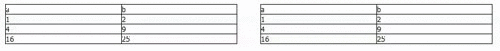

Extjs framework provides us with two helper classes responsible for performing drag-drop operation:  

- Ext.dd.DragZone
The most important element of this class is _getDragData_ function, which provides data for drag operation. It is necessary for this method to return object with _ddel_ property containing DOM element, from which draging operation was originated.- Ext.dd.DropZone
This class has two important methods. The first one is _getTargetFromEvent_ which informs if drop operation should be performed. The other one is _onNodeDrop_ which is responsible for actual drop operation.

  
Having covered the basics, let's try to implement drag-drop operation. Let's start from creating simple container with two tables.

```
Ext.define('GeneralLearning.views.DragAndDropView', {
    extend:'Ext.container.Container',
    renderTpl:Ext.create('Ext.Template',
     '',
        '',
             '',
                '',
                '',
             '',
            '',
                '',
                '',
            '',
            '',
                '',
                '',
            '',
            '',
                '',
                '',
            '',
        'ab12491625',
        '',
             '',
                '',
                '',
             '',
             '',
                '',
                '',
            '',
            '',
                '',
                '',
            '',
            '',
                '',
                '',
            '',
        'ab12491625',
    '')
})

```

In the next step we will create DragZone and DropZone.

```
 createDragDropZones:function () {
        var me = this,
            rightTable = me.el.select('#rightTable').first(),
            leftTable = me.el.select('#leftTable').first();
        Ext.create('Ext.dd.DragZone', rightTable, {
            getDragData:function (e) {
                if (e.target.nodeName == 'TD') {
                    var sourceEl = e.target;
                    var d = sourceEl.cloneNode(true);
                    d.id = Ext.id();
                    return {
                        ddel:d,
                        sourceEl:sourceEl,
                        repairXY:Ext.fly(sourceEl).getXY()
                    }
                }

            },
            getRepairXY:function () {
                return this.dragData.repairXY;
            }
        });

        Ext.create('Ext.dd.DropZone', leftTable, {
            getTargetFromEvent:function (e) {
                if (e.target.nodeName == 'TD')
                    return e.target;
            },
            onNodeEnter:function (target, dd, e, data) {
                Ext.fly(target).addCls('drop-target-hover');
            },
            onNodeOut:function (target, dd, e, data) {
                Ext.fly(target).removeCls('drop-target-hover');
            },
            onNodeOver:function (target, dd, e, data) {
                return Ext.dd.DropZone.prototype.dropAllowed;
            },
            onNodeDrop:function (target, dd, e, data) {
                target.parentNode.replaceChild(dd.dragData.ddel, target)
                return true;
            }
        })
    }

```

As You cas see _DragZone_ was created on the right table. I want to be able to drag only _td_ elements, that is why function _getDragData_ returns null, if drag operation was originated from other HTML element. Extjs will take care of showing approperiate animation, if drag-drop is available. I also overrode _getRepairXY_ method, which is responsible for providing _X_ and _Y_ coordinates for animation, which is fired in case of invalid drop off. The code responsible for handling drop operation is a little bit more complicated. After creating a _DropZone_ from left table, I ovverode _getTargetFromEvent_ method, so as to drop could be performed only to _td_ elements of table. What is more, using _onNodeEnter_ and _onNodeOut_ methods I changed target elements of the drop, to show user where given element will be placed. Actual drop is performed in _onNodeDrop_ method, in my case I just replace HTML node form original one to dropped. Here is a result: [](http://tpodolak.com/blog/wp-content/uploads/2013/05/extjs-drag-and-drop-between-tables/dragdrop.gif) Entire code listing looks like that:

```
 #table_container table { border: 1px solid black;float:left;width:400px;}
 #table_container td, #table_container th   { border: 1px solid black;}
 
 td.drop-target-hover {
     border-color: yellow !important;
     border-width: 3px !important;
 }

```

```
Ext.define('GeneralLearning.views.DragAndDropView', {
    extend:'Ext.container.Container',
    renderTpl:Ext.create('Ext.Template',
     '',
        '',
             '',
                '',
                '',
             '',
            '',
                '',
                '',
            '',
            '',
                '',
                '',
            '',
            '',
                '',
                '',
            '',
        'ab12491625',
        '',
             '',
                '',
                '',
             '',
             '',
                '',
                '',
            '',
            '',
                '',
                '',
            '',
            '',
                '',
                '',
            '',
        'ab12491625',
    ''),

    initComponent:function () {
        var me = this;
        me.callParent(arguments);
        me.on('afterrender', me.createDragDropZones, me);
    },

    createDragDropZones:function () {
        var me = this,
            rightTable = me.el.select('#rightTable').first(),
            leftTable = me.el.select('#leftTable').first();
        Ext.create('Ext.dd.DragZone', rightTable, {
            getDragData:function (e) {
                if (e.target.nodeName == 'TD') {
                    var sourceEl = e.target;
                    var d = sourceEl.cloneNode(true);
                    d.id = Ext.id();
                    return {
                        ddel:d,
                        sourceEl:sourceEl,
                        repairXY:Ext.fly(sourceEl).getXY()
                    }
                }
            },
            getRepairXY:function () {
                return this.dragData.repairXY;
            }
        });

        Ext.create('Ext.dd.DropZone', leftTable, {
            getTargetFromEvent:function (e) {
                if (e.target.nodeName == 'TD')
                    return e.target;
            },
            onNodeEnter:function (target, dd, e, data) {
                Ext.fly(target).addCls('drop-target-hover');
            },
            onNodeOut:function (target, dd, e, data) {
                Ext.fly(target).removeCls('drop-target-hover');
            },
            onNodeOver:function (target, dd, e, data) {
                return Ext.dd.DropZone.prototype.dropAllowed;
            },
            onNodeDrop:function (target, dd, e, data) {
                target.parentNode.replaceChild(dd.dragData.ddel, target)
                return true;
            }
        })
    }
})

```

Source code for this post can be found [here](https://github.com/tpodolak/Blog/tree/master/ExtjsDragDrop)
