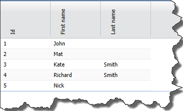

Extjs doesn't provide us with any build-in mechanism for flipping text vertically in grid's header. Fortunately we can achieve this effect by using a mixture of CSS rules and some javascript code. In order to make code more reusable, I'll write it as a plugin for grid. Let's start from creating CSS rules responsible for text rotation

```
.v-vertical-header-grid .x-column-header  .x-column-header-text
   {
       display:block;
       margin-left:auto;
       margin-right:auto;
       text-align: left;
       -webkit-transform: rotate(-90deg);     
       -moz-transform: rotate(-90deg);     
       -o-transform: rotate(-90deg);    
       -ms-transform: rotate(-90deg); /* IE  */                             
}

```

_.x-column-header .x-column-header-text_ is a selector for header text in every Extjs grid. It is obvious that we want only certain grids to have vertical headers, that is why I extended selector with additional custom class _.v-vertical-header-grid_. Having CSS class prepared, now we can write actual plugin.

```
Ext.define('GeneralLearning.ux.VerticalHeader', {
    alias: 'plugin.verticalheader',
    grid: null,
    textMetric: null,
    init: function (grid) {
        var me = this;
        me.grid = grid;
        me.grid.addCls('v-vertical-header-grid');
        me.textMetric = new Ext.util.TextMetrics();
        me.grid.on({
            afterlayout: {
                scope: me,
                fn: me.handleAfterLayout
            }
        });
    },

    constructor: function (cfg) {
        Ext.apply(this, cfg);
    },

    handleAfterLayout: function (cmp) {
        var me = this,
            maxWidth = 0,
            headerItems = cmp.headerCt.items,
            curremtWidth;

        headerItems.each(function (item) {
            if ((curremtWidth = me.textMetric.getWidth(item.text)) > maxWidth) {
                maxWidth = curremtWidth + 10;
            }
        });

        cmp.headerCt.el.select('.x-column-header-text').each(function (el) {
            el.setSize(maxWidth, maxWidth);
        });
    }
});

```

At the very beginning _.v-vertical-header-grid_ class is added to the grid. Thanks to this, CSS selector created in the first step is able to select text in header. At this point text is rotated, however it can't fit into header - its size didn't change. That is why in function _handleAfterLayout_ I manually measure text height using _Ext.util.TextMetrics_ and change height of header.Solution presented above works fine in IE10, Opera, Firefox and Chrome. There were some problems in IE9, however extending CSS class with these rules

```
.v-vertical-header-grid .x-column-header {
                background-image: -ms-linear-gradient(rgb(249, 249, 249), rgb(227, 228, 230)) !important;
                filter: progid:DXImageTransform.Microsoft.gradient(GradientType=0,startColorstr='#F9F9F9', endColorstr='#E3E4E6');

  }
  
  .v-vertical-header-grid .x-grid-header-ct {
                background-image: -ms-linear-gradient(rgb(249, 249, 249), rgb(227, 228, 230)) !important;
                filter: progid:DXImageTransform.Microsoft.gradient(GradientType=0,startColorstr='#F9F9F9', endColorstr='#E3E4E6');

  }

```

did the trick. Here is the result [](http://tpodolak.com/blog/wp-content/uploads/2013/06/extjs-vertical-header-in-grid/result.png) Source code for this post can be found [here](https://github.com/tpodolak/Blog/tree/master/ExtjsVerticalGridHeader)  
**There is a problem with this plugin and locked columns, please see the updated version of this plugin [here](http://tpodolak.com/blog/2013/11/10/extjs-vertical-header-in-grid-and-locked-columns)**
