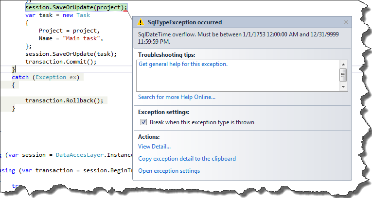

I think, that it is a common practice to store information about creation and modification date of entities. However keeping appropriate columns up to date manually is error prone. We must remember that every time we modify entity, we also have to change its modification date. Fortunately thanks to event listeners, NHibernate can do all of this boring stuff for us. Let's start from creating class which implements two interfaces:

- IPreInsertEventListener
- IPreUpdateEventListener

```
public class NHListener : IPreInsertEventListener, IPreUpdateEventListener
{
    public bool OnPreInsert(PreInsertEvent @event)
    {
        throw new NotImplementedException();
    }

    public bool OnPreUpdate(PreUpdateEvent @event)
    {
        throw new NotImplementedException();
    }
}

```

As You probably guessed OnPreInsert method is invoked before insert, and OnPreUpdate is called before update of entity. Having prepared the basic skeleton of class, it is time to configure NHibernate to use our event listeners. The basic configuration is taken from my previous post about NHibernate [automappings](http://tpodolak.com/blog/2013/03/25/fluent-nhibernate-automappings), so I will only extend it by appending event listeners

```
Fluently.Configure().Database(
                    MsSqlConfiguration.MsSql2008.ConnectionString(
                        @"YourConnectionString"))
                    .Mappings(val => val.AutoMappings.Add(CreateAutomappings))
                    .ExposeConfiguration(val =>
                    {
                        val.AppendListeners(ListenerType.PreUpdate, new IPreUpdateEventListener[] { new NHListener() });
                        val.AppendListeners(ListenerType.PreInsert, new IPreInsertEventListener[] { new NHListener() });
                    })
                    .BuildSessionFactory();

```

Now we can put some logic into OnPreInsert and OnPreUpdate functions. First of all we have to somehow identify entities which hold information about creation and modification time. In order to do that I created simple interface _IDateInfo_

```
public interface IDateInfo
{
    DateTime ModificationDate { get; set; }
    DateTime CreationDate { get; set; }
}

```

In the next step we have to modify _OnPreInsert_ and _OnPreUpdate_ methods, so that they can set creation and modification date of entities which implement _IDateInfo_ interface.

```
public class NHListener : IPreInsertEventListener, IPreUpdateEventListener
{
    public bool OnPreInsert(PreInsertEvent @event)
    {
        IDateInfo dateInfo;
        if ((dateInfo = @event.Entity as IDateInfo) != null)
        {
            var currentDate = DateTime.Now;
            dateInfo.CreationDate = dateInfo.ModificationDate = currentDate;
        }
        return false;
    }

    public bool OnPreUpdate(PreUpdateEvent @event)
    {
        IDateInfo dateInfo;
        if ((dateInfo = @event.Entity as IDateInfo) != null)
        {
            var currentDate = DateTime.Now;
            dateInfo.ModificationDate = currentDate;
        }
        return false;
    }
}

```

Unfortunately at this moment saving entity (which implements IDateInfo interface) will throw exception [](http://tpodolak.com/blog/wp-content/uploads/2013/08/nhibarnate-using-event-listeners-to-set-entity-modification-date/Exception.png) Despite the fact that we set values of _ModificationDate_ and _CreationDate_ properties , NHiberante seems not to notice that. That is why we have to manually update values of _State_ object from _PreInsertEvent_ and _PreUpdateEvent_. According to the documentation _State_ object from class _PreInsertEvent_ holds values which should be inserted and _State_ object from class _PreUpdateEvent_ holds values which should be updated. Function which update values of state object might look like that

```
private void SetState(IEntityPersister persister, object[] state, string propertyName, object value)
{
    var index = Array.IndexOf(persister.PropertyNames, propertyName);
    if (index == -1)
        return;
    state[index] = value;
}

```

Updated NHListener class now looks like that

```
using System;
using System.Linq.Expressions;
using NHibernate.Event;
using NHibernate.Impl;
using NHibernate.Persister.Entity;

namespace DataAccessLayer
{
    public class NHListener : IPreInsertEventListener, IPreUpdateEventListener
    {
        private static readonly string ModificationDatePropertyName = GetPropertyName(val => val.ModificationDate),
                                       CreationDatePropertyName = GetPropertyName(val => val.CreationDate);

        public bool OnPreInsert(PreInsertEvent @event)
        {
            IDateInfo dateInfo;
            if ((dateInfo = @event.Entity as IDateInfo) != null)
            {
                var currentDate = DateTime.Now;
                dateInfo.CreationDate = dateInfo.ModificationDate = currentDate;
                SetState(@event.Persister, @event.State, ModificationDatePropertyName, currentDate);
                SetState(@event.Persister, @event.State, CreationDatePropertyName , currentDate);
            }
    
            return false;
        }
    
        public bool OnPreUpdate(PreUpdateEvent @event)
        {
            IDateInfo dateInfo;
            if ((dateInfo = @event.Entity as IDateInfo) != null)
            {
                var currentDate = DateTime.Now;
                dateInfo.ModificationDate = currentDate;
                SetState(@event.Persister, @event.State, ModificationDatePropertyName, currentDate);
            }
            return false;
        }
        
        private void SetState(IEntityPersister persister, object[] state, string propertyName, object value)
        {
            var index = Array.IndexOf(persister.PropertyNames, propertyName);
            if (index == -1)
                return;
            state[index] = value;
        }
    
        private static string GetPropertyName(Expression> expression)
        {
            return ExpressionProcessor.FindPropertyExpression(expression.Body);
        }
    }
}

```

As You can see, after setting values of IDateInfo I also call function _SetState_ and update state of appropriate properties. From now everything works fine and our entities can be saved without problems. Source code for this post can be found [here](https://github.com/tpodolak/Blog/tree/master/NHibernateEventListener)
