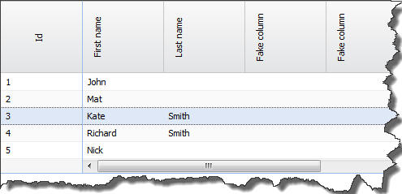

A while ago I wrote an article where I described how to create a plugin, which can flip header of `Ext.panel.Grid` vertically.
I've been using this plugin for a couple of months in a company I work for, however in the last week it turned out that this extension does not work for grid with [locked columns](http://dev.sencha.com/deploy/ext-4.0.0/examples/grid/locking-grid.html).
After digging into `Extjs` source code I found out that when You use locked columns, the grid is created as a combination of two grids: `normalGrid` and `lockedGrid`.
Therefore it is necessary to apply vertical-header plugin to these two grids separately. In order to do that, I improved this extension to detect if grid has locked columns or not.
The main change is in `init` function which now looks that way

```javascript
init: function (grid) {
      var me = this;
      me.grid = grid;
      me.grid.addCls('v-vertical-header-grid');
      me.textMetric = new Ext.util.TextMetrics();

      if (me.isLocked()){
          var normalGridPlugin = Ext.create('GeneralLearning.ux.VerticalHeader',me.extraCfg),
              lockedGridPlugin = Ext.create('GeneralLearning.ux.VerticalHeader',me.extraCfg);
              normalGridPlugin.init(me.grid.normalGrid);
              lockedGridPlugin.init(me.grid.lockedGrid);
              me.grid.normalGrid.plugins.push(normalGridPlugin);
              me.grid.lockedGrid.plugins.push(lockedGridPlugin);
      } else {
          me.grid.on({
              afterlayout: {
                  scope: me,
                  fn: me.handleAfterLayout
              }
          });
      }
}
```

In the first step I check if columns are locked. The method for do that is pretty straightforward

```javascript
isLocked: function () {
          var me = this;
          return me.grid.normalGrid && me.grid.lockedGrid;
}
```

Afterward I do create two instances of vertical-header plugin and initialize them with appropriate partial grid (`lockedGrid` or `normalGrid`).
Entire code listing is presented below

```javascript
Ext.define('GeneralLearning.ux.VerticalHeader', {
    alias: 'plugin.verticalheader',
    grid: null,
    extraCfg:null,
    textMetric: null,
    init: function (grid) {
        var me = this;
        me.grid = grid;
        me.grid.addCls('v-vertical-header-grid');
        me.textMetric = new Ext.util.TextMetrics();

        if (me.isLocked()) {
            var normalGridPlugin = Ext.create('GeneralLearning.ux.VerticalHeader',me.extraCfg),
                lockedGridPlugin = Ext.create('GeneralLearning.ux.VerticalHeader',me.extraCfg);
                normalGridPlugin.init(me.grid.normalGrid);
                lockedGridPlugin.init(me.grid.lockedGrid);
                me.grid.normalGrid.plugins.push(normalGridPlugin);
                me.grid.lockedGrid.plugins.push(lockedGridPlugin);

        } else {
            me.grid.on({
                afterlayout: {
                    scope: me,
                    fn: me.handleAfterLayout
                }
            });
        }
    },

    constructor: function (cfg) {
        var me = this;
        me.extraCfg = cfg;
        Ext.apply(this, cfg);
        me.callParent(arguments);
    },

    handleAfterLayout: function (cmp) {
        var me = this,
            maxWidth = 0,
            headerItems = cmp.headerCt.items,
            curremtWidth;

        headerItems.each(function (item) {
            if ((curremtWidth = me.textMetric.getWidth(item.text)) > maxWidth) {
                maxWidth = curremtWidth + 10;
            }
        });

        cmp.headerCt.el.select('.x-column-header-text').each(function (el) {
            el.setSize(maxWidth, maxWidth);
        });
    },

    isLocked: function () {
        var me = this;
        return me.grid.normalGrid && me.grid.lockedGrid;
    }

});
```

[](http://tpodolak.com/blog/wp-content/uploads/2013/11/extjs-vertical-header-in-grid-and-locked-columns/lockedColumns.png)

Source code for this post can be found [here](https://github.com/tpodolak/Blog/tree/master/ExtjsVerticalGridHeaderLockedColumns)
