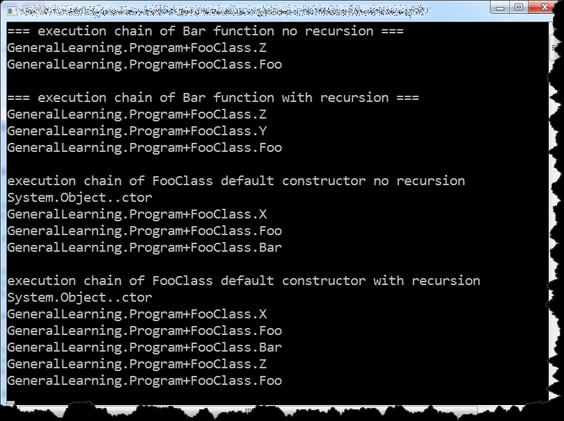

An application which I'm currently developing has quite complicated authorization system. That is why, we can not use role based authorization, and basically every developer is obliged to call appropriate security check method in every controller action he or she writes. As You probably know it is quite easy to forget about that, therefore I decided to write a test which would check whether all controller's action invokes this security critical function. After hours of searching for some anchor point, I came across this article http://blogs.msdn.com/b/haibo\_luo/archive/2006/11/06/system-reflection-based-ilreader.aspx in which author creates so called "reflection based ILReader". _ILReader_ is a class which allows You to iterate over IL instructions of every object of type _RuntimeMethodInfo_ or _RuntimeConstructorInfo_ .One of these instructions is _InlineMethodInstruction_ which indicates method call. That is why, in order to get all methods which are called by given method, we have to simply select all instructions of type _InlineMethodInstruction_

```csharp
public static class MethodInvokerCrawler
{
    public static IEnumerable GetMethods(MethodBase caller)
    {
        ILReader reader = new ILReader(caller);
        return reader.OfType().Select(method => method.Method);
    }
}

```

We can go a bit further and create a recursive version of this function to iterate over entire function execution chain

```csharp
public static class MethodInvokerCrawler
{
    public const string DefaultPrefix = "GeneralLearning";
    public static IEnumerable GetMethods(MethodBase caller, bool recursive = false, string namespacePrefix = DefaultPrefix)
    {
        ILReader reader = new ILReader(caller);
        foreach (InlineMethodInstruction method in
            reader.OfType())
        {
            yield return method.Method;
            if (recursive && method.Method.DeclaringType != null && method.Method.DeclaringType.FullName.StartsWith(namespacePrefix, StringComparison.InvariantCultureIgnoreCase))
            {
                foreach (var innerMethod in GetMethods(method.Method))
                {
                    yield return innerMethod;
                }
            }
        }
    }
}

```

Please notice, that I limited recursion depth to methods from user defined namespace, otherwise we would end up iterating over .NET's native functions. Now it is time to show some results. Here is a sample program which demonstrate possibilities of _MethodInvokerCrawler_ class

```csharp
internal class Program
{
    public class FooClass
    {
        public FooClass()
        {
            this.X();
            this.Foo();
            this.Bar();
        }

        public void Foo(){}

        public void Bar()
        {
            this.Z();
            this.Foo();
        }

        public string X()
        {
            return null;
        }

        public void Y(){ }

        public void Z()
        {
            this.Y();
        }
    }

    public static void Main(string[] args)
    {
        Console.WriteLine("=== execution chain of Bar function no recursion ===");
        foreach (var s in MethodInvokerCrawler.GetMethods(typeof(FooClass).GetMethod("Bar")))
        {
            Console.WriteLine("{0}.{1}", s.DeclaringType.FullName, s.Name);
        }

        Console.WriteLine();
        Console.WriteLine("=== execution chain of Bar function with recursion ===");
        foreach (var s in MethodInvokerCrawler.GetMethods(typeof(FooClass).GetMethod("Bar"), true))
        {
            Console.WriteLine("{0}.{1}", s.DeclaringType.FullName, s.Name);
        }

        Console.WriteLine();
        Console.WriteLine("execution chain of FooClass default constructor no recursion");
        foreach (var s in MethodInvokerCrawler.GetMethods(typeof(FooClass).GetConstructors().Single()))
        {
            Console.WriteLine("{0}.{1}", s.DeclaringType.FullName, s.Name);
        }

        Console.WriteLine();
        Console.WriteLine("execution chain of FooClass default constructor with recursion");
        foreach (var s in MethodInvokerCrawler.GetMethods(typeof(FooClass).GetConstructors().Single(), true))
        {
            Console.WriteLine("{0}.{1}", s.DeclaringType.FullName, s.Name);
        }
        Console.ReadKey();
    }
}

```

[](http://tpodolak.com/blog/wp-content/uploads/2013/12/how-to-check-if-one-function-calls-another-function/result.png) At this point checking whether function or constructor calls another function is limited to simple LINQ query

```csharp
MethodInvokerCrawler.GetMethods(typeof(FooClass).GetMethod("Bar")).Any(val => val.Name == "Foo");

```

Source code for this post can be found [here](https://github.com/tpodolak/Blog/tree/master/MethodCrawler)
