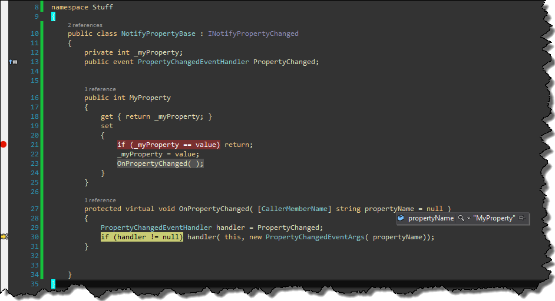

I think almost every .NET developer is familiar with _INotifyPropertyChanged_ interface. Typical implementation of this interface looks more or less like that:

```
public class NotifyPropertyBase : INotifyPropertyChanged
{
    public event PropertyChangedEventHandler PropertyChanged;
    protected virtual void OnPropertyChanged( Expression> propertyExpression )
    {
        PropertyChangedEventHandler handler = PropertyChanged;
        if (handler != null) handler( this, new PropertyChangedEventArgs( GetPropertyName( propertyExpression ) ) );
    }

    private string GetPropertyName( Expression> propertyExpression )
    {
        var unaryExpression = propertyExpression.Body as UnaryExpression;
        var memberExpression = unaryExpression == null ? (MemberExpression)propertyExpression.Body : (MemberExpression)unaryExpression.Operand;
        var propertyName = memberExpression.Member.Name;
        return propertyName;
    }
}

```

Thanks to lambda expressions we can get rid of so called "magic" strings when rising PorpertyChange event.

```
private int _myProperty;
public int MyProperty
{
    get { return _myProperty; }
    set
    {
        if (_myProperty == value) return;
        _myProperty = value;
        OnPropertyChanged( ( ) => MyProperty );
    }
}

```

However, with .NET 4.5 we can even get rid of lambda expressions itself. Everything thanks to _[CallerMemberNameAttribute](http://msdn.microsoft.com/pl-pl/library/system.runtime.compilerservices.callermembernameattribute\(v=vs.110\).aspx)_, which provides us information about caller of given method. Now we can rewrite _NotifyPropertyBase_ class as follows

```
public class NotifyPropertyBase : INotifyPropertyChanged
{
    public event PropertyChangedEventHandler PropertyChanged;
    protected virtual void OnPropertyChanged( [CallerMemberName] string propertyName = null )
    {
        PropertyChangedEventHandler handler = PropertyChanged;
        if (handler != null) handler( this, new PropertyChangedEventArgs( propertyName));
    }
}

```

From this moment we can call _OnPropertyChanged_ method without any arguments

```
private int _myProperty;
public int MyProperty
{
    get { return _myProperty; }
    set 
    {
      if (_myProperty == value) return;
      _myProperty = value;
      OnPropertyChanged();
    }
}

```

and thanks to _CallerMemberName_ attribute, argument _propertyName_ will be filled with appropriate value. [](http://tpodolak.com/blog/wp-content/uploads/2014/01/implementing-inotifypropertychanged-without-lambda-expressions-and-magic-strings/callermembername.png) Source code for this post can be found [here](https://github.com/tpodolak/Blog/tree/master/NotifyPropertyChangedCallerMemberName)
