### 1\. Introduction

I think one of the most important features of Resharper is on-the-fly code quality analysis.
Basically, every time Resharper finds possible pitfall in code, it indicates this with appropriate warning.
The most common warning is `"Possible System.NullReferenceException"`.
You can easily reproduce it by writing this code

```csharp
List<object> objlList = new List<object>( );
var result = objlList.SingleOrDefault( );
Console.WriteLine( result.GetHashCode( ) );
```

[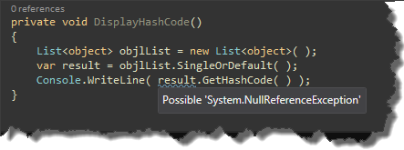]()

As you can see `R#` is able to figure out, that `LINQ` `SingleOrDefault` function can return null.
However there is no warning if we try to do something like that
```csharp
private static void DisplayHashCode()
{
    var result = Foo();
    Console.WriteLine( result.GetHashCode( ) );
}

private static object Foo()
{
    return null;
}
```

So it got me thinking, how `Resharper` recognizes whether or whether not to show warnings.
It turned out, that it uses annotation attributes, which describe behavior of functions, properties, classes and interfaces.

 ### 2. Source code annotations

In order to use these attributes we have to place them in our project.
First of all, let's create `Annotation.cs` file and then copy default implementation of annotations into this file.
The default implementation can be found in Code annotation option (`Resharper->Options->Code Inspections->Code Annotations`) under the button `Copy default implementation to clipboard`.

[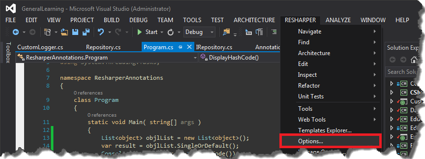]()


[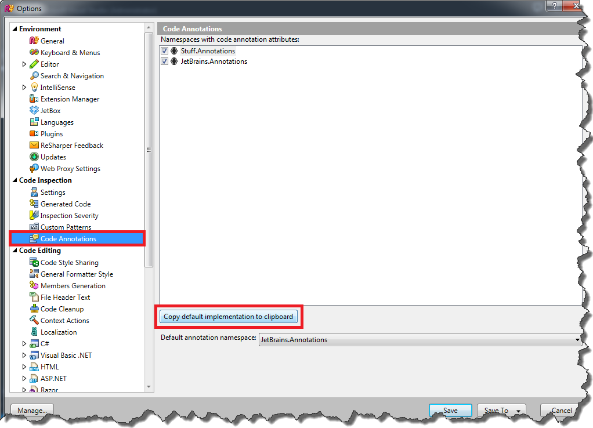]()

From now on we can decorate our functions with e.g. `CanBeNull` attribute
```csharp
private static void DisplayHashCode()
{
    var result = Foo();
    Console.WriteLine( result.GetHashCode( ) );
}
       
[CanBeNull]
private static object Foo()
{
    return null;
}
```
and we will get warning if necessary

[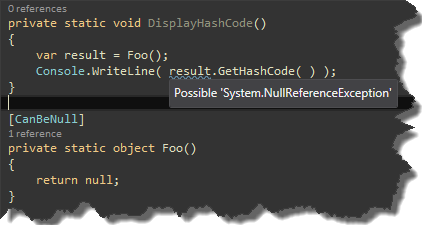]()


Of course there are a lot more of attributes to use. My favorites are:

- StringFormatMethodAttribute

[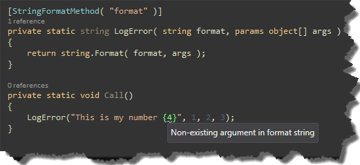]()


- PathReferenceAttribute

[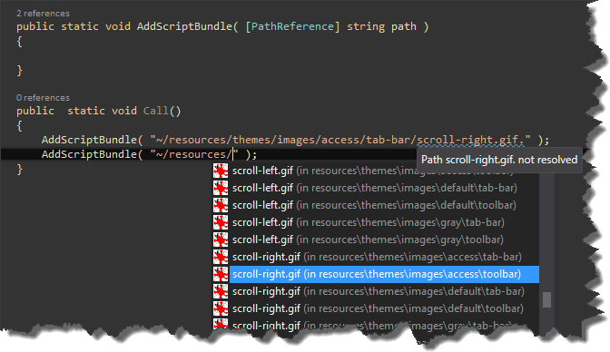]()

- NotifyPropertyChangedInvocatorAttribute

[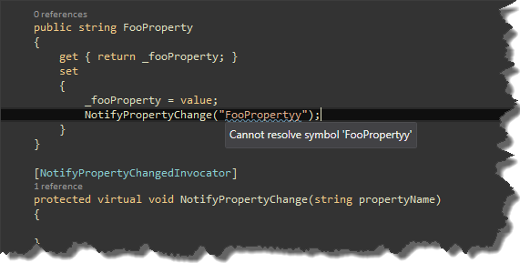]()


### 3. External code annotations 

In case we do not have access to source code, we still are able to use annotation attributes.
However we have to define annotations in `xml` configuration file.
Let's say we want to decorate `NHibernte's` `SaveOrUpdate` function with NotNullAttribute.
First of all we have to create xml file with appropriate declaration (This is standard XML Document Comment file.
You can read specification [here](http://msdn.microsoft.com/en-us/library/aa288481(v=vs.71).aspx) and [here](http://msdn.microsoft.com/en-us/library/fsbx0t7x.aspx))
```xml
<assembly name="NHibernate">
    <member name="M:NHibernate.ISession.SaveOrUpdate(System.Object)">
        <parameter name="obj">
            <attribute ctor="M:JetBrains.Annotations.NotNullAttribute.#ctor" />
        </parameter>
    </member>
</assembly>
```
Having prepared configuration file, we need to place it in appropriate location in order for Resharper to use it. It can be stored in

```text showLineNumbers=false
[ReSharper install directory]\Bin\ExternalAnnotations\[Assembly name].xml
[ReSharper install directory]\Bin\ExternalAnnotations\[Assembly name][Any name].xml.
```

So in my case the location is
`C:\Program Files (x86)\JetBrains\ReSharper\v8.1\Bin\ExternalAnnotations\NHibernateNHibernate.xml`

After restarting `Visual Studio`, `Resharper` should load the file and show warning messages.

[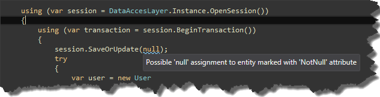]()


### 4. Generating initial XML annotation files

Creating `xml` annotation file for large library is very tedious task, fortunately `Resharper` have a hidden feature which can help us with generating initial xml file.
First of all we have to run `Visual Studio` with `/ReSharper.Internal` parameter. In this mode we have an access to undocumented/hidden features of `Resharper`.
Now, in the `Resharper` menu there is one additional menu item - `Internal`, where You can find `Annotator` submenu in which resides `Annotate` item.

[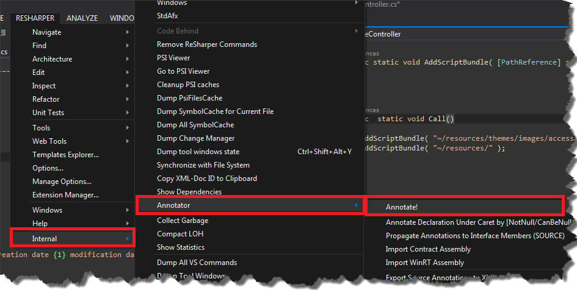]()


Now You can specify for which dll `Resharper` should generate xml annotation file.

[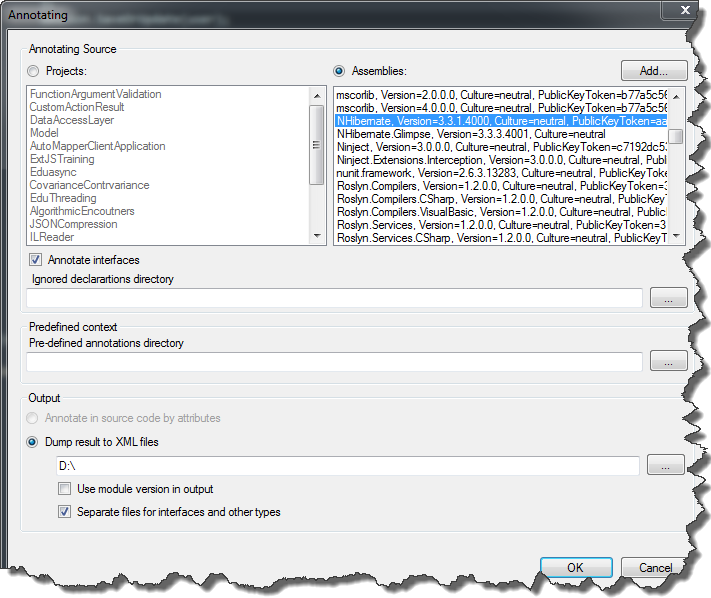]()


and after a while You should get complete `xml` declaration.

[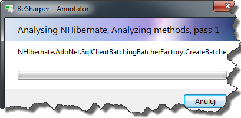]()
> [!WARNING]
> Please bear in mind, that Annotator is not official `R#` feature, so there is no guarantee that generating annotation files will succeed. 


Source code for this post can be found [here](https://github.com/tpodolak/Blog/tree/master/ResharperAnnotations)
