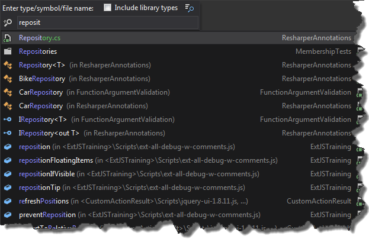
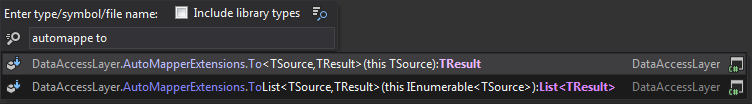
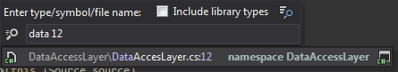

In Resharper 8 JetBrains introduced new command called "Go to Everything". You can use it by hitting the CTRL + N keys (CTRL + T with Visual Studio keyboard shortcuts layout) This command is basically combination of three features known from previous versions of Resharper, namely: "Go to Class", "Go to Type" and "Go to Symbol". Most common usage of this functionality is just to search classes, properties or functions.  However not everyone knows, that we can narrow down search criteria and find methods or properties in given class  What is even more interesting, is the fact that it is possible to go to specific line in searched type 
