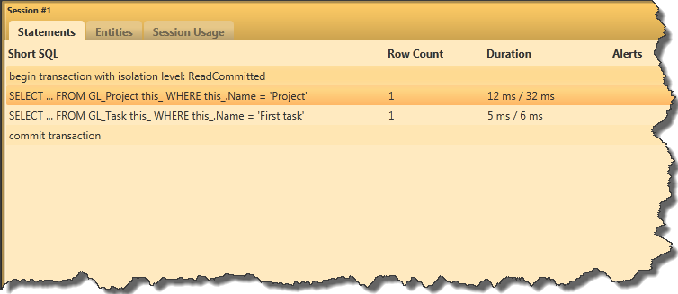
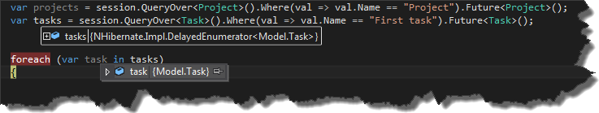
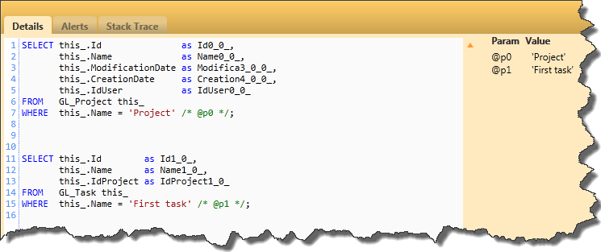

Usually when we need to retrieve data from database server, we write code which looks like that

```csharp
using (var session = DataAccesLayer.Instance.OpenSession())
{
    using (var transaction = session.BeginTransaction())
    {
        var projects = session.QueryOver<Project>().Where(val => val.Name == "Project").List();
        var tasks = session.QueryOver<Task>().Where(val => val.Name == "First task").List();
        //more queries           
        //more queries             
        //exception handling etc.
    }
}
```

This code will execute two queries,each of them in separate roundtrip to the server.

[](http://tpodolak.com/blog/wp-content/uploads/2014/04/nhhibernate-multiple-queries-in-one-roundtrip-to-server/SeveralRoundtrips.png)

This is the most popular way of getting data for multiple tables etc. However it is possible to enhance the code above and execute several queries in only one roundtrip to the database server.
NHibernate provides us with three different mechanisms to accomplish this goal:

- **MultiQuery**

First way to execute several queries at once is `MultiQuery`. In my opinion this is not very handy mechanism because of the fact, that we must use `HQL`.
Here is an example of usage

```csharp
var projectQuery = session.CreateQuery("FROM Project as prj where prj.Name= :projectName")
                          .SetParameter("projectName", "Project");

var taskQuery = session.CreateQuery( "FROM Task as tsk where tsk.Name=:taskName" )
                       .SetParameter("taskName","First task");
 
var multiQueryByIndex = session.CreateMultiQuery( )
                               .Add<Project>( projectQuery )
                               .Add<Task>( taskQuery );
```

As You can see thanks to `CreateMultiQuery` method we are able to aggregate multiple queries.
In order to get access to results, we have to execute code below

```csharp
var result = multiQueryByIndex.List();
```

Now we can get result of specific query using indexer

```csharp
var projects = result[0] as List<Project>;
var tasks = result[1] as List<Task>;
```

If we don't like this approach, the `CreateMultiQuery` method has an overload which allows to give "names" to queries.
Thanks to this we can get result of query by its name.

```csharp
var multiQueryByKey = session.CreateMultiQuery( )
                             .Add<Project>( "project", projectQuery )
                             .Add<Task>( "task", taskQuery );
 
var projects = multiQueryByKey.GetResult( "project" ) as List<Project>;
var tasks = multiQueryByKey.GetResult( "task" ) as List<Task>;
```

- **MultiCriteria**

Much better way of creating multiple queries is MultiCriteria. In this case we can use `QueryOver` API, so we don't have to rely on `HQL` query strings.

```csharp
var projectQuery = session.QueryOver<Project>().Where(val => val.Name == "Project");
var taskQuery = session.QueryOver<Task>( ).Where(val => val.Name == "First task");
var multiCriteriaByIndex = session.CreateMultiCriteria( )
                                  .Add( projectQuery )
                                  .Add( taskQuery );

var multiCriteriaByKey = session.CreateMultiCriteria( )
                                .Add( "project", projectQuery )
                                .Add( "task", taskQuery );

IList result = multiCriteriaByIndex.List( );
var projects = result[0] as List<Project>;
var tasks = result[1] as List<Task>;

projects = multiCriteriaByKey.GetResult( "project" ) as List<Project>;
tasks = multiCriteriaByKey.GetResult( "task" ) as List<Task>;
```

As You can see the usage of `CreateMultiCriteria` method is pretty consistent with `CreateMultiQuery`.
Unfortunately we still have to retrieve data from specific query by index or by query name.

- **Future**

My personal favorite for creating multi queries is `Future`. The usage is pretty straightforward

```csharp
var projects = session.QueryOver<Project>().Where(val => val.Name == "Project").Future<Project>();
var tasks = session.QueryOver<Task>().Where(val => val.Name == "First task").Future<Task>();
```

As You can see, we can leverage `QueryOver` API and instead of calling `List` we call `Future`.
`NHibernate` will aggregate our queries and will execute them once we start to iterate over one of them.

[](http://tpodolak.com/blog/wp-content/uploads/2014/04/nhhibernate-multiple-queries-in-one-roundtrip-to-server/delayedenumerator.png) 

Despite the fact that all three mechanism has completely different syntax ,SQL created by all of them is the same and looks like that

[](http://tpodolak.com/blog/wp-content/uploads/2014/04/nhhibernate-multiple-queries-in-one-roundtrip-to-server/intheend.png)
