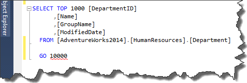
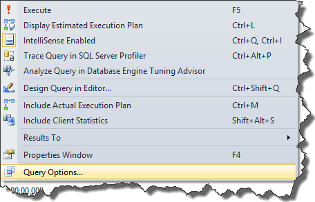
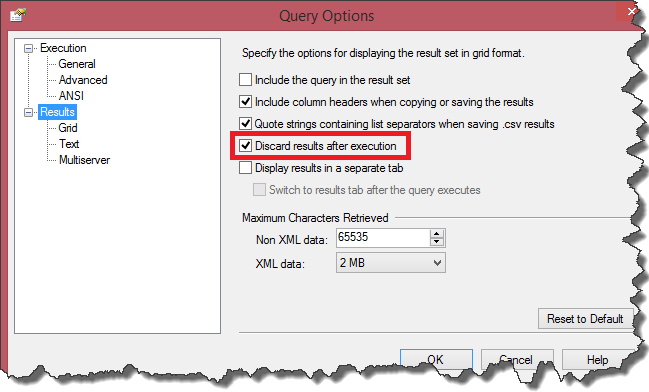

For time to time during my everyday work I have to do some `SQL` query optimization.
The simplest way of measuring whether my changes improved the performance or not, is simply measure the execution time of given query (I know that this is not the best way of doing that, but let's leave aside execution plans for now).
However measuring time of single executin is not very meaningfull. Thats why I like execute query multiple times by using this simple trick

```sql showLineNumbers=false
GO 100
```

[](http://tpodolak.com/blog/wp-content/uploads/2014/10/t-sql-executing-query-multiple-times/GO1000.png)

and then calculate an average time of execution by dividing the total time by execution count.
As You can see, all You have to do is to specify execution count after the `GO` statment.
Despite the fact that `Management Studio` indicates that there is an error in the `SQL`, this is perfectly valid code.
Of course You should hide execution results in order to measure only the time of execution, not the time of rendering data.
To do that, right click on query window and choose `Query Options...`

[](http://tpodolak.com/blog/wp-content/uploads/2014/10/t-sql-executing-query-multiple-times/queryoptions.png)

then select `Results` node and check `Discard results after execution`

[](http://tpodolak.com/blog/wp-content/uploads/2014/10/t-sql-executing-query-multiple-times/queryoptionshighlighted.png)
