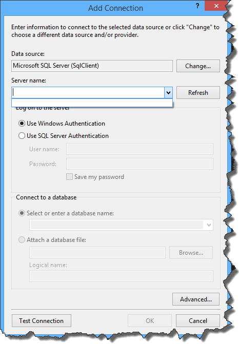
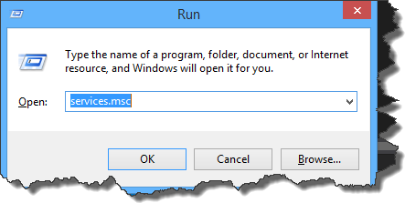
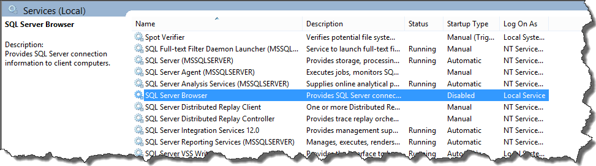
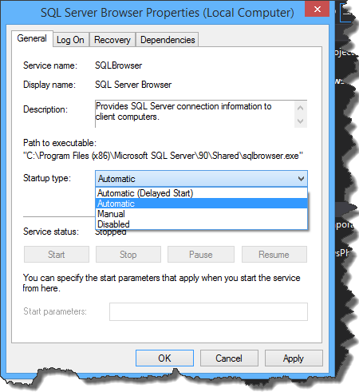
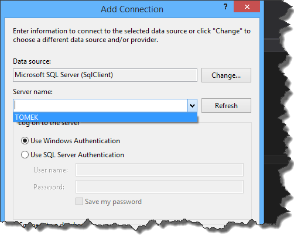

I consider myself as a quite experienced user of `Nhibernate`, that is why I decided to check what is going on on the other side of barricade and started playing with `Entity Framework`.
I followed the steps of some tutorial and I stuck at the very beginning of it.
I was about to generate model classes using `Entity Data Model Wizard` but it turned out that the wizard could not find my SQL server (despite the fact that server itself was up and running).

I remember having similar issue a while back, but at that time I wasn't able to solve it (I ended up creating connections string manually).
This time I wanted to give this issue a closer look. After a bit of digging I found the problem - the SQL server wasn't broadcasting information about itself.
In order to fix it and make the server visible to other computers and applications it is necessary to start `SQL Server Browser` service.
To do that go to `Start -> Run` and type `Services.msc`

Then in newly opened window find `SQL Server Browser` service

Double click it and set up startup type to `Automatic`. You can also click `Start` button to make sure that service starts immediately

From now on SQL servers should be visible in `Entity Data Model Wizard`

