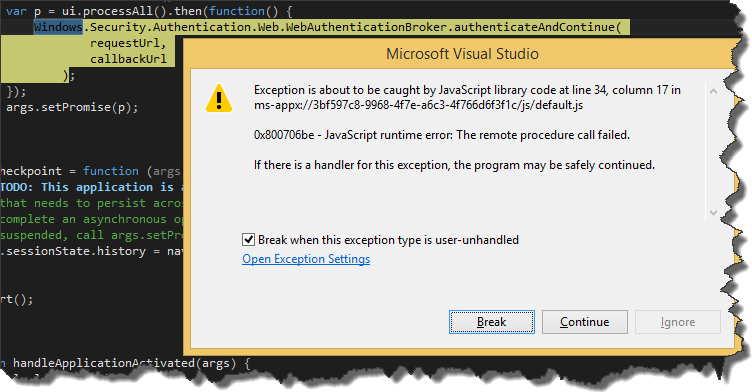
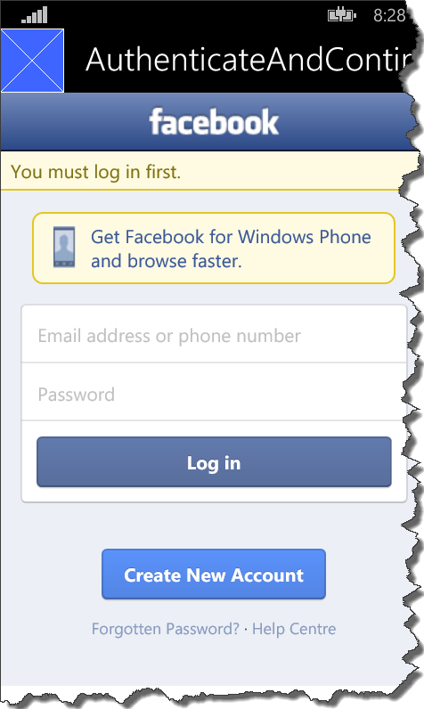

A while ago I started playing around a bit with `JavaScript` on `Windows Phone`. I wanted to create very simple app using AngularJS but of course I also had to use some `WinJS` features (for integration with device ). One of the things I needed to implement was authentication/authorization using `OAuth`. According to `WinJS` [documentation](https://msdn.microsoft.com/pl-pl/library/dn608114.aspx) it should be pretty straightforward - just use `Windows.Security.Authentication.Web.WebAuthenticationBroker.authenticateAndContinue` method with appropriate URLs. Of course I wanted authentication/authorization to be called before navigating to any screen, so I slightly modified default `WinJS` template and my code looked like that

```javascript
// rest of code omitted for brevity
var activation = Windows.ApplicationModel.Activation,
    app = WinJS.Application,
    nav = WinJS.Navigation,
    sched = WinJS.Utilities.Scheduler,
    ui = WinJS.UI;

 app.addEventListener("activated", function (args) {
        if (args.detail.kind === activation.ActivationKind.launch) {
            if (args.detail.previousExecutionState !== activation.ApplicationExecutionState.terminated) {
                // TODO: This application has been newly launched. Initialize
                // your application here.
            } else {
                // TODO: This application has been reactivated from suspension.
                // Restore application state here.
            }

            nav.history = app.sessionState.history || {};
            nav.history.current.initialPlaceholder = true;

            var p = ui.processAll().then(function() {
                Windows.Security.Authentication.Web.WebAuthenticationBroker.authenticateAndContinue(
                        requestUrl, // for instance facebook auth url
                        callbackUrl // for instance facebook auth callback url
                    );
            });
            args.setPromise(p);
        }
    });
// rest of code omitted for brevity
```

Unfortunately all I got was this strange exception

[](http://tpodolak.com/blog/wp-content/uploads/2015/02/angularjs-extending-existing-services-using-decorator/RemoteProcedureCallsFailed.png)


The exception itself originated somewhere from `WinJS` framework so I wasn't able to debug it at all. It took me a while to figure this out but after all it turned out, that all you have to do, to make it work is to `schedule` call of `AuthenticateAndContinue` method using `WinJS.Utilities.Scheduler`

```javascript
WinJS.Utilities.Scheduler.schedule(function(){ //your code in here});

```

After this change entire code listing looks like that

```javascript
// rest of code omitted for brevity
var activation = Windows.ApplicationModel.Activation,
   app = WinJS.Application,
   nav = WinJS.Navigation,
   sched = WinJS.Utilities.Scheduler,
   ui = WinJS.UI;

app.addEventListener("activated", function (args) {
       if (args.detail.kind === activation.ActivationKind.launch) {
           if (args.detail.previousExecutionState !== activation.ApplicationExecutionState.terminated) {
               // TODO: This application has been newly launched. Initialize
               // your application here.
           } else {
               // TODO: This application has been reactivated from suspension.
               // Restore application state here.
           }
           
           nav.history = app.sessionState.history || {};
           nav.history.current.initialPlaceholder = true;
           
           var p = ui.processAll().then(function() {
               return sched.schedule(function() {
                   Windows.Security.Authentication.Web.WebAuthenticationBroker.authenticateAndContinue(
                       requestUrl, // for instance facebook auth url,
                       callbackUrl // for instance facebook auth callback url
                   );
               });
           });
           
           args.setPromise(p);
       }
   });
// rest of code omitted for brevity
```

After this procedure we should be successfully redirected to the `requestUrl`, in my case to `Facebook` login page

[](http://tpodolak.com/blog/wp-content/uploads/2015/02/angularjs-extending-existing-services-using-decorator/Succesfull.png)
