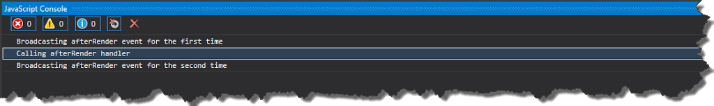

One of the features I miss the most in _AngularJS_ is ability to easy unsubscribe event handlers. There is no convenience function opposed to _$on_, so in order to unsubscribe event, we have to call method returned by _$on_ function

```
(function () {
    angular.module('app.download', [])
        .controller('downloadCtrl', downloadController);

    function downloadController($scope) {
        // keep the unsubscribe function in local variable
        var afterRenderUnsubscribe = $scope.$on('afterRender', onAfterRender);

        function onAfterRender() {
            console.log('CallingonAfterRender');
            // unsubscribe form event
            afterRenderUnsubscribe();
        }
    }
}());

```

However in my opinion this approach fails in real life scenarios, because usually we are subscribed to more than one event - thus we have to have multiple local variables for detaching listeners. Fortunately _AngularJS_ provides an easy way to extend existing services with some new functionalities - we can achieve that by using _$provide_ service. This service exposes [_decorator_](https://docs.angularjs.org/api/auto/service/$provide#decorator) method, which is able to intercept creation of any service, so we are able to augment it with some new functions. The best moment to call _$provide.decorator_ method is during module configuration, thanks to this approach we are sure that our custom logic is invoked before module is started.

```
angular.module('app.common', [])
       .config(extendServices);

/*ngInject*/
function extendServices($provide) {
    $provide.decorator('serviceName', function ($delegate) {
     /*some interception logic*/
    });
}

```

In my case I wanted to extend _$rootScope_ with new method _$un_ for unsubscribing events, so I called method _decorator_ with parameter _'$rootScope'_ (note single quotation marks) - this tells _Angular_ that I will be modifying _$rootScope_ service

```
angular.module('app.common', [])
    .config(extendServices);

/*ngInject*/
function extendServices($provide) {
    $provide.decorator('$rootScope', extendRootScope);
}

/*ngInject*/
function extendRootScope($delegate) {
}

```

Because I passed _'$rootScope'_ as a first argument of _$provide.decorator_ method, the _$delegate_ parameter in _extendRootScope_ function is actually a _$rootScope_ service. Now having access to the service I can augment it with my custom logic for detaching event handlers.

```
/*ngInject*/
function extendRootScope($delegate){
    $delegate.$un=function(name,listener){
        var namedListeners=this.$$listeners[name],
            idx;
        if(namedListeners&&(idx=namedListeners.indexOf(listener))>-1){
            namedListeners.splice(idx,1);
        }
    };
    return $delegate;
}

```

Entire code listing looks then as follows

```
(function () {
    angular.module('app.common', [])
           .config(extendServices);

    /*ngInject*/
    function extendServices($provide)
    {
        $provide.decorator('$rootScope', extendRootScope);
    }

    /*ngInject*/
    function extendRootScope($delegate)
    {
        $delegate.$un = function (name, listener) {
            var namedListeners = this.$$listeners[name],
                idx;
            if (namedListeners && (idx = namedListeners.indexOf(listener)) > -1) {
                namedListeners.splice(idx, 1);
            }
        };
        return $delegate;
    }
}());

```

From now on, you can unsubscribe events handlers simply by calling $un method

```
(function () {
    angular.module('app.download', ['app.common'])
        .controller('downloadCtrl', downloadController);

    function downloadController($scope) {
        $scope.$on('afterRender', onAfterRender);

        function onAfterRender() {
            console.log('Calling afterRender handler');
            $scope.$un('afterRender', onAfterRender);
        }
    }
}());

```

and our listener will react only once

```
console.log('Broadcasting afterRender event for the first time');
$rootScope.$broadcast('afterRender');
console.log('Broadcasting afterRender event for the second time');
$rootScope.$broadcast('afterRender');

```

[](http://tpodolak.com/blog/wp-content/uploads/2015/02/angularjs-extending-existing-services-using-decorator/InvokeEvents.png) Source code for this post can be found [here](https://github.com/tpodolak/Blog/tree/master/AngularJSDecorator)
