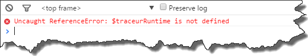
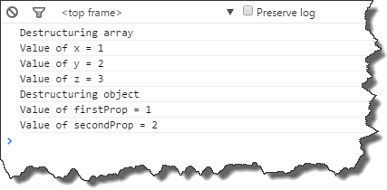
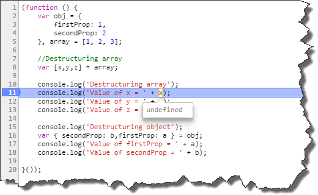
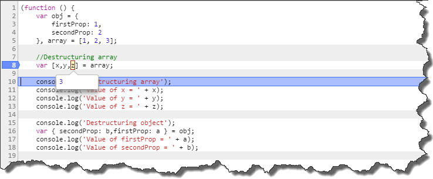

### 1\. Introduction

Although _ECMAScript6_ has not been officially released yet, we can play around with new language features today. There are tools such as _Traceur_ or _Babel_ which are able to convert _ECMAScript6_ into _ECMASciprt5_, thus we are able to run the code in every browser. So let's try to run the snippet below, which leverages [destructuring assignment](https://developer.mozilla.org/en-US/docs/Web/JavaScript/Reference/Operators/Destructuring_assignment)using those tools

```javascript
(function () {
    var obj = {
        firstProp: 1,
        secondProp: 2
    }, array = [1, 2, 3];

    //Destructuring array
    var [x,y,z] = array;

    console.log('Destructuring array');
    console.log('Value of x = ' + x);
    console.log('Value of y = ' + y);
    console.log('Value of z = ' + z);

    console.log('Destructuring object');
    var { secondProp: b,firstProp: a } = obj;
    console.log('Value of firstProp = ' + a);
    console.log('Value of secondProp = ' + b);

}());

```

### 2\. Using _Traceur_

I'll start from _Traceur_ first. First of all we have to install it, so run in console (I am using gulp as my build system)

```bash
npm install gulp-traceur --save-dev

```

Then we have to write simple gulp task which:

- grabs all of our js files
- runs the code analysis using _JsHint_
- transpiles source files into valid _ECMAScript5_
- concatenates the result into single file
- generates source maps (for debugging proposes)

```javascript
var gulp = require('gulp');
var sourcemaps = require('gulp-sourcemaps');
var traceur = require('gulp-traceur');
var concat = require('gulp-concat');
var jshint = require('gulp-jshint');

return gulp.src('app/*.js')
           .pipe(jshint())
           .pipe(jshint.reporter('jshint-stylish'))
           .pipe(jshint.reporter('fail'))
           .pipe(sourcemaps.init())
           .pipe(traceur())
           .pipe(concat('app.all.js'))
           .pipe(sourcemaps.write('.'))
           .pipe(gulp.dest('dest'));

```

Having our result file ready, now we can add a script tag in html pointing to _app.all.js_. However at this point in the runtime we will get an error.

```text
$traceurRuntime is not defined

```

[](http://tpodolak.com/blog/wp-content/uploads/2015/04/using-ecmascript6-today/runtimeerror.png) Quick look at the generated _app.all.js_ file reveals the problem

```javascript
"use strict";
(function() {
  var $__1,
      $__2;
  var obj = {
    firstProp: 1,
    secondProp: 2
  },
      array = [1, 2, 3];
  var $__0 = array,
      x = ($__1 = $__0[$traceurRuntime.toProperty(Symbol.iterator)](), ($__2 = $__1.next()).done ? void 0 : $__2.value),
      y = ($__2 = $__1.next()).done ? void 0 : $__2.value,
      z = ($__2 = $__1.next()).done ? void 0 : $__2.value;
  console.log('Destructuring array');
  console.log('Value of x = ' + x);
  console.log('Value of y = ' + y);
  console.log('Value of z = ' + z);
  console.log('Destructuring object');
  var $__3 = obj,
      b = $__3.secondProp,
      a = $__3.firstProp;
  console.log('Value of firstProp = ' + a);
  console.log('Value of secondProp = ' + b);
}());

//# sourceMappingURL=app.all.js.map

```

Transpiled code has references to _$traceurRuntime_ objects, so in order to make our code work, we have to add additional script tag pointing to _traceur-runtime.js_. You can easily get the sources with _bower_, just run in console

```bash
npm install bower --save-dev
bower install  traceur-runtime

```

Now everything should work and in console we'll get expected result [](http://tpodolak.com/blog/wp-content/uploads/2015/04/using-ecmascript6-today/result.png) As you could see in example above _Traceur_ generates overcomplicated code which makes debugging of the original sources (using source maps) a painful process. Just take a look at the following screenshot [](http://tpodolak.com/blog/wp-content/uploads/2015/04/using-ecmascript6-today/SourceMapTraceur.png) fortunately _Babel_ doesn't seem to have these drawbacks.

### 3\. Using _Babel_

Let's modify our gulp build script to use _Babel_ instead of _Traceur_

```bash
npm install gulp-babel --save-dev

```

```javascript
var gulp = require('gulp');
var sourcemaps = require('gulp-sourcemaps');
var babel= require('gulp-babel');
var concat = require('gulp-concat');
var jshint = require('gulp-jshint');

return gulp.src('app/*.js')
           .pipe(jshint())
           .pipe(jshint.reporter('jshint-stylish'))
           .pipe(jshint.reporter('fail'))
           .pipe(sourcemaps.init())
           .pipe(babel())
           .pipe(concat('app.all.js'))
           .pipe(sourcemaps.write('.'))
           .pipe(gulp.dest('dest'));

```

And basically that all, we are ready to go. _Babel_ doesn't require any runtime dependencies, generated code is simple

```javascript
'use strict';

(function () {
    var obj = {
        firstProp: 1,
        secondProp: 2
    },
        array = [1, 2, 3];

    //Destructuring array
    var x = array[0];
    var y = array[1];
    var z = array[2];

    console.log('Destructuring array');
    console.log('Value of x = ' + x);
    console.log('Value of y = ' + y);
    console.log('Value of z = ' + z);

    console.log('Destructuring object');
    var b = obj.secondProp;
    var a = obj.firstProp;

    console.log('Value of firstProp = ' + a);
    console.log('Value of secondProp = ' + b);
})();
//# sourceMappingURL=app.all.js.map

```

and even source maps seem to work correctly. [](http://tpodolak.com/blog/wp-content/uploads/2015/04/using-ecmascript6-today/SourceMapBabel.png) So when it comes to me I choose _Babel_. Source code for this post can be found [here](https://github.com/tpodolak/Blog/tree/master/UsingEcmaScript6Today)
