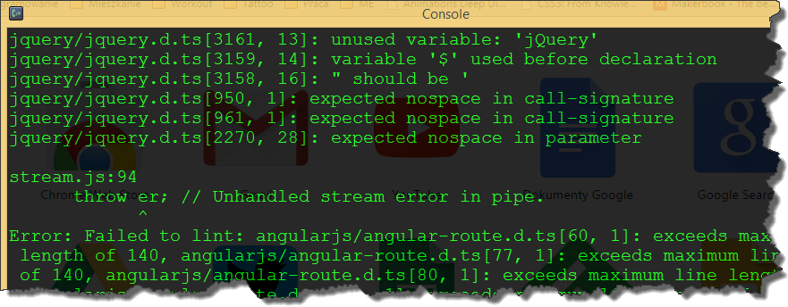
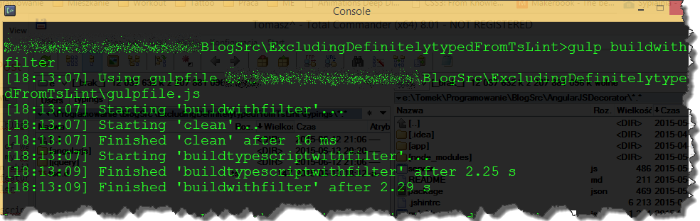

I wanted to improve a code quality of my _TypeScript_ project, so I decided to add linting to my gulp build process. My original build task looked pretty straightforward

```csharp
function buildTypeScript() {
    return gulp.src(['app/**/*.ts','typings/**/*.ts'])
               .pipe(sourcemaps.init())
               .pipe(ts({
                   sortOutput: true,
                   noExternalResolve: true,
                   noEmitOnError: true,
                   target: 'ES5'
               }))
               .pipe(concat(constants.appall))
               .pipe(sourcemaps.write())
               .pipe(gulp.dest(paths.app));
}

```

and according to _gulp-tslint_ [manual](https://www.npmjs.com/package/gulp-tslint) adding linting requires including only two additional lines of code

```javascript
//..
.pipe(tslint())
.pipe(tslint.report('verbose'));
//..

```

This works fine until you start using type definitions (d.ts files) from external resources (which is the usual way of combining _TypeScript_ with existing _JavaScript_ libraries). Usually these files have different code styling rules than our own, which means that our build will fail. [](http://tpodolak.com/blog/wp-content/uploads/2015/06/gulp-exluding-type-definitions-files-from-typescript-linting/buildfail.png) There are couple of ways of solving this problem. The obvious one is to split the task into two separate tasks, one for linting and one for building, but in my opinion a much cleaner way is to use [_gulp-filter_](https://www.npmjs.com/package/gulp-filter). _Gulp-filter_ has an ability to filter the stream on the fly, but what is more interesting it can also restore it to previous unfiltered state. Using these two features we can filter the stream from d.ts files before linting process begins and then restore the stream and pass it to _TypeScript_ compiler. We can do it with two additional lines of code. Improved build script is presented below

```javascript
function buildTypeScript() {
    // include all typescript files but exclude definitions
    var filter = gulpFilter(['**/*.ts', '!**/*d.ts']);

    return gulp.src(['app/**/*.ts','typings/**/*.ts'])
               .pipe(filter)    // use the filter
               .pipe(tslint())
               .pipe(tslint.report('prose', {
                   emitError: true
               }))
               .pipe(filter.restore()) // clear filter
               .pipe(sourcemaps.init())
               .pipe(ts({
                   sortOutput: true,
                   noExternalResolve: true,
                   noEmitOnError: true,
                   target: 'ES5'
               }))
               .pipe(concat(constants.appall))
               .pipe(sourcemaps.write())
               .pipe(gulp.dest(paths.app));
}

```

[](http://tpodolak.com/blog/wp-content/uploads/2015/06/gulp-exluding-type-definitions-files-from-typescript-linting/buildfilter.png) Source code for this post can be found [here](https://github.com/tpodolak/Blog/tree/master/ExcludingDefinitelytypedFromTsLint)
