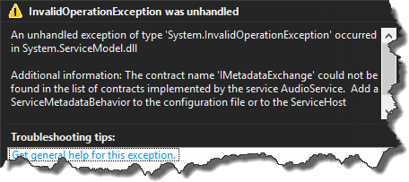
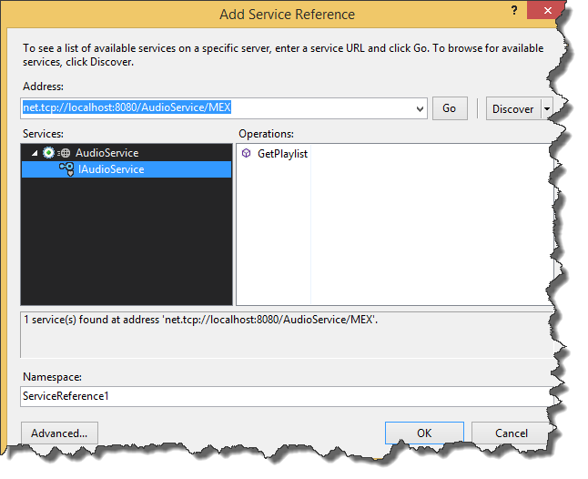

I think that everyone who has ever been working with _WCF_ knows that we can enable metadata exchange by adding _ServiceMetadataBehavior_ to _App.config_ file

Up until yesterday the build in solution works fine for me. However recently I've had to expose metadata over _TCP_ protocol. _ServiceMetadataBehavior_ doesn't have something like _TcpGetEnabled_ property so in order to expose metadata over other protocols (in my case _TCP_) it is necessary to add custom _MEX_ endpoint.

The endpoint configuration has to have a specific binding - in my case _mexTcpBinding_ (there are of course _MEX_ bindings available for other protocols). What is more, the contract has to be set to _IMetadataExchange_. The address value is up to us, we can use full blown address as well as leverage base address. At this point if we run service we will get the exception  Even though we added custom endpoint for metadata exchange we still have to use _ServiceMetadataBehavior_. This time however we can skip _httpGetEnabled_ property

From now on we can access metadata over _TCP_  Source code for this post can be found [here](https://github.com/tpodolak/Blog/tree/master/WCFExposingServiceMetadataOverTCP)
