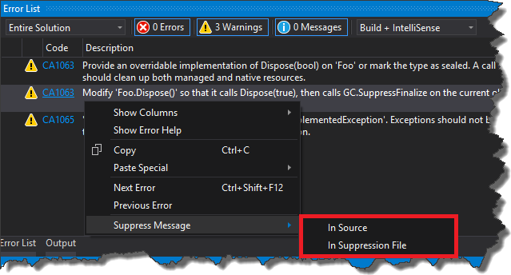
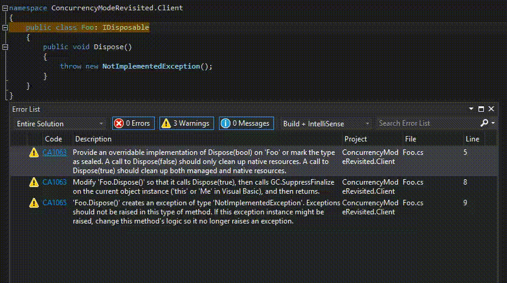
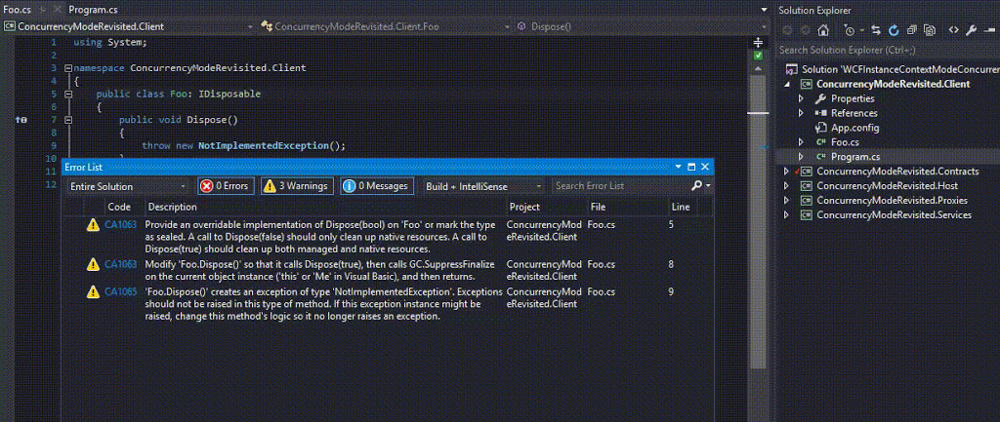

Everyone who has ever been using a code analysis knows that sometimes it is hard to follow the _Microsoft_ coding guidelines and it is necessary to suppress some warnings. For me it always was a painful operation because I didn't know any automated way of doing that. So basically I had to find the warning in the _MSDN_, copy category, code and other necessary stuff and then manually add appropriate attribute in code. Fortunately a friend of mine yesterday showed me a simple trick to generate this attribute with couple of mouse clicks. All you have to do is to right-click on warning message and choose _Suppress Message_ context menu ... 

There are two options in there. The first option - _In Source_, will add attribute directly in the code

 and the second one - _In Suppression_ File, will create _GlobalSuppressoins.cs_ file with assembly attribute which suppresses given warning in entire assembly

